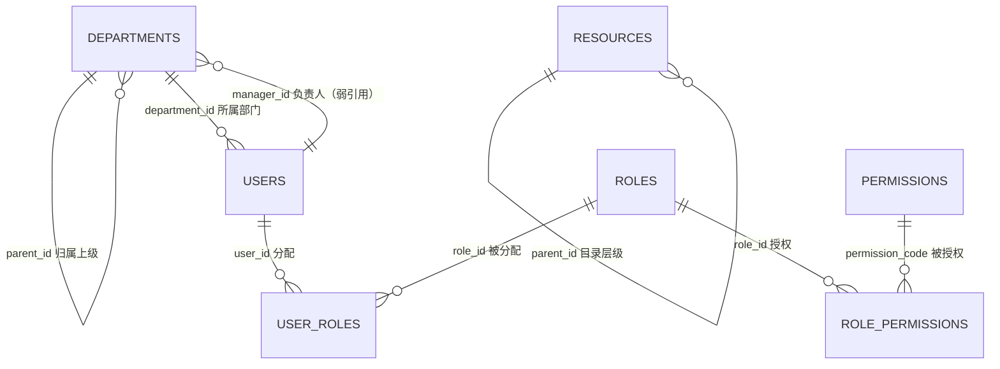

# 数据字典（RBAC0 面向功能后端）

主责：成员 1（数据库设计）。本文件与 `backend-procedural/src/main/resources/schema.sql` 保持一致，描述 RBAC0 面向功能后端的实际表结构。

- DBMS：H2 内存数据库（`MODE=MySQL` 兼容模式，`src/main/resources/application.yml`），生产环境建议迁移 MySQL 8（DDL 语法兼容）。
- 主键策略：全部使用 `VARCHAR` 字符串 ID（外部可读），如 `demo-u-001`、`demo-dept-oa`；数据库初始化脚本为演示数据。
- 字符集：UTF-8；时间字段：当前模型不落库时间戳（审计由应用日志承担，后续迭代补充）。

## ER 图

说明：`departments.manager_id` 为弱引用（无外键约束），负责人用户被删除时展示层按"无负责人"处理。

## 1. departments（部门）

| 字段 | 类型 | 可空 | 默认 | 约束 | 说明 |
| --- | --- | --- | --- | --- | --- |
| id | VARCHAR(64) | 否 | - | 主键 | 部门 ID，如 demo-dept-hq |
| name | VARCHAR(255) | 否 | - | - | 部门名称 |
| branch | VARCHAR(255) | 否 | - | - | 所属分公司/机构（展示与筛选用） |
| parent_id | VARCHAR(64) | 是 | NULL | 逻辑引用 departments.id | 上级部门；根节点为空 |
| manager_id | VARCHAR(64) | 是 | NULL | 弱引用 users.id | 部门负责人 |

## 2. users（用户）

| 字段 | 类型 | 可空 | 默认 | 约束 | 说明 |
| --- | --- | --- | --- | --- | --- |
| id | VARCHAR(64) | 否 | - | 主键 | 用户 ID，如 demo-u-001 |
| name | VARCHAR(255) | 否 | - | - | 姓名 |
| employee_no | VARCHAR(64) | 否 | - | 唯一 | 员工号（登录账号之一） |
| phone | VARCHAR(32) | 是 | NULL | 唯一 | 手机号（登录账号之一） |
| department_id | VARCHAR(64) | 是 | NULL | 逻辑引用 departments.id | 所属部门 |
| position | VARCHAR(128) | 是 | NULL | - | 岗位 |
| account_type | VARCHAR(32) | 否 | - | 枚举 employee / temporary-ops | 账号类型 |
| status | VARCHAR(32) | 否 | - | 枚举 active / inactive | 账号状态；inactive 禁止登录 |
| password_hash | VARCHAR(255) | 否 | - | - | BCrypt 密码哈希，永不下发前端 |
| role_version | INT | 否 | 1 | 乐观锁 | 用户角色集合版本，每次替换 +1 |

## 3. roles（角色）

| 字段 | 类型 | 可空 | 默认 | 约束 | 说明 |
| --- | --- | --- | --- | --- | --- |
| id | VARCHAR(64) | 否 | - | 主键 | 角色 ID，如 demo-r-reader |
| code | VARCHAR(128) | 否 | - | 唯一 | 稳定角色码，如 document-reader、super-admin |
| name | VARCHAR(255) | 否 | - | - | 角色名称 |
| description | VARCHAR(512) | 是 | NULL | - | 描述 |
| enabled | BOOLEAN | 否 | TRUE | - | 停用角色不参与有效权限计算 |
| permission_version | INT | 否 | 1 | 乐观锁 | 角色权限集合版本，每次替换 +1 |

## 4. permissions（权限目录）

| 字段 | 类型 | 可空 | 默认 | 约束 | 说明 |
| --- | --- | --- | --- | --- | --- |
| code | VARCHAR(128) | 否 | - | 主键 | 稳定权限码，格式 系统:资源:动作，如 oa:document:read |
| name | VARCHAR(255) | 否 | - | - | 权限名称 |
| system_id | VARCHAR(64) | 是 | NULL | - | 所属系统 ID（展示分组用） |
| system_name | VARCHAR(255) | 是 | NULL | - | 所属系统名称 |
| module_id | VARCHAR(64) | 是 | NULL | - | 所属模块 ID |
| module_name | VARCHAR(255) | 是 | NULL | - | 所属模块名称 |
| resource_code | VARCHAR(128) | 是 | NULL | - | 资源编码（展示分组，与 resources 为逻辑映射） |
| resource_name | VARCHAR(255) | 是 | NULL | - | 资源名称 |
| action | VARCHAR(32) | 是 | NULL | - | 操作类型：read / create / edit / approve 等 |
| scope_options | VARCHAR(255) | 是 | NULL | 逗号分隔 | 可选范围，如 all,self |

## 5. resources（资源目录）

| 字段 | 类型 | 可空 | 默认 | 约束 | 说明 |
| --- | --- | --- | --- | --- | --- |
| id | VARCHAR(64) | 否 | - | 主键 | 资源 ID |
| name | VARCHAR(255) | 否 | - | - | 资源名称 |
| type | VARCHAR(32) | 否 | - | 枚举 system / module / function | 资源层级类型 |
| parent_id | VARCHAR(64) | 是 | NULL | 逻辑引用 resources.id | 上级资源；根节点为空 |

## 6. user_roles（用户-角色关联）

| 字段 | 类型 | 可空 | 默认 | 约束 | 说明 |
| --- | --- | --- | --- | --- | --- |
| user_id | VARCHAR(64) | 否 | - | 联合主键；引用 users.id | 用户 |
| role_id | VARCHAR(64) | 否 | - | 联合主键；引用 roles.id | 角色 |

## 7. role_permissions（角色-权限关联）

| 字段 | 类型 | 可空 | 默认 | 约束 | 说明 |
| --- | --- | --- | --- | --- | --- |
| role_id | VARCHAR(64) | 否 | - | 联合主键；引用 roles.id | 角色 |
| permission_code | VARCHAR(128) | 否 | - | 联合主键；引用 permissions.code | 权限码 |
| scope | VARCHAR(32) | 否 | 'all' | 枚举 all / self | 授权范围；同码多角色合并时 all 优先 |

## 关键约束与业务规则

1. 登录唯一性：`employee_no` 与 `phone` 分别唯一，登录时二者均可作为账号。
2. RBAC0 有效权限 = 已分配且启用角色的 `role_permissions` 去重并集；`scope` 合并规则：任一路径为 `all` 则 `all`，否则 `self`；默认拒绝。
3. 乐观锁：替换用户角色前比对 `users.role_version`，替换角色权限前比对 `roles.permission_version`，不符返回 409（`VERSION_CONFLICT`）。
4. 删除策略：用户删除为物理删除（先删 `user_roles` 再删 `users`）；角色、权限、部门当前仅导入维护，不提供删除接口。
5. 演示数据由 `DataInitializer` 在库为空时写入（5 用户、6 角色、14 权限码、6 资源、5 部门），正式环境不使用。
