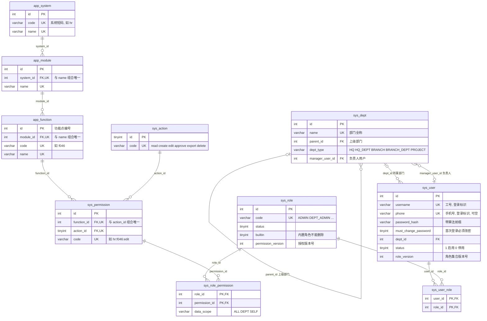

# 数据字典

主责：成员 1。状态：RBAC0 第一版，对应迁移 [V001__create_core_tables.sql](../../database/migrations/V001__create_core_tables.sql)。已在一次性 MySQL 8.4 库上实测建表、导入、约束和回滚。字段口径已按全组需求访谈（2026-10-15，下文以 Q 编号引用）调整；标注“待确认”或“待统一”的地方还没有定论。

- 数据库：MySQL 8.0.16 及以上（CHECK 约束从此版本起生效，部门树查询用递归 CTE），小组定为 8.4 LTS。引擎 InnoDB，字符集 utf8mb4，排序规则 utf8mb4_0900_ai_ci。全组只有这一套表结构，两套后端共用，各连独立的库实例（Q3）。
- 命名：`sys_` 是用户、组织、角色、权限等系统表，`app_` 是权限清单里的应用资源目录，`v_` 是视图。索引前缀：`uk_` 唯一、`idx_` 普通、`fk_` 外键、`ck_` 检查。
- 主键：整数自增，`sys_action` 用固定编号；功能点和权限的 ID 由编号表算出，清单调整行序或重复导入时都不变。接口可以把整数 ID 输出成字符串，库结构不受影响。
- 时间：`DATETIME`，按服务器时区，部署时统一为 Asia/Shanghai。
- 删除策略：外键的删除行为写在“键 / 约束”列，每张表后再汇总一次。未注明的是 MySQL 默认的 RESTRICT，即有引用时拒绝删除。
- 来源列：`部门表.X`、`清单.X`、`员工表.X` 分别指《部门信息表》《应用软件功能权限清单》《员工信息表》的列 X（员工表的列为姓名、用户名、分公司、部门、岗位、电话号码）；`派生` 是导入脚本计算的值；`固定` 是脚本内置常量或仓库里的编码表；`系统` 是数据库或应用运行时写入。清洗规则见 [导入质量规则](import-rules.md)。
- 字典里不写真实姓名、电话和密码样例。

## ER 图

核心思路：**权限 = 功能点 × 动作**。清单有 359 个功能点，乘以 6 种动作得到 2154 条权限，权限码是 `系统码:功能点编号:动作`（如 `hr:f046:edit`）；清单里一个格子（如“查看/编辑本人”）拆成多条角色授权。视图 `v_user_permission` 汇总每个用户最终拥有的权限，不在图中。

## 概念与表

| 概念 | 表 | 重要关系与约束 | 阶段 |
| --- | --- | --- | --- |
| 用户 | `sys_user` | 工号唯一；手机号不为空时唯一；角色通过关联表维护 | RBAC0 |
| 部门 | `sys_dept`，邻接表（`parent_id` 自关联） | 只有一个根节点；禁止上级循环；负责人存用户 ID；第一阶段只读，由导入维护（Q22） | RBAC0 |
| 角色 | `sys_role` | 稳定角色码唯一；一个用户可以有多个角色；内置角色不能删除（Q20） | RBAC0 |
| 资源与权限 | `app_system` > `app_module` > `app_function`，`sys_action`，`sys_permission` | 程序按权限码判断，不按显示名称；第一阶段只读，由导入维护（Q22） | RBAC0 |
| 用户角色 | `sys_user_role` | 组合唯一；整组替换并校验 `sys_user.role_version`（Q22）；RBAC2 起分配时校验约束 | RBAC0 |
| 角色权限 | `sys_role_permission` | 组合唯一；带数据范围 `data_scope`；整组替换并校验 `sys_role.permission_version`（Q22） | RBAC0 |
| 有效权限 | 视图 `v_user_permission` | 并集，同一权限码取最大范围 ALL > DEPT > SELF，默认拒绝（Q15） | RBAC0 |
| 角色层级 | 计划新增 `sys_role_inherit(senior_role_id, junior_role_id)`，视图改为递归 CTE | senior 继承 junior；无环；多父 DAG（Q25，组内已定） | RBAC1 |
| 约束 | 计划新增约束表 | 静态互斥、动态互斥、基数；区分分配时、激活时校验（Q28、Q31） | RBAC2 |
| 会话 | 待定 | 登录用户、已激活角色、失效信息（Q32） | 待定 |

## 1. sys_dept 部门

| 字段 | 类型 | 可空 | 默认 | 键 / 约束 | 来源 | 说明 |
| --- | --- | --- | --- | --- | --- | --- |
| id | INT | 否 | 自增 | PK | 派生：源表行序 | 部门 ID |
| name | VARCHAR(64) | 否 | — | UK `uk_dept_name` | 部门表.部门名称 | 全称；分公司下属部门写成“分公司-部门” |
| short_name | VARCHAR(32) | 否 | — | — | 派生 | 全称中第一个“-”之后的部分，没有“-”时等于全称 |
| parent_id | INT | 是 | NULL | FK `fk_dept_parent` → sys_dept.id，有下级时拒绝删除；`idx_dept_parent` | 部门表.上级部门（按名称查 ID） | 根节点为空 |
| dept_type | VARCHAR(16) | 否 | — | CHECK `ck_dept_type` | 派生 | HQ：根节点；HQ_DEPT：二级且名称不以“分公司”结尾；BRANCH：二级且以“分公司”结尾；PROJECT：三级且含“项目经理部”；BRANCH_DEPT：其余三级 |
| level | TINYINT | 否 | — | — | 派生 | 到根节点的层数，1/2/3。可由树推出，冗余存储便于查询 |
| manager_name | VARCHAR(32) | 是 | NULL | — | 部门表.部门经理 | 原始姓名，只用于核对，程序不按它判断 |
| manager_user_id | INT | 是 | NULL | FK `fk_dept_manager` → sys_user.id，用户删除时置空 | 派生：按负责人关联规则 | 负责人以用户 ID 为准；关联不上时为空并写进核对报告 |
| sort_no | INT | 否 | 0 | — | 派生：同 id | 显示顺序 |
| created_at | DATETIME | 否 | CURRENT_TIMESTAMP | — | 系统 | 创建时间 |

删除策略：

- 第一阶段部门只读，由导入维护，不提供增删改接口（Q22）。
- 有下级部门或有用户的部门不能删除；负责人用户被删除时，部门保留，`manager_user_id` 置空。
- 上级关系不能成环。外键防不住环，导入脚本会拒绝有环的源表；以后若提供“修改上级部门”，要先用递归 CTE 检查新上级是否在本部门的子树里。

## 2. sys_user 用户

| 字段 | 类型 | 可空 | 默认 | 键 / 约束 | 来源 | 说明 |
| --- | --- | --- | --- | --- | --- | --- |
| id | INT | 否 | 自增 | PK | 派生 | 用户 ID，admin 固定为 1 |
| username | VARCHAR(32) | 否 | — | UK `uk_user_username` | 员工表.用户名（SG000001 起）；没有员工表时生成 E0001 起的编号 | 业务唯一标识（工号），登录标识之一（Q8）。admin 是预置超级管理员；admin、staff 是保留名，staff 只在没有员工表的演示方案里生成（Q43） |
| password_hash | VARCHAR(255) | 否 | — | — | 派生：导入时指定的初始密码的哈希 | 带算法前缀，导入脚本生成 `{pbkdf2@SpringSecurity_v5_8}` 加 96 位十六进制（16 字节盐 + 32 字节哈希）。初始密码不进仓库；不存明文，不返回前端。最终算法与成员 4 统一（Q23） |
| must_change_password | TINYINT | 否 | 1 | CHECK `ck_user_must_change` | 系统 | 1 表示下次登录必须先修改密码。导入和管理员重置密码后为 1，本人改密后为 0（Q23） |
| real_name | VARCHAR(32) | 否 | — | `idx_user_real_name` | 员工表.姓名 | 允许重名，重名不等于同一账号（员工表有 1,596 个姓名重复出现） |
| dept_id | INT | 是 | NULL | FK `fk_user_dept` → sys_dept.id，被引用的部门不能删除；`idx_user_dept` | 员工表.分公司 + 部门，按组织映射规则 | 只有 admin 为空 |
| position | VARCHAR(32) | 是 | NULL | — | 员工表.岗位 | 只展示，不用于授权（Q16） |
| gender | CHAR(1) | 是 | NULL | CHECK `ck_user_gender` | 员工表.性别（现有员工表没有这一列，导入后为空） | M / F，由“男/女”转换，无法识别时置空 |
| phone | VARCHAR(20) | 是 | NULL | UK `uk_user_phone` | 员工表.电话号码 | 手机号，登录标识之一；可以为空，不为空时唯一（Q8）。按文本存，保留前导 0 |
| email | VARCHAR(64) | 是 | NULL | — | 员工表.邮箱（现有员工表没有这一列） | 默认为空，员工台账里可由本人或有编辑权限的人填写（Q43） |
| status | TINYINT | 否 | 1 | CHECK `ck_user_status` | 系统 | 1 启用，0 停用；停用用户在视图中没有任何权限 |
| role_version | INT | 否 | 1 | — | 系统 | 角色集合版本号。整组替换用户角色时，请求带上读到的版本，与库里不一致返回 409，一致则替换并加 1（Q22） |
| last_login_at | DATETIME | 是 | NULL | — | 系统 | 登录成功时更新 |
| created_at | DATETIME | 否 | CURRENT_TIMESTAMP | — | 系统 | 创建时间 |
| updated_at | DATETIME | 否 | CURRENT_TIMESTAMP，更新时自动刷新 | — | 系统 | 最后修改时间 |

删除策略：删除用户时，其用户-角色记录自动删除，其负责部门的 `manager_user_id` 置空。不能停用、删除自己；唯一的超级管理员账号 admin 不能被停用、删除或改角色（Q20，由后端校验）。

## 3. sys_role 角色

| 字段 | 类型 | 可空 | 默认 | 键 / 约束 | 来源 | 说明 |
| --- | --- | --- | --- | --- | --- | --- |
| id | INT | 否 | 自增 | PK | 固定 1–6；之后新增的角色自增 | 角色 ID |
| code | VARCHAR(32) | 否 | — | UK `uk_role_code` | 固定 | 程序按 code 判断，不按名称。内置角色见下表 |
| name | VARCHAR(32) | 否 | — | — | 清单.角色列名，或固定 | 显示名称 |
| description | VARCHAR(255) | 是 | NULL | — | 固定 | 说明来源 |
| sort_no | INT | 否 | 0 | — | 派生：同 id | 显示顺序 |
| status | TINYINT | 否 | 1 | CHECK `ck_role_status` | 系统 | 1 启用，0 停用；停用角色不参与有效权限计算 |
| builtin | TINYINT | 否 | 0 | CHECK `ck_role_builtin` | 固定 | 1 是内置角色，不能删除；新增的角色为 0（Q20） |
| permission_version | INT | 否 | 1 | — | 系统 | 角色授权版本号，整组替换授权时校验并加 1，用法同 `sys_user.role_version`（Q22） |
| created_at | DATETIME | 否 | CURRENT_TIMESTAMP | — | 系统 | 创建时间 |

内置角色：

| id | code | 名称 | 来源与规则 |
| --- | --- | --- | --- |
| 1 | ADMIN | 系统管理员 | 清单“系统管理员”列，即超级管理员。只预置给账号 admin，界面上不能授予他人，其权限不能修改（Q9、Q20） |
| 2 | LEADER | 公司领导 | 清单“公司领导”列 |
| 3 | DEPT_MANAGER | 部门经理 | 清单“部门经理”列 |
| 4 | PROJECT_MANAGER | 项目经理 | 清单“项目经理”列 |
| 5 | STAFF | 普通员工 | 清单“普通员工”列 |
| 6 | DEPT_ADMIN | 部门管理员 | 平台自己的管理角色，不来自清单。管理范围与数据范围 DEPT 相同，即本部门及全部下级部门的用户；只能分配业务角色，不能分配管理类角色，也不能修改角色授权（Q10、Q18）。导入时没有授权，它的 `rbac:*` 权限待接口设计阶段确定 |

“管理类角色”指 ADMIN、DEPT_ADMIN，以及以后任何拥有 `rbac:*` 管理权限的角色；部门管理员能否分配某个角色，由后端按这个规则判断，库里不另设字段，避免新建一个带管理权限的角色就绕过限制。

删除策略：内置角色不能删除（后端校验）；删除其他角色时，其用户-角色和角色-权限记录一并删除。

## 4. app_system 软件系统

| 字段 | 类型 | 可空 | 默认 | 键 / 约束 | 来源 | 说明 |
| --- | --- | --- | --- | --- | --- | --- |
| id | INT | 否 | 自增 | PK | 固定：系统短码表中的顺序 | 系统 ID |
| code | VARCHAR(16) | 否 | — | UK `uk_system_code` | 固定：[system_codes.csv](../../database/seeds/system_codes.csv) | 系统短码，权限码第一段，如 hr；2–16 位小写字母或数字（Q12） |
| name | VARCHAR(64) | 否 | — | UK `uk_system_name` | 清单.软件系统（合并单元格向下填充） | 18 个，最后一个“系统管理后台”是本平台自己 |
| sort_no | INT | 否 | 0 | — | 派生：同 id | 显示顺序 |

删除策略：第一阶段资源目录只读，由导入维护（Q22）。删除系统时，其模块、功能点、权限和相关角色授权逐级删除。

## 5. app_module 功能模块

| 字段 | 类型 | 可空 | 默认 | 键 / 约束 | 来源 | 说明 |
| --- | --- | --- | --- | --- | --- | --- |
| id | INT | 否 | 自增 | PK | 派生：首次出现的顺序 | 模块 ID |
| system_id | INT | 否 | — | FK `fk_module_system` → app_system.id，系统删除时一并删除；与 name 组成 UK `uk_module` | 派生 | 所属系统 |
| name | VARCHAR(64) | 否 | — | UK `uk_module (system_id, name)` | 清单.功能模块（向下填充） | 不同系统可以重名，如“供应商管理” |
| sort_no | INT | 否 | 0 | — | 派生：同 id | 显示顺序 |

删除策略：删除模块时，其功能点、权限和相关角色授权一并删除。

## 6. app_function 功能点

| 字段 | 类型 | 可空 | 默认 | 键 / 约束 | 来源 | 说明 |
| --- | --- | --- | --- | --- | --- | --- |
| id | INT | 否 | 自增 | PK | 固定：[function_codes.csv](../../database/seeds/function_codes.csv) 中的编号 | 功能点编号。清单调整行序时不变；删除的编号保留不复用 |
| module_id | INT | 否 | — | FK `fk_function_module` → app_module.id，模块删除时一并删除；与 name 组成 UK `uk_function` | 派生 | 所属模块 |
| code | VARCHAR(8) | 否 | — | UK `uk_function_code` | 派生：f 加三位编号 | 权限码第二段，如 f046（Q12） |
| name | VARCHAR(64) | 否 | — | UK `uk_function (module_id, name)` | 清单.功能点 | 同一模块内不能重名 |
| description | VARCHAR(255) | 是 | NULL | — | 清单.功能说明 | — |
| sort_no | INT | 否 | 0 | — | 派生：清单中的顺序 | 显示顺序 |

删除策略：删除功能点时，其 6 条权限和相关角色授权一并删除。

## 7. sys_action 动作

| 字段 | 类型 | 可空 | 默认 | 键 / 约束 | 来源 | 说明 |
| --- | --- | --- | --- | --- | --- | --- |
| id | TINYINT | 否 | — | PK | 固定 1–6 | 动作 ID |
| code | VARCHAR(16) | 否 | — | UK `uk_action_code` | 固定 | read、create、edit、approve、export、delete，权限码第三段（Q12） |
| name | VARCHAR(16) | 否 | — | — | 固定，对应清单写法 | 查看、新增、编辑、审批、导出、删除 |

删除策略：被权限引用的动作不能删除。以后增加一种动作只需插入一行，再给每个功能点补一条权限，不用改表结构。

## 8. sys_permission 权限

| 字段 | 类型 | 可空 | 默认 | 键 / 约束 | 来源 | 说明 |
| --- | --- | --- | --- | --- | --- | --- |
| id | INT | 否 | 自增 | PK | 派生：(功能点编号 − 1) × 6 + 动作 ID | 由编号和动作算出，所以清单调整行序时也不变 |
| function_id | INT | 否 | — | FK `fk_perm_function` → app_function.id，功能点删除时一并删除；与 action_id 组成 UK `uk_perm` | 派生 | 功能点 |
| action_id | TINYINT | 否 | — | FK `fk_perm_action` → sys_action.id，被引用的动作不能删除 | 派生 | 动作 |
| code | VARCHAR(64) | 否 | — | UK `uk_perm_code` | 派生：系统码:功能点编号:动作 | 权限码，如 `hr:f046:edit`，供前端按钮和后端鉴权使用（Q12）。管理后台另用 `rbac:*` 码，与清单第 18 个系统的对照见“待统一” |

删除策略：删除权限时，相关角色授权一并删除。

## 9. sys_user_role 用户-角色

| 字段 | 类型 | 可空 | 默认 | 键 / 约束 | 来源 | 说明 |
| --- | --- | --- | --- | --- | --- | --- |
| user_id | INT | 否 | — | PK `(user_id, role_id)`；FK `fk_ur_user` → sys_user.id，用户删除时一并删除 | 派生：角色初始化规则（Q16） | 同一用户不能重复拥有同一角色 |
| role_id | INT | 否 | — | PK；FK `fk_ur_role` → sys_role.id，角色删除时一并删除；`idx_ur_role` | 派生 | 主键按最左前缀只能加速按用户查，按角色查用户靠 `idx_ur_role` |
| created_at | DATETIME | 否 | CURRENT_TIMESTAMP | — | 系统 | 分配时间 |

## 10. sys_role_permission 角色-权限

| 字段 | 类型 | 可空 | 默认 | 键 / 约束 | 来源 | 说明 |
| --- | --- | --- | --- | --- | --- | --- |
| role_id | INT | 否 | — | PK `(role_id, permission_id)`；FK `fk_rp_role` → sys_role.id，角色删除时一并删除 | 清单.角色列 | 角色 |
| permission_id | INT | 否 | — | PK；FK `fk_rp_perm` → sys_permission.id，权限删除时一并删除；`idx_rp_perm` | 清单单元格拆出的每个动作 | 权限 |
| data_scope | VARCHAR(8) | 否 | 'ALL' | CHECK `ck_rp_scope`：ALL / DEPT / SELF | 派生：角色列、动作和单元格是否含“本人”（Q14、Q38） | ALL 全部数据；DEPT 用户所在部门（`sys_user.dept_id`）及其全部下级部门的数据；SELF 仅本人数据。功能权限决定能不能用，数据范围决定能看、能改哪些行。导入规则：部门经理、项目经理的新增、编辑、审批、删除为 DEPT，查看、导出为 ALL；系统管理员、公司领导全部为 ALL；普通员工含“本人”的格子为 SELF，其余为 ALL |

## 视图 v_user_permission 用户有效权限

| 列 | 来自 | 说明 |
| --- | --- | --- |
| user_id、username | sys_user | 只含启用的用户 |
| permission_id、permission_code | sys_permission | — |
| system_name、module_name | app_system、app_module | 用于菜单分组 |
| function_id、function_name | app_function | — |
| action_code、action_name | sys_action | — |
| data_scope | sys_role_permission | 多个角色给了同一权限时取最大范围，ALL > DEPT > SELF。视图里用 `FIELD` 把范围换成 1/2/3 取 `MAX`，再用 `ELT` 换回名称；只在同一权限码内比较 |

规则：只计算启用的角色；多个角色的权限取并集；视图里查不到即无权限（默认拒绝）。鉴权查询用 `WHERE user_id = ? AND permission_code = ?`，如 `permission_code = 'hr:f046:edit'`。授权变更后下一次请求即按新权限检查（Q17）。RBAC1 加角色层级时只改这个视图（改成递归 CTE），调用方的查询不变。

## 与 PR #12 表结构的对照

成员 4、5 的 [PR #12](https://github.com/wenjiu-leng66/RBAC-Permission-System/pull/12)（撰写本文时尚未合并）在 `backend-procedural/src/main/resources/schema.sql` 用 H2 建了 7 张表，与本字典不同。需求访谈已定“全组只用成员 1 迁移维护的一套表结构”（Q3），下表供改 Mapper 时对照。

| PR #12 | 本字典 | 差异 |
| --- | --- | --- |
| `departments(id, name, branch, parent_id, manager_id)` | `sys_dept` | `branch` 可由上级链或 `dept_type` 推出；`manager_id` 在本字典有外键 |
| `users(id, name, employee_no, phone, department_id, position, account_type, status, password_hash, role_version)` | `sys_user` | `employee_no` 对应 `username`；`phone` 同样唯一、可登录；`status` 的 active/inactive 对应 1/0；`role_version` 一致；不做 `account_type`（Q11）；本字典多了 `must_change_password` |
| `roles(id, code, name, description, enabled, permission_version)` | `sys_role` | `enabled` 对应 `status`；`permission_version` 一致；本字典多了 `builtin` |
| `permissions(code, name, system_*, module_*, resource_*, action, scope_options)` | `sys_permission` + `app_function` / `app_module` / `app_system` + `sys_action` | 本字典按范式拆开，名称靠连接查询或视图取得；权限码同为“系统:资源:动作”格式 |
| `resources(id, name, type, parent_id)` | `app_system` / `app_module` / `app_function` | 清单是固定三级，分三张表存 |
| `user_roles(user_id, role_id)` | `sys_user_role` | 基本一致，本字典多一个分配时间 |
| `role_permissions(role_id, permission_code, scope)` | `sys_role_permission(role_id, permission_id, data_scope)` | 按权限 ID 引用；范围值大小写不同（all/self 与 ALL/SELF） |
| 主键 VARCHAR，如 `demo-u-001` | INT 自增 | 接口层可以把整数 ID 输出为字符串 |
| 密码 BCrypt | 带算法前缀，导入脚本生成 PBKDF2 | 后端用 Spring Security 的 `DelegatingPasswordEncoder` 可以同时校验 `{bcrypt}` 和 `{pbkdf2@SpringSecurity_v5_8}` |
| 动作 read / create / edit / approve | read / create / edit / approve / export / delete | 前四种一致，清单另有导出、删除 |

## 已定与待统一

已按需求访谈落实到表结构的：权限码格式与动作码（Q12）、工号或手机号登录且手机号不为空时唯一（Q8）、版本号与 409（Q22）、首次登录改密与初始密码不进仓库（Q23）、内置角色与部门管理员（Q9、Q10、Q20）、不做账号类别（Q11）、部门和资源目录第一阶段只读（Q22）、数据范围 ALL / DEPT / SELF 及其导入规则（Q38）。清单清洗口径（问题清单 Q-07 ~ Q-12）和层级多父 DAG（Q-05）已改为组内自定、不再问老师（Q40），依据见 [导入质量规则](import-rules.md)。需求规格说明书第 5.4 节也写了数据范围的导入规则。

| 事项 | 现状 | 需要谁 |
| --- | --- | --- |
| 管理后台的 `rbac:*` 权限码 | 清单第 18 个系统里实现的模块（用户管理 f339、角色管理 f340、权限配置 f341、组织架构管理 f342、登录日志 f348、操作日志 f349）的授权要映射成 `rbac:*` 码，映射表在接口设计阶段写进契约（Q19）；落库方式随契约确定 | 成员 3、4、6 |
| 密码哈希算法 | 列宽已能容纳 BCrypt、PBKDF2 等格式，最终算法跟随后端 | 成员 4 |
| 删除用户的方式 | 第一阶段要提供删除用户（Q22），物理删除还是停用后隐藏待定 | 成员 4 |
