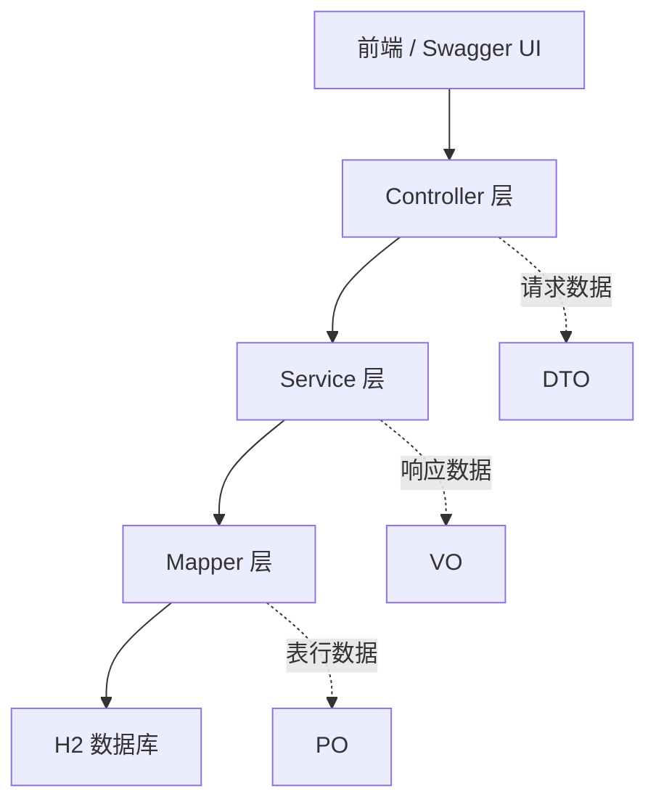
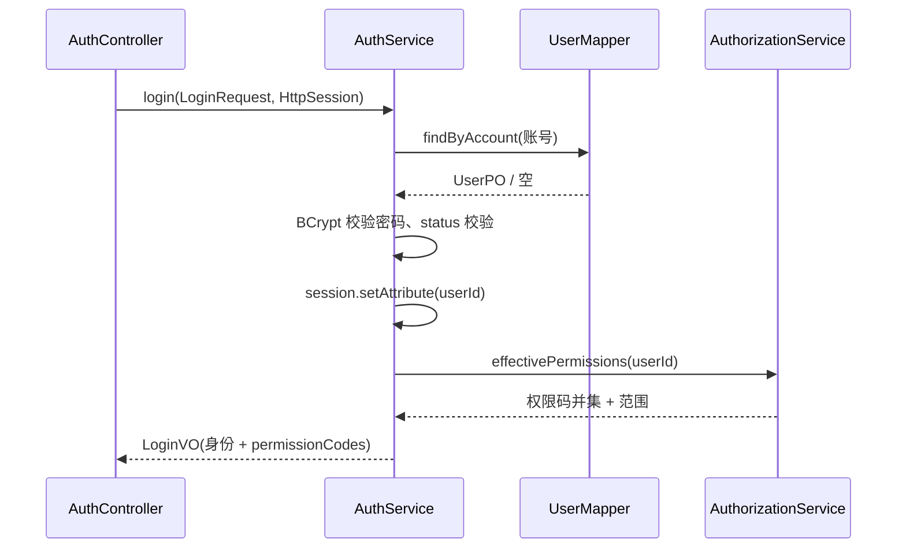
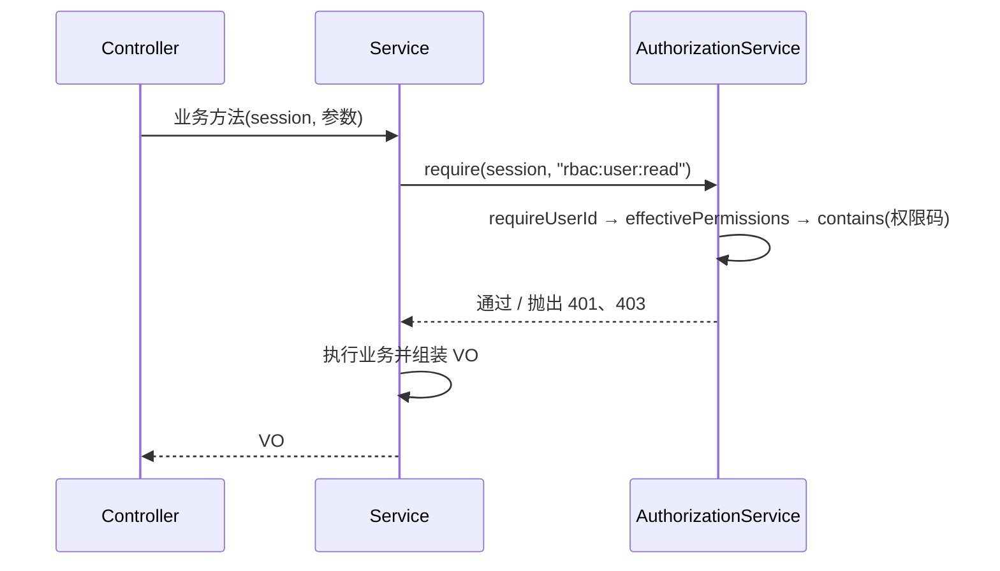
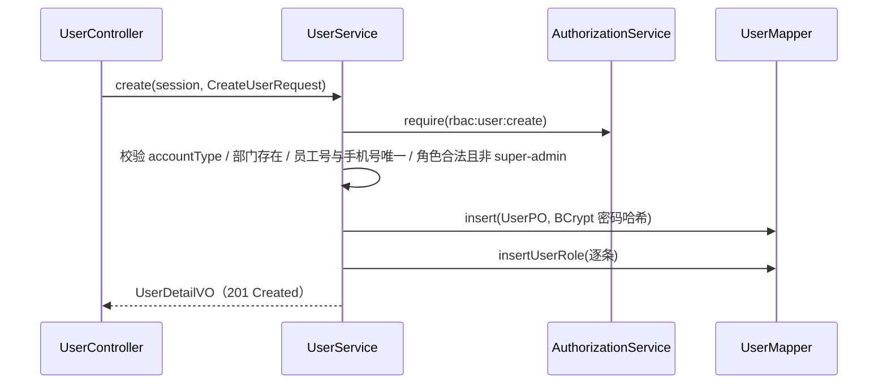

# RBAC0 面向功能后端 · 详细设计说明书

| 项目 | 内容 |
| --- | --- |
| 系统名称 | 模块化政务 RBAC 权限管理系统 |
| 文档对象 | 面向功能/过程实现的后端（`backend-procedural/`） |
| 版本 | v0.2.0（与代码、openapi.yaml 同步） |
| 技术栈 | Java 21、Spring Boot 3.3.5、Spring JDBC (JdbcTemplate)、H2（MODE=MySQL）、HttpSession、BCrypt |
| 构建/测试 | Maven；JUnit 5 + MockMvc 集成测试；JaCoCo 0.8.12 |
| 相关文档 | `api/openapi.yaml`（接口契约）、`docs/database/data-dictionary.md`（数据字典）、`backend-procedural/README.md`（运行指南） |

## 1. 系统概述

本系统的后端采用**面向功能（面向过程）**的方式实现 RBAC0 权限模型：不引入复杂的领域对象模型，而是把系统能力组织为一条条**功能流水线**——「认证 → 加载用户角色 → 计算有效权限 → 检查约束 → 执行业务 → 组装视图」。

### 1.1 需求与目标

1. 支持用户登录/退出、账号启停（`active`/`inactive`）。
2. 支持 RBAC0：用户-角色-权限两级分配；有效权限 = 已分配且启用角色的权限码去重并集；支持范围（`all`/`self`）；默认拒绝。
3. 提供用户管理（查询、创建、停用/启用、删除）、角色管理（查询、权限替换）、权限目录、资源目录、部门树等管理功能。
4. 全部对外接口遵循 REST 风格：资源来自 ER 图实体、JSON 交互、GET/POST/PUT/DELETE、HTTP 状态码表达结果。
5. 并发授权变更使用乐观锁版本控制，冲突返回 409。

### 1.2 明确不做（本期范围外）

RBAC1/2（角色继承、约束）、审批流、移动端、生产级数据库高可用；会话采用内存 HttpSession，不做集群共享。

## 2. 总体架构设计

### 2.1 分层架构



- **Controller → Service → Mapper 三层调用**，上层只依赖下一层，禁止跨层访问（Controller 不直接调用 Mapper）。
- **DTO 接收请求数据**：`dto/` 包（如 `CreateUserRequest`），带 Jakarta Validation 注解，由 `@Valid` 触发校验。
- **VO 返回响应数据**：`vo/` 包（如 `UserDetailVO`），只含展示所需字段，密码哈希等内部字段永不下发。
- **PO 对应数据库表**：`po/` 包与表一一对应（7 张表 7 个 PO），Mapper 只返回 PO，不做跨表组装。
- **横向支撑**：`error/`（统一异常与错误包络）、`config/`（BCrypt Bean）、`data/`（演示数据初始化）。

### 2.2 包结构

```text
com.municipal.rbac.procedural
├── ProceduralApplication.java      # 启动类
├── controller/                     # ① 接收请求、参数绑定、返回 VO
│   ├── AuthController  MeController  UserController
│   ├── RoleController  CatalogController  DepartmentController
├── service/                        # ② 过程编排：鉴权→计算→校验→执行→组装
│   ├── AuthService  AuthorizationService(集中授权)  MeService
│   ├── UserService  RoleService  CatalogService  DepartmentService
│   └── EffectivePermissions        # 有效权限快照（角色集/权限码/范围）
├── mapper/                         # ③ 只读写表行（JdbcTemplate），返回 PO
│   ├── UserMapper  RoleMapper  CatalogMapper  DepartmentMapper
├── dto/                            # 请求对象（5 个）
│   LoginRequest  CreateUserRequest  UpdateUserStatusRequest
│   ReplaceRolesRequest  ReplacePermissionsRequest
├── vo/                             # 响应对象（13 个，含 PageVO 泛型分页）
├── po/                             # 表映射（7 个）
├── error/                          # ApiException + GlobalExceptionHandler
├── config/                         # SecurityConfig（仅 PasswordEncoder Bean）
└── data/                           # DataInitializer（演示数据，库空时写入）
```

### 2.3 对象转换链（以“用户详情”为例）

```text
users 表行 --UserMapper--> UserPO --UserService(+部门字典/角色名/有效权限)--> UserDetailVO --JSON--> 前端
```

## 3. 核心机制详细设计

### 3.1 认证与会话

- 登录账号 = 员工号或手机号（`UserMapper.findByAccount`：`employee_no = ? OR phone = ?`）。
- 密码校验：BCrypt（`spring-security-crypto`，不引入 Spring Security 自动配置）。
- 状态校验：仅 `status = 'active'` 可登录，否则 403 `ACCOUNT_DISABLED`。
- 会话：登录成功后 `session.setAttribute("userId", id)`；后续请求由 `AuthorizationService.requireUserId` 取会话身份，缺失抛 401 `UNAUTHENTICATED`。
- 退出：`session.invalidate()`。

登录时序：



### 3.2 RBAC0 授权模型与有效权限计算

有效权限（`AuthorizationService.effectivePermissions`）：

1. 查 `user_roles ⋈ roles`，取**已分配且启用**（`enabled = TRUE`）的角色 ID 列表；
2. 遍历每个角色的 `role_permissions`，权限码进入 `LinkedHashSet`（自动去重、保序）；
3. 范围合并 `scopes.merge(code, scope, mergeScope)`：任一路径为 `all` 则结果 `all`，否则 `self`；
4. 输出 `EffectivePermissions(roleIds, permissionCodes, scopes)`。

校验规则（默认拒绝）：`require(session, 权限码)` 未命中即 403 `FORBIDDEN`；`requireSelf(session, ownerId)` 用于本人范围资源。

授权检查时序（所有受保护接口共用）：



### 3.3 乐观锁（并发授权安全）

| 场景 | 版本字段 | 流程 |
| --- | --- | --- |
| 替换用户角色 `PUT /users/{id}/roles` | `users.role_version` | 读取当前版本 → 请求版本不符则 409；相符则删旧插新并 `version+1` |
| 替换角色权限 `PUT /roles/{id}/permissions` | `roles.permission_version` | 同上 |

冲突响应 `409 VERSION_CONFLICT`，`details` 携带 `expectedVersion` / `currentVersion`，前端重新读取后复核提交。

### 3.4 统一错误处理

- 业务异常 `ApiException(HttpStatus, code, message, details)`，由 `GlobalExceptionHandler` 统一转成：

```json
{ "error": { "code": "FORBIDDEN", "message": "没有执行该操作的权限。", "requestId": "4f2a9c1b7d3e", "details": null } }
```

- 参数校验失败（`MethodArgumentNotValidException`）→ 400 `INVALID_ARGUMENT`；请求体不可解析 → 400 `INVALID_ARGUMENT`；未知异常 → 500 `INTERNAL_ERROR`（记录日志）。

错误码总表（与 openapi.yaml 一致）：

| HTTP | 错误码 | 含义 |
| --- | --- | --- |
| 400 | INVALID_ARGUMENT | 参数非法（含状态/账号类型枚举校验） |
| 400 | DUPLICATE_ITEM | 员工号/手机号/集合元素重复 |
| 400 | UNKNOWN_ROLE | 角色不存在（分配时） |
| 400 | UNKNOWN_PERMISSION | 权限码不存在（授权时） |
| 400 | UNKNOWN_DEPARTMENT | 部门不存在（创建用户时） |
| 401 | INVALID_CREDENTIALS | 账号或密码错误 |
| 401 | UNAUTHENTICATED | 未登录或会话失效 |
| 403 | ACCOUNT_DISABLED | 账号已停用 |
| 403 | FORBIDDEN | 缺少所需权限码（默认拒绝） |
| 403 | PROTECTED_ACCOUNT | 受保护账号（本人/超级管理员）不可改状态或删除 |
| 403 | PROTECTED_ROLE | 不允许分配超级管理员角色 |
| 404 | USER_NOT_FOUND / ROLE_NOT_FOUND / RESOURCE_NOT_FOUND | 资源不存在 |
| 409 | VERSION_CONFLICT | 乐观锁版本冲突 |
| 500 | INTERNAL_ERROR | 未预期错误 |

## 4. 功能模块详细设计

### 4.1 认证模块（AuthService / AuthController）

- `POST /api/v1/auth/login`：登录，返回 `LoginVO`（身份摘要 + 权限码）；
- `POST /api/v1/auth/logout`：退出，返回 `{ "success": true }`。

### 4.2 当前身份模块（MeService）

- `GET /api/v1/me`：`MeVO`；`GET /api/v1/me/permissions`：`PermissionsVO`（roleIds、permissionCodes、scopes、version）。

### 4.3 用户管理模块（UserService）

| 功能 | 规则要点 |
| --- | --- |
| 分页查询 `GET /users` | 需 `rbac:user:read`；支持 keyword（姓名/员工号/岗位）、departmentId、accountType；pageSize 上限 100 |
| 详情 `GET /users/{id}` | 组装部门名/分公司（部门字典）、启用角色名、有效权限码 |
| 创建 `POST /users` | 需 `rbac:user:create`；accountType ∈ {employee, temporary-ops}；部门必须存在；员工号/手机号唯一；roleIds 不允许含 super-admin；ID 规则 `u-` + UUID 前 12 位；初始 `status=active`、`role_version=1`；返回 201 |
| 状态变更 `PUT /users/{id}/status` | 需 `rbac:user:update`；status ∈ {active, inactive}；本人账号、超级管理员账号受保护（403 PROTECTED_ACCOUNT） |
| 删除 `DELETE /users/{id}` | 需 `rbac:user:delete`；事务内先删 `user_roles` 再删 `users`；本人、超级管理员受保护；返回 204 |
| 角色集合查询 `GET /users/{id}/roles` | 需 `rbac:user:read`；返回完整角色 ID 集合 + 版本 |
| 角色替换 `PUT /users/{id}/roles` | 需 `rbac:user:assign-role`；完整集合语义；重复 400、未知角色 400、版本冲突 409 |

创建用户流程：



### 4.4 角色模块（RoleService）

- `GET /roles`：需 `rbac:role:read`；列表含角色码、权限码与版本；
- `GET /roles/{id}/permissions`：需 `rbac:role:read`；
- `PUT /roles/{id}/permissions`：需 `rbac:role:grant`；重复 400、未知权限码 400、版本冲突 409；替换后权限的 scope 统一为 `all`。

### 4.5 目录与组织模块

- `GET /permissions`：需 `rbac:permission:read`；`scope_options` 字符串在 Service 拆分为列表；
- `GET /resources`：需 `rbac:permission:read`；按 `parentId` 逐层展开，`hasChildren` 由 Mapper 查询填充；
- `GET /departments`：需 `rbac:department:read`；读平表后在内存组装树（含 parentName、manager 姓名、employeeCount）。

## 5. 接口设计（REST）

设计原则：资源来自 ER 图实体（users / roles / permissions / resources / departments）；JSON 交互；以 GET/POST/PUT/DELETE 表达操作；HTTP 状态码表达结果。

| # | 方法 | 路径 | 功能 | 所需权限码 | 成功码 |
| --- | --- | --- | --- | --- | --- |
| 1 | POST | /api/v1/auth/login | 登录 | 公开 | 200 |
| 2 | POST | /api/v1/auth/logout | 退出 | 公开 | 200 |
| 3 | GET | /api/v1/me | 当前身份 | 登录即可 | 200 |
| 4 | GET | /api/v1/me/permissions | 有效权限 | 登录即可 | 200 |
| 5 | GET | /api/v1/users | 用户分页 | rbac:user:read | 200 |
| 6 | POST | /api/v1/users | 创建用户 | rbac:user:create | **201** |
| 7 | GET | /api/v1/users/{id} | 用户详情 | rbac:user:read | 200 |
| 8 | PUT | /api/v1/users/{id}/status | 启停账号 | rbac:user:update | 200 |
| 9 | DELETE | /api/v1/users/{id} | 删除用户 | rbac:user:delete | **204** |
| 10 | GET | /api/v1/users/{id}/roles | 用户角色集合 | rbac:user:read | 200 |
| 11 | PUT | /api/v1/users/{id}/roles | 替换角色（乐观锁） | rbac:user:assign-role | 200 |
| 12 | GET | /api/v1/roles | 角色分页 | rbac:role:read | 200 |
| 13 | GET | /api/v1/roles/{id}/permissions | 角色权限集合 | rbac:role:read | 200 |
| 14 | PUT | /api/v1/roles/{id}/permissions | 替换权限（乐观锁） | rbac:role:grant | 200 |
| 15 | GET | /api/v1/permissions | 权限目录分页 | rbac:permission:read | 200 |
| 16 | GET | /api/v1/resources | 资源目录分页 | rbac:permission:read | 200 |
| 17 | GET | /api/v1/departments | 部门树 | rbac:department:read | 200 |

完整请求/响应 Schema 见 `api/openapi.yaml`；在线调试：启动后访问 `http://localhost:8080/swagger-ui.html`。

## 6. 数据库设计

7 张表：`departments`、`users`、`roles`、`permissions`、`resources`、`user_roles`、`role_permissions`。ER 图与逐字段字典见 `docs/database/data-dictionary.md`；建表脚本 `backend-procedural/src/main/resources/schema.sql`。

## 7. 测试设计（JaCoCo）

- 框架：JUnit 5 + `@SpringBootTest` + MockMvc 全链路集成测试（真实 H2 + 演示数据），会话通过登录助手获取；写库用例加 `@Transactional` 自动回滚，互不污染。
- 测试类与关注点：

| 测试类 | 用例数 | 覆盖点 |
| --- | --- | --- |
| AuthApiTest | 8 | 登录成功/手机号/错误密码/停用账号/参数校验、/me、退出 |
| AccessControlApiTest | 7 | 未登录 401、无权限 403、有效权限计算、404 |
| UserManagementApiTest | 19 | 分页与过滤、详情、角色替换（成功/冲突/重复/未知）、创建（成功/重复/未知部门/未知角色/super-admin 保护）、状态变更、删除与保护 |
| RolePermissionApiTest | 13 | 角色列表/过滤、角色权限替换（成功/冲突/未知码）、权限目录、资源目录、部门树 |

- JaCoCo 报告：`mvn test` 自动生成于 `backend-procedural/target/site/jacoco/index.html`（HTML）与 `jacoco.xml`（机器可读）。
- 当前结果：**47 个用例全部通过；指令覆盖率 95%（4,265 / 4,472），行覆盖 95%（653 / 689），类覆盖 51/51；Controller、VO、PO、DTO 包 100%。**

## 8. 与课程验收要求对照

| 验收要求 | 实现情况 |
| --- | --- |
| 用面向功能的方式实现 RBAC0 后端 | 全流程过程式 Service（认证→授权→执行），见第 3、4 节 |
| 三层：Controller → Service → Mapper | `controller/`、`service/`、`mapper/` 严格单向调用，Controller 无 Mapper 依赖 |
| DTO 接收数据、VO 返回数据、PO 对应数据库表 | `dto/` 5 个、`vo/` 13 个、`po/` 7 个（与 7 张表一一对应） |
| API 按 REST：资源来自 ER 实体、JSON、GET/POST/PUT/DELETE | 17 个操作见第 5 节，`openapi.yaml` 完整契约 |
| 状态码用 HTTP 状态码 | 200/201/204/400/401/403/404/409/500 + 统一错误包络，见 3.4 |
| API 设计文档 | `api/openapi.yaml` + 运行时 Swagger UI |
| 数据库设计 | `docs/database/data-dictionary.md`（ER 图 + 7 表字段字典） |
| 详细设计 | 本文档 |
| JaCoCo 测试报告（或代码） | 测试代码 `src/test/java/.../*.java`；报告 `target/site/jacoco/`；覆盖率 95%（指令） |

## 9. 运行与演示（给评审）

```powershell
# 在仓库根目录（Windows PowerShell；本机 JDK 21 位于 D:\jdk21）
& 'D:\IDEA\IntelliJ IDEA 2025.2.3\plugins\maven\lib\maven3\bin\mvn.cmd' -f backend-procedural/pom.xml clean test
& 'D:\IDEA\IntelliJ IDEA 2025.2.3\plugins\maven\lib\maven3\bin\mvn.cmd' -f backend-procedural/pom.xml spring-boot:run
```

1. 浏览器访问 `http://localhost:8080/swagger-ui.html`，用 E001 / 123456 登录后调试全部接口；
2. H2 控制台 `http://localhost:8080/h2-console`（JDBC URL：`jdbc:h2:mem:rbac`，用户 sa，空密码）查看 7 张表数据；
3. 无领导小组面试建议演示路径：错误密码 401 → E004 查用户 403（默认拒绝）→ E001 创建用户 201 → 停用 200 → 用户登录被 403 → 删除 204 → 替换角色 409 版本冲突 → JaCoCo 报告。
