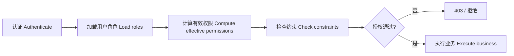
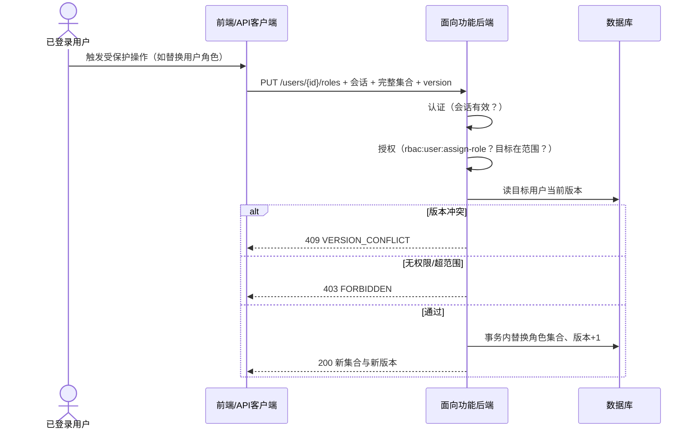

# 成员 4 第一阶段：RBAC0 面向功能后端设计

作者：王信凯（成员 4）、胡俊朗（成员 5）共同完成

阶段：2026 年 10 月 11 日起的准备阶段；对应第一阶段 RBAC0，课程验收窗口为 10 月 27—29 日

任务：首批任务「RBAC0 功能分解与接口草案」

状态：设计草案交付，且后端已按 Java + Spring Boot 完成实现并通过集成测试验证（`backend-procedural/`，47 个用例全部通过，JaCoCo 指令覆盖 95%；详见 [README](../../backend-procedural/README.md) 与 [详细设计](detailed-design.md)）。实现按合理默认值编写，待全组统一后再修改（Q-02/Q-03/会话方式）。

## 1. 我负责什么，为什么先做这些

成员 4 负责**面向功能/过程的后端**（`backend-procedural/`），与成员 5 的面向对象后端共用同一外部契约，但核心授权逻辑独立实现。首批任务要求交付「功能分解、后端接口草案、基础授权」——即说明登录、角色、授权流程怎样分解，接口输入输出、认证与失败分支是什么，基础授权怎样计算。

由于 [Q-02 面向功能允许的语言与框架](../../docs/requirements/questions.md)、[Q-03 两后端独立程度](../../docs/requirements/questions.md) 尚未确认，先按 **Java 21 + Spring Boot 3.3.5 + Spring JDBC + H2 内存库 + HttpSession + BCrypt** 写出第一版后端，把授权过程、职责边界和失败分支落到代码里，供成员 2、3、5、6 并行对接；所选默认值待全组统一后再修改，不隐式关闭 Q-02/Q-03 的待确认结论。

| 本次交付 | 文件 | 用途 |
| --- | --- | --- |
| 功能分解与授权设计 | 本文件 | 授权过程、职责分层、基础授权算法、失败分支 |
| 后端接口草案 | [member4-procedural-backend-api.md](../../api/proposals/member4-procedural-backend-api.md) | 登录、角色、用户角色、目录等接口的输入输出与认证 |
| 详细设计 | [detailed-design.md](detailed-design.md) | 架构、机制、模块、接口、测试的完整设计说明书 |
| 学习与答辩说明 | [member4-procedural-rbac0-explained.md](../guides/member4-procedural-rbac0-explained.md) | 逐步解释做了什么、为什么、怎样演示 |
| 自检记录 | [member4-procedural-rbac0-verification.md](../testing/member4-procedural-rbac0-verification.md) | 本次文档一致性与仓库检查结果 |

## 2. 面向功能后端怎样分解功能

面向功能范式按**过程步骤**组织，而不是按领域对象。RBAC0 后端把一次受保护请求分解为一条流水线：



每一步是一个独立、可复用的过程，输入输出明确：

| 步骤 | 输入 | 输出 | RBAC0 行为 |
| --- | --- | --- | --- |
| 认证 | 会话凭证 | 已确认的用户 ID | 无效会话 401 |
| 加载用户角色 | 用户 ID | 已分配且启用的角色集合 | 无角色即空集合，不是错误 |
| 计算有效权限 | 角色集合 | 去重后的权限码并集（含范围） | 多角色并集、去重 |
| 检查约束 | 权限集合、目标操作 | 允许/拒绝 | RBAC0 无 SSD/DSD，保留入口 |
| 执行业务 | 目标对象、载荷 | 结果或错误 | 事务内校验版本、范围、对象归属 |

RBAC1 的继承闭包、RBAC2 的约束检查分别接在「计算有效权限」和「检查约束」两个步骤上，第一阶段只保留扩展位置，不提前实现。

## 3. 职责分层

包 `com.municipal.rbac.procedural` 下的分层与过程一一对应，目录名称不构成范式证据，最终以代码与测试说明：

| 层 | 职责 | 对应过程 |
| --- | --- | --- |
| `controller` | HTTP 端点、请求 DTO 绑定、调用服务、返回 VO | 入口与出口 |
| `service` | 过程编排：认证、计算有效权限、替换集合、授权检查 | 核心过程 |
| `mapper` | 用户、角色、用户角色、角色权限、权限目录的数据访问（返回 PO） | 数据读写 |
| `dto` | 请求形状（接收数据），与外部契约一致 | 契约边界 |
| `vo` | 响应形状（返回数据），内部字段不下发 | 契约边界 |
| `po` | 数据库表行映射（7 张表一一对应） | 数据读写 |

授权判定不散落在各 controller 里，而是一个集中的授权过程：给定「会话身份 + 所需权限码 + 目标对象」，返回允许或拒绝及原因。这样成员 5 的 OO 后端可以有不同的内部结构，但两者对同一请求给出相同的业务结果与状态。

## 4. 基础授权算法

RBAC0 有效权限是用户所有已分配、已启用角色的直接权限的**去重并集**。不含继承（RBAC1），不含显式拒绝或职责分离（RBAC2）。

过程式伪代码（概念示意，非已实现代码）：

```text
effectivePermissions(userId):
    roles = loadEnabledRoles(userId)
    codes = emptySet()
    scopes = emptyMap()
    for role in roles:
        for grant in role.directGrants:
            codes.add(grant.permissionCode)
            scopes.merge(grant.permissionCode, grant.scope)   # 范围合并规则待 Q-10 确认
    return codes, scopes

authorize(session, requiredCode, target):
    if not session.valid: return DENIED(UNAUTHENTICATED)
    codes, scopes = effectivePermissions(session.userId)
    if requiredCode not in codes: return DENIED(FORBIDDEN)
    if scopes[requiredCode] == SELF and target.ownerId != session.userId:
        return DENIED(FORBIDDEN)                              # 本人范围不能绕过
    return ALLOWED
```

要点：

- **默认拒绝**：没有精确匹配的权限码就拒绝；权限未加载、权限元数据无效也拒绝。
- **不信任自报**：后端只从会话取身份，忽略请求里的 `userId`、`roleIds`、`permissionCodes` 等自报字段。
- **本人范围**：`hr:self:read`、`oa:document:edit(self)` 等必须在后端比对目标对象归属，不能因为前端显示「本人」就认为安全。
- **并集去重**：同一权限来自多个角色只保留一份；撤销某个角色后，由其他角色继续提供的权限仍保留。

## 5. 一次受保护请求的授权时序



以上流程已在代码中落地：真实原子性、版本比较与数据库事务见 `backend-procedural/`（`UserService`、`RoleService`），并由集成测试覆盖（含 409 冲突用例）。

## 6. 关键过程详解

### 6.1 替换用户角色集合

1. 认证并检查 `rbac:user:assign-role`，检查目标用户在可管理范围内。
2. 读取目标用户当前 `version`；校验载荷中所有 `roleIds` 存在且允许分配、无重复。
3. 比较载荷 `version` 与当前版本；不一致返回 409 `VERSION_CONFLICT`，整个集合保持不变。
4. 一致时在**一次事务**内替换关联并递增版本；失败则全部回滚，不允许「新增成功但撤销失败」。
5. 成功返回已保存集合与新版本；空 `roleIds: []` 是合法撤销全部角色。

是否限制自行撤权、最后一个管理员撤权，是需要确认的管理策略，本文不默认启用。

### 6.2 替换角色直接权限集合

与 6.1 相同的替换语义和并发版本检查，只是目标对象换成角色、载荷换成 `permissionCodes`。保存空集合意味着撤销该角色全部直接权限，不意味着删除角色。

### 6.3 本人范围检查

拥有 `oa:document:edit` 不说明能编辑任何人的公文。范围 `self` 时，后端读取目标记录归属并与会话身份比对，不一致返回 403。范围合并规则（`all` 与 `self` 并存、多个角色范围如何合并）仍待 [Q-10](../../docs/requirements/questions.md) 确认，未确认前按拒绝处理。

## 7. 失败分支与状态码

与接口草案一致，后端按 **401 → 403 → 业务校验** 的顺序判断：

| 层 | 状态码 | 错误码示例 | 前端行为（成员 2、3 已约定） |
| --- | --- | --- | --- |
| 认证 | 401 | `UNAUTHENTICATED`、`INVALID_CREDENTIALS` | 清会话转登录 |
| 授权 | 403 | `FORBIDDEN`、`ACCOUNT_DISABLED` | 显示拒绝，不伪造数据 |
| 参数 | 400 | `INVALID_ARGUMENT`、`UNKNOWN_ROLE`、`DUPLICATE_ITEM` | 保留草稿修正 |
| 对象 | 404 | `USER_NOT_FOUND`、`ROLE_NOT_FOUND` | 返回列表/重选 |
| 冲突 | 409 | `VERSION_CONFLICT` | 重新读回复核，不覆盖 |

正常空结果一律 200，不把空数组当作故障；网络错误与 5xx 返回可重试错误，不伪装保存成功。

## 8. 与成员 2、3、5、6 的衔接

| 对接人 | 对方需要交付 | 成员 4 提供 | 对接完成标志 |
| --- | --- | --- | --- |
| 成员 2 陈清香 | 登录状态、用户/部门页面、统一 API 客户端 | 登录/退出/用户/部门接口草案与失败分支 | 前端按草案建立 Mock，字段不靠猜 |
| 成员 3 杨昕桐 | 角色权限页面、用户角色交互、目录检索 | 角色/目录/用户角色接口草案、并发版本、授权时机 | 契约确认后测试库能保存并读回 |
| 成员 5 胡俊朗 | OO 后端等价实现 | 同一外部契约与授权语义说明 | 两实现同一请求业务结果一致 |
| 成员 6 孙逸轩 | 正式 OpenAPI、验收用例、一致性清单 | 本草案、失败分支、待确认口径 | 结论写回 OpenAPI，成员 6 独立验证允许/拒绝 |

## 9. 与 OO 后端等价但独立

两套后端遵守同一外部契约、使用等价独立测试数据，核心授权逻辑各自实现，不互相调用同一份权限计算来冒充两种实现。面向功能后端按过程分解；面向对象后端按 User/Role/Permission/Policy 等领域概念组织。目录共存不自动证明两种范式完成，仍需实际代码与测试证据。

## 10. RBAC1 与 RBAC2 的边界

- **RBAC1 角色层级**：在「计算有效权限」步骤前叠加继承闭包，senior 继承 junior；单父树还是多父 DAG 待 [Q-05](../../docs/requirements/questions.md)。第一阶段不计算闭包、不保存层级关系。
- **RBAC2 约束**：SSD 在「替换用户角色」时检查，DSD 在「会话激活角色」时检查；候选规则待老师与小组确认，RBAC0 不实现。

## 11. 第一阶段验收清单

| 编号 | 项 | 当前状态 |
| --- | --- | --- |
| M4-01 | 功能分解与职责分层已记录 | 本文件 §2、§3 |
| M4-02 | 登录、角色、授权流程已记录 | 本文件 §4—§6 |
| M4-03 | 接口输入输出、认证与失败分支已记录 | 接口草案 + [OpenAPI](../../api/openapi.yaml) |
| M4-04 | 基础授权（并集、默认拒绝、本人范围）已记录 | 本文件 §4，已在代码实现并测试 |
| M4-05 | 与成员 2、3 提案字段口径一致 | 接口草案 §2、自检记录 |

后端代码、数据库持久化、真实并发版本均已完成并通过测试（`backend-procedural/`，47 个用例、JaCoCo 指令覆盖 95%）；权限变更后的会话失效策略与两后端一致性仍为**待实测**，见自检记录。

## 12. 待确认的决策

- 面向功能允许的语言与框架、封装边界（Q-02）。
- 两后端独立程度与共享边界（Q-03）。
- 会话 Cookie/Token、权限改变对既有会话的生效时点。
- `all`/`self` 范围合并规则（Q-10）、多角色映射规则（Q-11）。
- 管理员能否授出任意权限、自行/最后管理员撤权策略。
- 对象存在性与 403/404 防枚举次序。

有关边界仍以 [需求范围](../requirements/scope.md)、[问题清单](../requirements/questions.md) 和 [API 约定草案](../standards/api-contract.md) 为准。设计提案不隐式关闭这些问题。
