# 文档修订记录

| 版本 | 日期 | 修订人 | 修订说明 |
| --- | --- | --- | --- |
| V0.1 | 2026-11-08 | 2-10组 | 依据大作业一需求规格说明书和第一轮检查意见，整理概要设计提纲 |
| V1.0 | 2026-11-11 | 2-10组 | 完成总体架构、权限模型、模块、设计模型、接口、数据、部署、非功能需求和追溯矩阵 |

> **文档状态说明**
>
> 本文是**概要设计基线**，描述系统在整改后的目标设计，而不是对当前仓库代码完成度的证明。第一轮检查中指出的旧版设计问题——权限只按“功能点×动作”表达、缺少菜单/按钮层次、缺少权限与 API 的映射、部门管理员无法在用户表中识别、API 和代码由需求文档直接生成、持久化使用 JDBC 且没有事务控制——**均不作为本设计的依据**。本文第 1.8 节逐条说明设计响应；代码、数据库迁移和 OpenAPI 契约应按本文整改后再进行下一轮验收。
>
> 本文遵守课程规定的阶段边界：只做到包/组件、模块、设计类、状态、系统级 DFD、系统级时序和概要表结构，不写完整表字段、SQL、代码级函数签名、JSON 样例和模块内部算法。

<!-- toc -->

<!-- pagebreak -->

# 1 引言与总体设计

## 1.1 编写目的

本文是“市政公司统一权限管理系统”大作业二的概要设计说明书。它在《需求规格说明书》已回答“做什么”的基础上，回答“怎么做”的总体问题：确定系统的体系结构、模块划分、模块间接口、全局数据设计、部署方式和质量属性实现方案，并对架构方案做一次轻量级 ATAM 评估。

本文的读者包括：

- **课程教师**：对照大作业二的评分要点检查架构、设计模型转换、ATAM、接口与数据设计、部署与非功能落实、可追溯性。
- **小组全体成员**：作为界面原型、OpenAPI、数据库迁移、两套后端和测试的共同设计基线，避免六个人各写一套模型。
- **后续详细设计与编码人员**：作为类设计、接口细化、表字段、事务边界和测试用例的输入。

本文不替代《需求规格说明书》，也不替代详细设计。需求编号、用例编号和验收标准以《需求规格说明书》为准；本文只引用其编号并说明设计如何落实。

## 1.2 项目背景

市政公司现有 111 个组织单元：1 个总公司、11 个总部部门、9 个分公司、54 个分公司下属部门、36 个项目经理部；在用 18 个软件系统，共 115 个功能模块、359 个功能点；员工约 10,000 人。各系统的权限目前分散在 Excel 清单中，由人工维护，难以统一审计，也无法阻止用户绕过界面直接调用后端接口。

本项目建设一个统一权限管理平台，集中管理员工、组织、角色、菜单、按钮和授权关系。平台的核心目标不是实现 18 个业务系统的全部业务，而是用一套可验证的权限模型证明：

1. 用户登录某个应用后，只能看到该应用下自己被授权的菜单和按钮；
2. 即使用户绕过前端、直接用工具调用后端 API，后端仍按“认证→权限码→数据范围→目标对象”的顺序拒绝越权请求；
3. 1 万多名员工可以通过部门分级管理，部门管理员只能管理本部门及下级部门，不能越权；
4. 撤销权限后，用户的下一次请求立即按新权限检查；
5. 新增一种菜单、按钮或 API 时，主要通过目录数据和映射关系完成，不反复修改表结构。

18 个系统中的 17 个业务系统以占位页演示权限效果，只有“员工台账管理”实现真实业务；第 18 个系统“系统管理后台”实现用户、组织、角色、授权、目录、日志等平台自身的管理功能。

## 1.3 术语与缩略语

| 术语 | 英文/缩写 | 含义 |
| --- | --- | --- |
| 应用 | Application | 权限清单中的一个软件系统。本系统管理 18 个应用；另有一个不参与清单计数的“统一门户”运行上下文 |
| 菜单 | Menu | 应用内的导航节点，最多三级；菜单是权限的载体之一，菜单权限通常对应“查看/进入” |
| 按钮 | Button | 菜单页面内的操作入口，如新增、编辑、审批、导出、删除；按钮是权限的载体之一 |
| 权限 | Permission | 本系统中可授予角色的最小单元，取值为一个菜单或一个按钮；权限码稳定，不随显示名称变化 |
| 功能点 | Function Point | 需求阶段清单中的最小功能单元，如“员工台账管理”；在本设计中映射为二级菜单 |
| 权限码 | Permission Code | 权限的稳定标识，格式为 `应用码:资源码:动作`，如 `hr:f046:edit` |
| 角色 | Role | 权限的集合；用户与角色多对多，角色与权限多对多 |
| 数据范围 | Data Scope | 拥有某权限时能处理的数据行：全部（ALL）、本部门及下级（DEPT）、本人（SELF） |
| 管理范围 | Management Scope | 部门管理员可管理的用户集合，等于其 `admin_dept_id` 对应部门及其全部下级部门 |
| 部门管理员 | Department Administrator | 由超级管理员任命的、只能管理本部门及下级部门用户和业务角色的管理员；在用户表中以 `admin_type=2` 识别 |
| 管理类角色 | Management Role | 拥有任一 `rbac:*` 管理权限的角色；部门管理员不得分配管理类角色 |
| 有效权限 | Effective Permission | 用户当前激活角色（含继承角色）所获得权限的并集；同一权限码取最大数据范围 |
| 应用上下文 | Application Context | 一次会话当前进入的应用；登录或切换应用时确定，后端只返回该应用下的权限 |
| API 端点 | API Endpoint | 后端受保护接口；以 OpenAPI 的 `operationId` 作为稳定标识，与权限建立多对多映射 |
| 默认拒绝 | Default Deny | 没有明确授予、权限未加载、API 未登记或映射不完整时，一律拒绝 |
| ATAM | Architecture Tradeoff Analysis Method | 体系结构权衡分析方法；本课程只模拟其“设计→讲故事→效用树→分析→改进”的核心逻辑 |
| DFD | Data Flow Diagram | 数据流图；本文只画系统级顶层图和第一层图，保证父子平衡 |
| JPA | Jakarta Persistence API | Java 持久化规范；本设计使用 Spring Data JPA 作为持久化层 |
| RBAC | Role-Based Access Control | 基于角色的访问控制；本系统最终覆盖 RBAC0 的核心关系，并在后续阶段加入层级与约束 |

## 1.4 参考资料

| 编号 | 名称 | 用途 |
| --- | --- | --- |
| [1] | GB/T 8567-2006《计算机软件文档编制规范》 | 文档结构与章节组织 |
| [2] | 《市政公司统一权限管理系统需求规格说明书》v1.1（大作业一） | 功能需求、非功能需求、用例和数据需求 |
| [3] | Sandhu R. S. 等，*Role-Based Access Control Models*，IEEE Computer，1996 | RBAC96 模型，RBAC0~RBAC3 的理论依据 |
| [4] | ANSI INCITS 359-2004 *Role Based Access Control* | RBAC 标准术语与关系 |
| [5] | 2026-10-28 第一轮检查录音及《2-10组检查纪要》 | 整改要求：菜单/按钮权限、权限—API 映射、部门管理员识别、JPA 与事务、结构化输入 |
| [6] | 本项目《数据字典》《API 约定》《部署说明》 | 现有数据口径、接口约定和部署约束 |
| [7] | 本项目 OpenAPI 目标契约 v0.4.0 | 本文第 5 节接口设计的机器可读目标版本；在现有 v0.3.0 基础上扩展 |

## 1.5 需求概述

### 1.5.1 功能需求概览

《需求规格说明书》共定义 60 条功能需求，分三个阶段验收。本文不重复其全文，只按需求组概括，并在第 9 节逐条追溯。

| 需求组 | 编号范围 | 条数 | 主要目标 | 主要阶段 |
| --- | --- | --- | --- | --- |
| 登录与会话 | LOGIN-01 ~ LOGIN-07 | 7 | 工号/手机号登录、会话、改密、锁定、激活角色 | 一 / 三 |
| 门户 | PORTAL-01 ~ PORTAL-06 | 6 | 菜单、占位页、我的权限、员工台账列表与编辑 | 一 |
| 用户管理 | USER-01 ~ USER-07 | 7 | 用户查询、新增、编辑、启停、重置密码、删除、账号保护 | 一 |
| 组织架构 | DEPT-01 ~ DEPT-02 | 2 | 部门树、部门成员 | 一 |
| 角色管理 | ROLE-01 ~ ROLE-15 | 15 | 角色增删改、启停、继承、约束、有效权限 | 一 / 二 / 三 |
| 权限目录 | CAT-01 ~ CAT-03 | 3 | 应用/菜单/按钮/权限目录、权限码、管理后台映射 | 一 |
| 授权 | GRANT-01 ~ GRANT-06 | 6 | 用户角色、角色权限、部门管理员可授出范围、合并、立即生效、约束兜底 | 一 / 三 |
| 鉴权 | AUTHZ-01 ~ AUTHZ-05 | 5 | 鉴权顺序、默认拒绝、数据范围、继承、仅激活角色 | 一 / 二 / 三 |
| 数据导入 | IMPORT-01 ~ IMPORT-06 | 6 | 部门、目录、授权、员工导入，幂等和初始密码 | 一 |
| 日志审计 | LOG-01 ~ LOG-03 | 3 | 登录日志、授权变更日志、查询导出 | 三 |
| **合计** |  | **60** |  |  |

第一轮检查后新增的设计要求不改变上述需求编号，而是在原需求上做**模型修正**：权限必须落到菜单和按钮；权限必须与应用、API 建立关系；部门管理员必须在用户表中可识别。第 1.8 节给出对应关系，第 9 节把修正后的设计追溯到原需求编号。

### 1.5.2 非功能需求概览

| 质量属性 | 编号范围 | 条数 | 关键指标 |
| --- | --- | --- | --- |
| 安全 | NFR-SEC-01 ~ NFR-SEC-05 | 5 | 密码慢哈希、参数绑定、统一登录失败提示、数据库不暴露公网、仓库不含敏感数据 |
| 性能 | NFR-PERF-01 ~ NFR-PERF-03 | 3 | 单次鉴权查询 ≤10 ms；常用页面 ≤1 s；EXPLAIN、慢查询和缓存失效 |
| 数据一致性与可靠性 | NFR-DATA-01 ~ NFR-DATA-04 | 4 | 外键/CHECK/唯一键、事务与版本号、Flyway 迁移、备份 |
| 可维护性 | NFR-MAINT-01 ~ NFR-MAINT-02 | 2 | 新增操作只加数据不改表；有效权限计算集中 |
| 双后端与实现 | NFR-IMPL-01 ~ NFR-IMPL-03 | 3 | 同一 OpenAPI、函数式纯函数、数据字典自动生成 |
| 环境 | NFR-ENV-01 | 1 | JDK 21、Spring Boot 3.3、MySQL 8.4、Vue 3、Linux 云服务器 |

### 1.5.3 关键业务规则

1. **权限即菜单或按钮。** 菜单有三级层次；没有上级菜单权限不能看到下级菜单；没有菜单权限也不能使用其中的按钮。
2. **应用与权限一对多。** 一个应用有多个菜单和按钮；权限归属应用；登录或切换应用时，后端只返回该应用下的权限树。
3. **权限与 API 多对多。** 一个菜单可能对应多个查询 API；一个按钮通常对应一个命令 API；后端按 `operationId` 找到 API 所需权限，再与用户有效权限比对。
4. **前后端双重控制。** 前端根据权限树决定菜单显示、按钮可用/置灰；后端对每个受保护请求独立鉴权，不信任前端传来的用户、角色、权限或数据范围。
5. **部门管理员双标识。** 用户表中 `admin_type=2` 表示部门管理员，`admin_dept_id` 给出管理范围；同时持有内置角色 `DEPT_ADMIN`。两者在一次事务中同时设置或清除。
6. **最小权限与立即撤销。** 撤销角色、撤销授权、停用角色或停用用户后，下一次请求按新权限检查；新增权限可以允许前端菜单稍后刷新，但后端始终按当前授权判断。
7. **默认拒绝。** 未授予、未知权限码、API 未登记、映射缺失、权限未加载，一律拒绝。

## 1.6 设计原则与约束

### 1.6.1 设计原则

| 原则 | 在本设计中的落实 |
| --- | --- |
| 可追溯 | 每个模块、接口、数据实体和架构决策都在第 9 节对应到需求编号；不出现“无来源”的设计 |
| 高内聚、低耦合 | 按业务能力划分模块；模块内部按 Web/应用/领域/基础设施分层；模块之间只通过应用服务或领域端口调用，不跨模块直接访问对方的表 |
| 单一事实来源 | 菜单、按钮、权限、API 和映射以目录表为准；权限码稳定；前端、后端、测试都读同一份 OpenAPI 和目录数据 |
| 默认拒绝与最小权限 | 鉴权链路的每个缺口都落到拒绝；部门管理员只能授出业务角色；管理类角色按 `rbac:*` 派生识别，不靠人工标记 |
| 关注点分离 | 界面展示、权限判定、数据访问、审计各自独立；前端只做展示控制，后端做最终判定 |
| 事务边界清晰 | 事务只放在应用服务层；整组替换、部门管理员任命、授权变更都在一个事务内完成，失败全部回滚 |
| 结构化输入、分阶段生成 | 用界面原型生成菜单/按钮目录，用目录和 OpenAPI 驱动 API 与代码生成；每个阶段人工检查合格后再进入下一阶段 |
| 可测试、可运维 | 有效权限计算写成纯函数；关键拒绝场景有契约测试；部署有健康检查、备份、回滚和可观测性 |

### 1.6.2 技术约束

| 约束 | 规定 |
| --- | --- |
| 后端语言与框架 | JDK 21、Spring Boot 3.3、Spring MVC、Spring Data JPA、Bean Validation、Spring Security 会话支持 |
| 事务 | 应用服务层使用 `@Transactional`；控制器和数据访问层不自行开启事务 |
| 数据库 | MySQL 8.4，InnoDB，utf8mb4；用 Flyway 命名管理迁移；两套后端共用一套表结构 |
| 前端 | Vue 3、Vue Router、Element Plus、Vite；桌面 Chrome/Edge；不做移动端适配 |
| 部署 | Linux 云服务器；Nginx 反向代理；Docker Compose 或等价容器编排；数据库端口不暴露公网 |
| 双后端 | `backend-procedural/` 面向功能，`backend-oo/` 面向对象；同一 OpenAPI、同一表结构、各自独立实现核心授权逻辑 |
| 数据规模 | 111 个组织、18 个应用、115 个模块、359 个功能点、2154 条清单权限、10,000 名员工加 `admin` |
| 安全与公开仓库 | 原始 Excel、真实姓名/电话、密码哈希、数据库备份、云密钥和令牌不得进入公开仓库 |
| 课程阶段 | 阶段一 RBAC0；阶段二角色层级和两套后端；阶段三约束、激活角色、审计和优化。本文覆盖最终目标架构，并标注阶段 |

### 1.6.3 AI 辅助设计的输入与门禁

第一轮检查指出：“API 和代码不能直接用需求文档驱动 AI 生成，而应以界面原型、OpenAPI、数据库等结构化输入逐阶段生成并人工检查。”本设计把这条要求固化为设计流程，而不是仅作为开发建议。

| 阶段 | 结构化输入 | AI/工具可生成的内容 | 人工检查门禁 | 输出 |
| --- | --- | --- | --- | --- |
| 需求分析 | 访谈记录、原始清单、用例 | 用例草案、术语表 | 需求编号、范围和验收标准确认 | 需求规格 v1.1 |
| 界面原型 | 需求、页面清单、角色 | 页面结构、菜单/按钮清单、交互状态 | 每个菜单、按钮、动作有明确名称和权限码；不出现界面外的资源 | 界面原型 + 菜单/按钮目录 |
| API 设计 | 界面原型、菜单/按钮目录、数据字典 | OpenAPI 路径、operationId、请求/响应大类、错误码 | 逐项核对“界面动作→API→权限码”；无孤立 API、无未登记按钮 | OpenAPI v0.4.0 + 权限—API 映射 |
| 后端代码 | OpenAPI、ER/表结构、模块/分层/技术说明 | JPA 实体、Repository、应用服务、Controller、DTO | 编译、单元/集成测试、事务边界、权限拒绝场景、代码评审 | 可运行后端 |
| 前端代码 | 界面原型、OpenAPI、权限树结构 | 页面、路由、按钮状态、API 客户端 | 菜单/按钮与权限码一致；无权按钮置灰；直接输入 URL 被拒绝 | 可运行前端 |
| 验收 | 需求、OpenAPI、测试用例 | 测试数据、脚本 | 独立执行、保存证据、对照 SHA | 验收记录 |

门禁规则：

1. **禁止“需求文档→代码”一步生成。** 需求文档只用于补充每个 API 的文字说明，不能直接作为代码生成输入。
2. **每个 API 必须有 `operationId`。** `operationId` 同时出现在 OpenAPI、Controller 注解和 `sys_api` 表中，是权限—API 映射的稳定键。
3. **每个受保护 Controller 方法必须登记。** 启动时扫描 `RequestMappingHandlerMapping`，发现未登记或映射缺失的受保护端点，生产环境启动失败；测试环境至少让契约测试失败。
4. **每个按钮必须有权限码和 API 映射。** 占位业务系统的按钮映射到统一的占位受控端点；真实业务按钮映射到真实 API。
5. **每个阶段人工检查合格后才进入下一阶段。** AI 产出不能直接合并；检查项写入 Pull Request 模板和验收记录。

### 1.6.4 设计边界

本文只写到以下粒度：

- 包图/组件图到包和组件，不展开包内类清单和类内部实现；
- 设计类图到核心边界类、控制类、实体类，只列关键属性和关键业务方法，不列 getter/setter 和私有辅助方法；
- 状态图到状态、事件、迁移和守卫条件，不展开状态内行为实现；
- DFD 到系统级顶层和第一层，保证父子平衡，不画模块内部流程；
- 时序图以模块/组件为生命线，不画到类方法级调用，不展开循环和条件内部算法；
- 表结构只列主要字段、主外键和约束，不列完整字段字典，不写 `CREATE TABLE`；
- 接口只列名称、功能、核心输入/输出大类和协议，不写代码级函数签名，不贴 JSON 样例；
- 不写算法伪代码、完整 SQL、部署脚本和配置参数。

## 1.7 与第一轮检查意见的对应

第一轮检查的核心意见是“模型不对，输入不对，控制不对”。本设计逐条给出响应，并明确旧版做法不再沿用。

| 编号 | 第一轮检查意见 | 旧版做法（不再沿用） | 本设计响应 | 章节 |
| --- | --- | --- | --- | --- |
| C-01 | 权限应定义为菜单和按钮，有层次结构 | 权限只按“功能点×动作”表达，菜单层次没有进入 ER | 权限实体直接对应菜单或按钮；菜单自关联成树，最多三级；按钮挂在菜单下；菜单权限和按钮权限分别授权 | 2.2.1、6.1、6.2 |
| C-02 | 菜单分一级、二级、三级，没有上级菜单权限不能看下级菜单 | 只有系统/模块/功能点三级目录，未说明菜单可见性规则 | 菜单树用 `parent_id` 表达；菜单树装配时从根向下过滤；父菜单不可见则整个子树不返回；没有菜单权限时按钮也不可用 | 2.2.1、4.1、4.4.2 |
| C-03 | 一个应用有很多菜单和按钮，权限要归属应用 | 应用与权限的一对多关系未在 ER 中体现 | `app_application 1:N app_resource`；权限通过资源归属应用；登录/切换应用只返回当前应用权限 | 2.2.2、6.1、6.2 |
| C-04 | 登录要明确用户名、密码和登录的系统，后端只返回该系统的权限 | 登录只校验用户名密码，返回用户全部权限 | 登录请求携带 `appCode`；门户是特殊上下文，只返回可访问应用清单；进入具体应用用切换上下文接口，后端只返回该应用权限树 | 2.2.2、5.2、4.4.1 |
| C-05 | 必须建立权限与 API 的关系，后端要判断用户能不能调某个 API | 只有前端按钮控制，后端没有权限—API 实体 | 新增 `sys_api` 和 `sys_permission_api`；以 OpenAPI `operationId` 为稳定键；API 可要求一个或多个权限；未登记 API 默认拒绝 | 2.2.3、4.4.3、6.1、6.2 |
| C-06 | 按钮通常直接对应一个 API；菜单可能对应多个 API | 没有区分菜单和按钮的 API 映射 | 映射表支持多对多；菜单权限映射查询 API，按钮权限映射命令 API；一个菜单可映射多个查询 API | 2.2.3、5.2 |
| C-07 | 部门管理员要在用户表中可识别，权限范围值为 2 可判断为管理员 | 只有 `DEPT_ADMIN` 角色，用户表没有管理标识和管理范围 | 用户表增加 `admin_type`（0 普通、1 超级、2 部门管理员）和 `admin_dept_id`；与 `DEPT_ADMIN` 角色在同一事务中维护；管理范围为本部门及全部下级 | 2.2.4、6.1、6.2 |
| C-08 | 部门管理员只能管理本部门及以下部门，不能分配管理类角色、不能改角色授权 | 仅靠角色编码判断，范围没有落到 ER | 管理范围递归查询 `admin_dept_id` 子树；可授出角色必须是非管理类业务角色；分配、撤销、修改授权分别校验 | 2.2.4、4.4.2、5.2 |
| C-09 | 撤销权限必须立即生效，新增权限可以不立即生效 | 授权变更后旧会话仍可能按旧权限通过 | 授权变更在同一事务递增 `sys_authz_version`；每次请求按当前版本计算；缓存键包含版本；撤销后下一次请求即拒绝 | 2.2.5、4.4.1、6.3.3 |
| C-10 | API 不能用需求文档直接生成，要用界面原型驱动 | 把整份需求文档交给 AI 生成 API，出现界面外资源 | 设计流程改为“界面原型→菜单/按钮目录→OpenAPI→代码”，每阶段人工门禁；API 必须能回到界面动作 | 1.6.3、2.1.4 |
| C-11 | 代码生成要控制模块、层次和技术，必须用 Java 课上的技术结构 | AI 自行决定三层结构、使用 JDBC、没有事务、DTO 混在一个 record | 明确分层、模块、每层技术和依赖规则；持久化统一 Spring Data JPA；应用服务统一 `@Transactional`；DTO 按 API/用例拆分、VO 按响应场景拆分；按 API 逐项生成和核对 | 2.1.3、2.1.4、3.1、3.2 |
| C-12 | 部门相关 API 和多个模块的接口有遗漏 | 代码没有按 API 契约逐项实现，部门接口缺失 | 第 5.2 节按模块列出完整 API 清单；第 9 节逐需求映射；启动时校验 API 登记完整性；契约测试覆盖每个端点 | 5.2、9.1 |
| C-13 | 代码没有事务控制 | 授权替换、用户删除等多步写入没有统一事务 | 事务边界放在应用服务；整组替换、部门管理员任命、删除用户、迁移都在一个事务内；失败回滚 | 2.1.3、6.3.2、8.3 |
| C-14 | 权限删除必须立即在后续请求生效，采用最小权限 | 依赖前端隐藏按钮，后端未逐请求检查 | 每个受保护 API 都经过拦截器；后端只信会话；默认拒绝；前端 403 后强制刷新权限树 | 2.2.3、2.2.5、4.4.1 |

## 1.8 设计范围与阶段边界

| 内容 | 本设计是否覆盖 | 说明 |
| --- | --- | --- |
| 总体架构、模块划分、包图/组件图 | 是 | 第 2、3 节 |
| 设计类图、状态图、系统级 DFD、系统级时序图 | 是 | 第 4 节 |
| 外部/内部接口契约、错误码 | 是 | 第 5 节 |
| 高级 ER 图、概要表结构、存储与缓存策略 | 是 | 第 6 节 |
| 部署图、物理拓扑、发布回滚 | 是 | 第 7 节 |
| 非功能需求落实 | 是 | 第 8 节 |
| 需求追溯矩阵 | 是 | 第 9 节 |
| 完整字段字典、索引 DDL、建表 SQL | 否 | 详细设计/数据库迁移 |
| 类内部算法、伪代码、完整方法实现 | 否 | 详细设计 |
| 页面视觉设计、组件级交互细节 | 否 | 界面原型/详细设计 |
| 完整测试用例和执行记录 | 否 | 测试文档/验收记录 |
| 真实员工数据和原始 Excel | 否 | 受控离线导入，不进仓库 |

<!-- pagebreak -->

# 2 总体架构设计与评估

## 2.1 架构设计

### 2.1.1 架构风格选择与理由

本系统采用**前后端分离的、分层 + 模块化单体（Modular Monolith）**架构，而不是微服务。具体含义是：

- **部署形态是单体**：一个 Spring Boot 应用进程承载全部后端模块，一个 Vue 3 单页应用承载门户和管理后台，一个 MySQL 数据库保存业务数据。
- **逻辑结构是分层的**：接入层（Web）→ 应用层（Application）→ 领域层（Domain）→ 基础设施层（Infrastructure）；依赖方向单向，领域层不依赖 Web 和基础设施实现。
- **代码组织是按业务模块纵向切分**：认证、组织、用户、角色、目录、授权、鉴权、门户、台账、审计、导入各自成模块；每个模块内部再分层。模块之间通过应用服务或领域端口调用，不跨模块直接访问对方的表。

选择理由：

1. **规模匹配。** 系统约 10,000 名员工、2,000 余条权限、3,500 余条授权，读多写少，单库单应用足以支撑课程验收和生产基线。微服务带来的服务发现、链路追踪、分布式事务和独立部署成本，远大于它在本项目中的收益。
2. **团队与课程约束。** 6 人小组、一个学期、三个阶段验收；模块化单体让所有人共享一套构建、一套数据库、一套 OpenAPI，减少联调成本。
3. **权限模型需要强一致。** 用户—角色、角色—权限、角色继承、约束、权限—API 映射都要求事务内一致；单体 + 单库 + 本地事务是最简单可靠的方案。
4. **可演进。** 模块边界按业务能力划分，未来如需拆分，可把目录、审计或台账模块独立出去；当前不提前承担分布式复杂度。
5. **符合 Java 课程技术结构。** Spring Boot + Spring MVC + Spring Data JPA + `@Transactional` + MySQL 是课程要求的技术栈，模块化单体可以直接落地，不需要额外的服务治理框架。

不选择的方案及原因：

| 方案 | 不选择的原因 |
| --- | --- |
| 微服务 | 当前规模不需要独立扩缩容；分布式事务、服务发现、配置中心、链路追踪会增加学习和运维成本；课程验收重点是权限模型，不是分布式架构 |
| 纯前端控制 | 用户可以把会话 Cookie 拷到 Postman 直接调 API；必须由后端逐请求鉴权 |
| 纯数据库视图鉴权 | 视图适合报表和核对，不适合承载复杂的继承、约束、API 映射和业务规则；授权判定集中在领域服务，视图只做一致性核对 |
| 无分层的小型 MVC | 权限、事务、审计会散落在 Controller 中，无法测试和复用；不满足可维护性要求 |

### 2.1.2 系统总体结构图

系统总体结构如图 2-1 所示。图中把系统分为客户端、接入层、应用层、领域层、基础设施层和外部数据六部分；右侧的“两套后端”表示阶段二起同一契约下的两种实现，不是两个同时对外服务的系统。

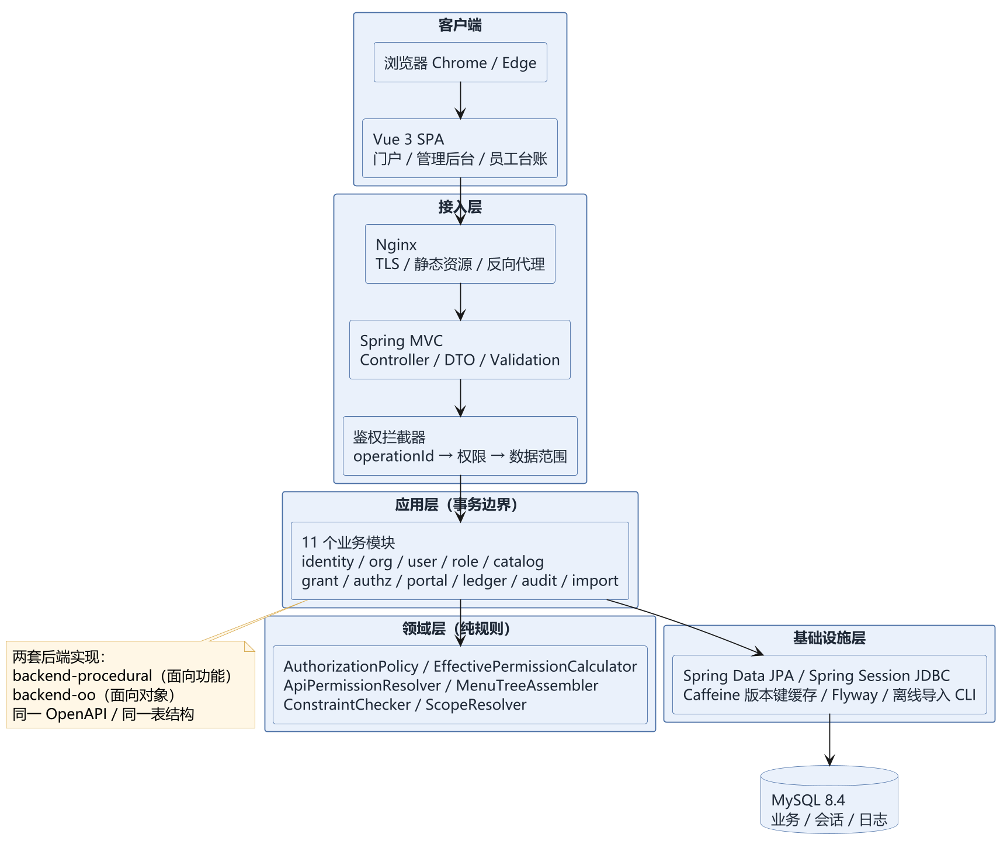

**图 2-1 系统总体结构图**

各部分的职责：

- **客户端**：Vue 3 单页应用，包含统一门户、业务系统占位页、员工台账和管理后台。前端只负责展示和交互，不把本地权限状态当作授权依据。
- **接入层**：Nginx 负责 TLS、静态资源、反向代理和统一的 `/api` 入口；Spring MVC 负责路由、DTO 校验、会话、异常转换和鉴权拦截。
- **应用层**：按用例编排事务，例如登录、切换应用、替换用户角色、替换角色授权、任命部门管理员、查询用户列表。事务边界在这一层。
- **领域层**：用户、部门、角色、权限、菜单/按钮资源、API 端点、继承、约束等核心概念；有效权限计算、范围合并、菜单树装配、API 权限解析、约束检查等领域服务。领域服务尽量写成纯函数，便于单元测试。
- **基础设施层**：Spring Data JPA 仓库、MySQL、Spring Session JDBC、Caffeine 本地缓存、Flyway 迁移、离线导入脚本、审计日志写入。
- **外部数据**：MySQL 业务库；课程原始 Excel 只在离线导入时读取，不进入运行时请求链路。

### 2.1.3 技术栈与分层职责

| 层 | 技术 | 职责 | 不允许做的事 |
| --- | --- | --- | --- |
| 客户端 | Vue 3、Vue Router、Element Plus、Vite | 页面、路由、菜单/按钮状态、API 客户端、错误提示 | 不以本地权限数组作为授权依据；不直接连接数据库 |
| 接入层 Web | Spring MVC、Bean Validation、Spring Security 会话、Springdoc | 路由、参数校验、会话、鉴权拦截、异常到 HTTP 状态码的转换 | 不写业务事务；不直接拼 SQL；不把实体直接序列化给前端 |
| 应用层 Application | Spring `@Service`、`@Transactional` | 用例编排、事务边界、跨模块协调、DTO/VO 转换 | 不包含 HTTP 细节；不直接操作 `EntityManager` |
| 领域层 Domain | 纯 Java 类、值对象、领域服务、仓库接口 | 权限模型、有效权限计算、范围合并、继承闭包、约束检查、菜单树、API 权限解析 | 不依赖 Web、不依赖具体数据库实现、不读环境变量 |
| 基础设施层 Infrastructure | Spring Data JPA、MySQL、Spring Session JDBC、Caffeine、Flyway | 实体映射、仓库实现、复杂查询、会话持久化、缓存、迁移、导入 | 不承载业务规则；不绕过应用服务直接改授权数据 |
| 外部 | MySQL 8.4、Nginx、Linux、Docker | 数据持久化、反向代理、运行环境 | 数据库不对公网开放 |

**DTO/VO 规则：** 请求 DTO 按 API/用例拆分，一个 DTO 只承载一个用例的输入；响应 VO 按页面/接口场景拆分；不把所有字段合并成一个 record，也不用实体直接序列化。

**JPA 使用规则：**

- 用户、部门、角色、权限、资源、API、授权关系、约束、日志都使用 JPA 实体映射；实体只映射表的主要字段，不在实体中写业务查询逻辑。
- 仓库接口放在领域层，实现放在基础设施层；简单查询用 Spring Data JPA 方法名或 `@Query`，复杂只读查询（递归部门子树、有效权限汇总、分页列表）用 JPA 原生查询或投影接口。
- 应用服务方法统一加 `@Transactional`；只读查询使用 `@Transactional(readOnly = true)`；整组替换、删除、任命等写操作使用默认事务传播。
- 不使用 JDBC 拼接 SQL 作为主要持久化方式；需要数据库特性时，仍在 JPA 仓库内用参数绑定的原生查询完成，不把 SQL 散落在 Service 中。

**事务边界：**

| 用例 | 事务范围 | 失败处理 |
| --- | --- | --- |
| 登录 | 校验账号、更新失败次数/锁定、写登录日志 | 登录失败也写日志；失败次数与锁定在同一事务 |
| 替换用户角色 | 校验权限/范围/版本/约束 → 删除旧关系 → 插入新关系 → 递增用户角色版本 → 递增全局授权版本 → 写审计 | 任一步失败全部回滚；旧版本返回 409，不部分写入 |
| 替换角色授权 | 校验权限/版本/查看权限 → 删除旧授权 → 插入新授权 → 递增角色授权版本 → 递增全局授权版本 → 写审计 | 同上 |
| 任命/撤销部门管理员 | 校验操作者是超级管理员 → 更新 `admin_type/admin_dept_id` → 分配/撤销 `DEPT_ADMIN` 角色 → 递增版本 → 写审计 | 两者必须同时成功或同时失败 |
| 删除用户 | 校验保护规则 → 删除用户角色 → 部门负责人置空 → 删除用户 → 写审计 | 外键和事务保证一致 |
| 迁移/导入 | 按批次事务；每批可重试；导入前后做有效权限快照对比 | 失败批次回滚；不破坏已提交批次；报告差异 |

### 2.1.4 关键架构决策

| 编号 | 决策 | 理由 | 影响的质量属性 | 对应需求 |
| --- | --- | --- | --- | --- |
| D1 | 采用分层 + 模块化单体，不拆微服务 | 规模、团队、课程周期和强一致要求匹配；降低分布式复杂度 | 可修改性、可部署性、可靠性 | NFR-MAINT-01/02、NFR-ENV-01 |
| D2 | 前后端分离，REST/JSON，OpenAPI 为唯一契约 | 前端可独立演进；两套后端可共享契约；接口可机器校验 | 可修改性、互操作性 | NFR-IMPL-01 |
| D3 | 权限 = 菜单或按钮；权限—API 多对多；默认拒绝 | 直接落实检查意见；前端展示与后端鉴权使用同一权限模型 | 安全、可审计性 | AUTHZ-01/02、CAT-01/03、GRANT-05 |
| D4 | 服务端会话 + 应用上下文（`appCode`） | 会话可立即失效；后端只返回当前应用权限；避免 JWT 无法即时撤销 | 安全、性能 | LOGIN-01/02/03、GRANT-05 |
| D5 | 部门管理员双标识：`admin_type=2` + `admin_dept_id` + `DEPT_ADMIN` 角色 | 用户表可识别；管理范围可查询；角色权限与行政边界分离，防止只改角色就绕过范围 | 安全、可维护性 | GRANT-03、USER-07、ROLE-03 |
| D6 | 持久化统一 Spring Data JPA；应用服务统一 `@Transactional`；整组替换用版本号 | 符合 Java 课程技术结构；事务边界清晰；并发冲突可检测 | 数据一致性、可维护性 | NFR-DATA-01/02、NFR-IMPL-01 |
| D7 | 鉴权读主库；权限缓存以 `authz_version` 为键；撤销必须失效 | 避免主从延迟导致撤权不生效；缓存命中降低重复计算 | 安全、性能 | NFR-PERF-01/02、GRANT-05 |
| D8 | 结构化输入分阶段生成：界面原型→目录→OpenAPI→代码；每阶段人工门禁 | 直接整改“需求文档直接生成 API/代码”的问题 | 可维护性、正确性 | NFR-MAINT-01、NFR-IMPL-01 |
| D9 | 两套后端同契约、同表结构、独立实现核心授权 | 满足课程两种范式要求；契约测试保证等价 | 可修改性、可测试性 | NFR-IMPL-01 |
| D10 | 单主 MySQL + Spring Session JDBC + 每日备份；可选只读副本和备库 | 课程规模下单主足够；会话可跨节点；备份满足可靠性 | 可用性、可靠性 | NFR-DATA-04、NFR-ENV-01 |

### 2.1.5 架构决策与检查意见的对应

| 检查意见 | 对应决策 | 说明 |
| --- | --- | --- |
| 权限要定义成菜单和按钮 | D3 | 权限实体直接指向菜单/按钮资源，不再用笼统的“功能” |
| 权限要归属应用 | D3、D4 | `app_application 1:N app_resource`；登录上下文绑定应用 |
| 权限与 API 要有关系 | D3 | `sys_permission_api` 多对多；`operationId` 稳定键 |
| 前后端都要控制 | D3、D4 | 前端权限树 + 后端拦截器；默认拒绝 |
| 部门管理员要可识别、有范围 | D5 | `admin_type=2`、`admin_dept_id`、子树查询 |
| 撤销要立即生效 | D4、D7 | 服务端会话 + 版本键缓存 + 主库读 |
| 用 Java 课上的技术结构 | D6 | JPA、事务、分层、模块 |
| API/代码不能由需求文档直接生成 | D8 | 界面原型/OpenAPI/数据库驱动，人工门禁 |

## 2.2 权限模型总体设计

本节是全文的核心。它把第一轮检查的整改要求落成可实现的模型；第 4 节的设计类图、第 6 节的 ER 和第 5 节的接口都以此为准。

### 2.2.1 权限的具象定义：菜单与按钮

**定义。** 在本系统中，权限不是抽象的“功能”，也不是角色的属性，而是**一个菜单或一个按钮**。角色被授予权限，就是被授予“看见某个菜单”或“使用某个按钮”的权利。

**菜单。** 菜单是应用内的导航节点，用 `parent_id` 自关联成树，最多三级：

- 一级菜单：模块分组，例如“人力资源管理”下的“员工管理”；
- 二级菜单：功能点页面，例如“员工台账管理”；
- 三级菜单：可选的页签或子页面，例如“员工台账管理 / 变更记录”。

菜单权限对应“查看/进入”。用户没有某个菜单的权限，就不能在导航中看到它；没有上级菜单的权限，下级菜单也不会返回；没有菜单权限，菜单页面内的按钮即使单独授权也不可用。这条规则在菜单树装配时统一执行，不能靠前端各自判断。

**按钮。**按钮挂在菜单下，是页面内的操作入口。原始清单的 6 种操作映射为：

| 操作 | 权限形态 | 说明 |
| --- | --- | --- |
| 查看 | 菜单权限 | 能进入该功能点页面，看到列表/详情 |
| 新增 | 按钮权限 | 页面内的“新增”按钮 |
| 编辑 | 按钮权限 | 页面内的“编辑”按钮 |
| 审批 | 按钮权限 | 页面内的“审批”按钮 |
| 导出 | 按钮权限 | 页面内的“导出”按钮 |
| 删除 | 按钮权限 | 页面内的“删除”按钮 |

因此，一个功能点产生 1 条菜单权限 + 5 条按钮权限 = 6 条权限；359 个功能点对应 359 条菜单权限 + 1,795 条按钮权限 = 2,154 条清单权限。这个数量与原始清单一致，不因为模型改造而丢失授权。

**权限码。** 权限码保持稳定，格式为 `应用码:资源码:动作`：

- 菜单权限：`hr:f046:read`；
- 按钮权限：`hr:f046:edit`、`hr:f046:create`、`hr:f046:approve`、`hr:f046:export`、`hr:f046:delete`；
- 管理后台：`rbac:user:read`、`rbac:user:update`、`rbac:role:grant` 等。

资源码使用功能点编号（如 `f046`），不随显示名称变化；应用码使用系统短码（如 `hr`）；动作码固定为 `read/create/edit/approve/export/delete`，新增操作时只增加数据，不改变已有权限码。

**模块节点与授权单元的区别。** 原始清单只在功能点层授权，模块只是分组。因此本设计把模块节点标记为 `grantable=0` 的导航节点：它参与菜单树和可见性计算，但不是独立授权单元；模块的可见性由其后代功能点权限推导。功能点菜单和按钮是 `grantable=1` 的授权单元。这样既保留“菜单三级层次”，又不虚构原始清单中不存在的 115 条模块授权。

**菜单树装配规则：**

1. 从当前应用的一级菜单开始，只保留用户有 `read` 权限的授权菜单，或至少有一个被授权后代的导航菜单。
2. 父菜单不在结果中时，整个子树不返回；不能出现“父菜单隐藏、子菜单仍可直达”的情况。
3. 对每个菜单，返回其按钮列表，但只包含用户有对应按钮权限的按钮；没有菜单权限时按钮列表为空。
4. 前端路由守卫再次检查目标路由对应的菜单权限；直接输入 URL 不能绕过。
5. 后端在每个菜单/按钮对应的 API 上再次检查权限；前端结果不是授权依据。

### 2.2.2 多应用归属与登录上下文

**应用与权限的关系。** 一个应用拥有多个菜单和按钮；一个菜单/按钮只属于一个应用。权限通过资源归属应用。ER 中体现为 `app_application 1:N app_resource 1:0..1 sys_permission`（模块导航节点不产生权限，可授权资源 1:1 产生权限）。

**登录必须指定应用。** 登录请求包含 `appCode`。后端认证成功后，只加载该应用下的权限树，不返回用户在其他应用的权限。这样做的原因：

- 减少一次登录返回的数据量；
- 避免用户在一个应用中看到其他应用的菜单；
- 便于按应用做审计和缓存；
- 直接落实检查意见“登录时要明确用户名、密码和登录的系统”。

**统一门户是特殊上下文。** `appCode=portal` 表示统一门户。门户不返回 18 个应用的全部菜单，只返回：

- 当前用户可访问的应用清单（由用户在哪些应用下拥有至少一条权限推导）；
- 门户自身的导航（我的权限、修改密码、退出）。

用户点击某个应用后，前端调用 `POST /auth/switch-app`，把会话的应用上下文切换到该应用；后端重新计算并返回该应用的菜单/按钮树。返回门户时再切回 `portal`。切换应用不需要重新输入密码，但必须重新校验账号状态和授权版本。

**会话内容。** 服务端会话保存：用户 ID、当前 `appCode`、激活角色集合、已见授权版本、首次改密标记。会话不保存“前端传来的权限列表”；权限每次从后端数据计算。会话 Cookie 为 `JSESSIONID`，`HttpOnly`、`SameSite=Lax`，HTTPS 下 `Secure`。

**为什么不用 JWT 承载权限。** JWT 一旦签发，在过期前无法即时撤销；本系统要求撤销权限下一次请求生效。服务端会话可以在每次请求重新检查，且可以用 Spring Session JDBC 持久化，满足重启和多节点需求。JWT 只适合无状态、可容忍延迟撤销的场景，不适合本系统的管理后台。

### 2.2.3 权限—API 映射与前后端双重控制

**问题。** 只控制前端菜单和按钮不够：用户登录后拿到会话 Cookie，可以把它拷到 Postman 或脚本里，直接请求后端 API。如果后端只按“用户有没有某个角色”粗粒度判断，或者根本不判断，就会越权。

**设计。** 建立“权限—API”多对多映射：

- `sys_api`：登记每个受保护 API 的稳定标识 `operationId`、HTTP 方法、路径模式、所属应用、鉴权模式（PUBLIC/SESSION/PERMISSION）、权限匹配模式（ANY/ALL）。
- `sys_permission_api`：把权限（菜单或按钮）映射到 API；一个菜单可以映射多个查询 API，一个按钮通常映射一个命令 API，一个 API 也可以被多个权限复用。
- 后端拦截器以 Controller 方法上的 `operationId` 为键，找到该 API 要求的权限集合，再与当前用户的有效权限比对。
- 未登记、未映射、映射为空的受保护 API，一律拒绝（默认拒绝）。
- 启动时校验：扫描所有受保护 Controller 方法，要求每个方法都有 `operationId` 且能在 `sys_api` 中找到；缺失则生产环境启动失败，测试环境契约测试失败。

**映射示例（概要级，不写 JSON）：**

| API 端点 | 权限要求 | 匹配模式 | 说明 |
| --- | --- | --- | --- |
| `GET /users` | `rbac:user:read` | ANY | 用户列表是菜单“用户管理”的查询 API；数据范围在查询中裁剪 |
| `GET /users/{id}` | `rbac:user:read` | ANY | 详情同样是查询 API |
| `PATCH /users/{id}` | `rbac:user:update` + `rbac:user:read` | ALL | 编辑按钮需要编辑权限，同时需要能看见该菜单 |
| `PUT /users/{id}/roles` | `rbac:user:assign-role` + `rbac:user:read` + `rbac:role:read` | ALL | 分配角色需要用户查看、角色查看和分配权限 |
| `GET /ledger/employees` | `hr:f046:read` | ANY | 员工台账菜单的查询 API；按查看范围裁剪 |
| `PATCH /ledger/employees/{id}` | `hr:f046:edit` + `hr:f046:read` | ALL | 编辑按钮；按编辑范围检查目标员工 |
| `POST /portal/placeholder-actions` | 请求中的 `permissionCode` | 特殊 | 17 个占位系统的按钮统一走受控占位端点；服务层校验指定权限，不产生业务数据 |

**前后端职责划分：**

| 控制点 | 前端 | 后端 |
| --- | --- | --- |
| 菜单是否显示 | 根据权限树过滤导航 | 菜单接口只返回授权菜单；直接访问无权路由返回 403 |
| 按钮是否可用 | 没有权限时置灰或隐藏 | 按钮对应 API 检查权限；无权返回 403 |
| 数据范围 | 展示范围标签，帮助用户理解 | 查询先按范围裁剪再分页；写入检查目标对象归属 |
| 会话与身份 | 携带 Cookie，不伪造用户 ID | 从会话取用户；忽略请求体中的用户/角色/权限字段 |
| 撤销权限 | 收到 403 后刷新权限树 | 每次请求按当前授权判断；下一次请求即拒绝 |
| 未知 API | 不调用 | 未登记/未映射默认拒绝 |

**为什么用 `operationId` 而不是解析 URL。** URL 可能含路径参数、版本前缀和通配符，解析容易出错；`operationId` 是 OpenAPI 的稳定标识，直接由 Controller 注解提供，能把“界面动作—权限—API—代码”串成一条可核对的链。路径和方法仍登记在 `sys_api` 中，用于文档、审计和重复检测，但不是权限匹配的主键。

### 2.2.4 部门管理员识别与管理边界

**为什么需要部门扩展。** 公司有 10,000 多名员工，超级管理员不可能逐一管理每个人的权限。把用户按部门组织，在每个部门设部门管理员，由他们管理本部门及下级部门的人员和业务角色，可以把管理人数降到一个可管理的范围。部门扩展的目的不是展示组织架构，也不是按员工属性做数据过滤，而是**分级授权管理**。

**用户表中的识别。** 用户表增加两个字段：

- `admin_type`：`0` 普通用户，`1` 超级管理员，`2` 部门管理员；
- `admin_dept_id`：部门管理员的管理范围根部门；普通用户和超级管理员为空。

约束：

- `admin_type=2` 时 `admin_dept_id` 必须非空；
- `admin_type≠2` 时 `admin_dept_id` 必须为空；
- 超级管理员只允许预置账号 `admin`，用唯一约束/保护规则保证只有一个；
- 部门管理员同时持有内置角色 `DEPT_ADMIN`；任命/撤销时两者在同一事务中更新，不能只改一边。

**为什么既要有 `admin_type` 又要有 `DEPT_ADMIN` 角色。** 两者职责不同：

- `admin_type/admin_dept_id` 是**行政边界**：决定“能管理哪些部门的人”；
- `DEPT_ADMIN` 角色是**功能权限**：决定“能调用哪些管理 API”；
- 只有角色没有边界，部门管理员可能管理全公司；只有边界没有角色，无法调用管理接口。两者同时校验，才能防止“给某人加一个带 `rbac:*` 的角色就绕过部门边界”的漏洞。

**管理范围。** 部门管理员的管理范围 = `admin_dept_id` 对应部门及其全部下级部门（递归 CTE）。在这个范围内：

| 操作 | 允许 | 不允许 |
| --- | --- | --- |
| 查看用户 | 本部门及下级部门用户 | 范围外用户；筛选参数指向范围外时返回空结果，不泄露 |
| 新增/编辑用户 | 范围内；迁入部门也必须在范围内 | 把用户迁到范围外 |
| 启停/重置密码/删除 | 范围内，且受账号保护规则约束 | 停用/删除自己；停用/删除唯一超级管理员 |
| 分配/撤销业务角色 | 范围内用户；只能授出非管理类角色 | 分配 `ADMIN`、`DEPT_ADMIN` 或任何带 `rbac:*` 的管理类角色 |
| 修改角色授权 | 不可以 | 任何角色授权修改 |
| 任命部门管理员 | 不可以 | 只有超级管理员可以 |
| 查看角色 | 可以查看角色列表和成员（按范围裁剪） | 不能修改角色本身 |

**管理类角色的判定。** 管理类角色 = 拥有任一 `rbac:*` 权限的角色。这个判定由查询实时计算（`EXISTS` 子查询），不在角色表加一个容易过期的人工标记。这样新增一个带管理权限的角色时，部门管理员不能把它授出，不会因为忘记打标记而绕过限制。

**任命流程。** 超级管理员在用户详情页选择“任命为部门管理员”，选择管理根部门；后端在一个事务中：校验操作者是超级管理员 → 校验目标用户存在且启用 → 设置 `admin_type=2`、`admin_dept_id` → 分配 `DEPT_ADMIN` 角色 → 递增授权版本 → 写审计日志。撤销时反向操作，并清除该用户的部门管理员身份。部门管理员不能任命其他部门管理员。

### 2.2.5 授权变更的生效策略

**目标。** 撤销必须立即生效；新增可以允许前端稍后刷新。最坏情况下，宁可让用户暂时看不到本来有权限的菜单，也不能让已撤销权限的人继续操作。

**机制。**

1. **版本号。** 每次授权变更（用户角色替换、角色授权替换、角色继承修改、约束修改、角色启停、部门管理员任命/撤销）在同一事务中递增 `sys_authz_version.version`。
2. **每请求校验。** 每个受保护请求开始时读取当前版本（主库单行查询，可缓存不超过 1 秒）；如果会话记录的版本不同，重新计算有效权限。
3. **缓存键含版本。** 有效权限缓存键为 `userId + appCode + authzVersion`；版本变化后旧键自然不再命中，不需要逐用户清理。
4. **主库读。** 鉴权相关读一律走主库，不走只读副本，避免复制延迟导致撤权延迟。
5. **前端刷新。** 前端在每次路由切换时刷新菜单；收到 403 时强制刷新权限树并提示“权限已变更”。前端允许在新增权限时滞后一个刷新周期，但撤销在后端下一次请求即生效。
6. **审计。** 授权变更写 `sys_grant_log`，记录操作人、时间、目标、动作和变更摘要；日志只增不改。

**为什么不用“删缓存”作为唯一手段。** 多节点部署时，逐节点删缓存容易漏；版本键让所有节点自然失效，且不需要广播。缓存 TTL 只作为兜底，不作为撤权生效的依据。

## 2.3 架构故事

本节选取 5 个核心质量属性场景，覆盖性能、安全、可用性和可修改性。每个故事按 ATAM 六要素描述：刺激源、刺激、环境、制品、响应、响应度量，并标注对应需求编号。故事不是用例复述，而是从质量属性维度描述“什么刺激、系统如何响应、如何度量”。

### 2.3.1 故事 S1（性能）：年终权限核查时的用户列表与鉴权

| 要素 | 内容 |
| --- | --- |
| 刺激源 | 200 名管理员和部门管理员 |
| 刺激 | 在年终权限核查时同时打开用户列表、按部门筛选、翻页，并对每个操作触发权限校验 |
| 环境 | 正常工作日的峰值时段；10,000 名员工、2,154 条权限、3,555 条角色授权；单主 MySQL |
| 制品 | 用户管理模块、鉴权模块、MySQL、权限缓存 |
| 响应 | 服务端先按管理范围裁剪，再筛选、计数、分页；用户列表使用覆盖索引和投影查询；鉴权使用带版本键的缓存，缓存未命中时查主库 |
| 响应度量 | 95% 的用户列表请求 ≤1 秒；单次鉴权查询 ≤10 毫秒；错误率 <0.1%；无重复或越界数据 |
| 对应需求 | NFR-PERF-01、NFR-PERF-02、USER-01、AUTHZ-01 |

**叙事。** 年终核查时，管理员会频繁切换部门、翻页和打开用户详情。如果每次请求都从 10,000 行用户表中做全表扫描，再在内存中过滤范围，响应会超过 1 秒。设计把“管理范围裁剪”下推到 SQL：部门管理员的范围是一个递归子树，先用递归 CTE 得到部门 ID 集合，再与用户表连接；分页在数据库完成；列表只投影必要字段。鉴权部分把有效权限按 `userId + appCode + authzVersion` 缓存；版本未变时命中缓存，版本变化时重新计算。缓存未命中不能返回空权限（那会导致误拒绝），必须回源主库。

### 2.3.2 故事 S2（安全）：撤销角色后下一次请求立即被拒绝

| 要素 | 内容 |
| --- | --- |
| 刺激源 | 超级管理员 |
| 刺激 | 撤销某用户的“用户管理”角色，该用户保持登录并立即尝试调用删除用户 API |
| 环境 | 用户已有有效会话；撤销事务已提交；用户在 1 秒内发起请求 |
| 制品 | 授权模块、鉴权拦截器、会话、审计日志、MySQL |
| 响应 | 撤销事务递增 `authz_version`；用户下一次请求读取新版本，重新计算有效权限；删除用户 API 要求 `rbac:user:delete`，用户已无此权限，返回 403；数据不变；前端收到 403 后刷新菜单 |
| 响应度量 | 撤销后下一次请求 403；目标数据零变化；审计日志记录撤销和拒绝；无需用户重新登录 |
| 对应需求 | GRANT-05、AUTHZ-01、AUTHZ-02、LOG-02 |

**叙事。** 这是第一轮检查特别强调的最小权限场景。用户可能把会话 Cookie 复制到 Postman，所以不能依赖前端隐藏按钮。后端在每次请求都重新取当前授权版本；撤销提交后，版本变化，旧缓存键失效，删除 API 的权限检查失败。即使请求在撤销事务提交前已经开始，它也只会看到旧权限；提交后的下一次请求一定看到新权限。系统接受“正在执行的请求可能完成”的边界，但不接受“撤销后新请求继续成功”。

### 2.3.3 故事 S3（安全）：部门管理员越界分配角色被拒绝

| 要素 | 内容 |
| --- | --- |
| 刺激源 | 部门管理员 |
| 刺激 | 尝试给管理范围外的用户分配角色，或给范围内用户分配 `DEPT_ADMIN` 管理类角色 |
| 环境 | 部门管理员已登录；目标用户在另一个分公司；或目标角色带 `rbac:*` 权限 |
| 制品 | 授权模块、组织范围服务、鉴权模块、MySQL |
| 响应 | 授权模块先校验操作者 `admin_type=2` 和 `admin_dept_id`；用递归 CTE 判断目标用户是否在子树内；再判断目标角色是否为管理类角色；任一不满足返回 403 `OUT_OF_SCOPE` 或 `FORBIDDEN`；事务不写入任何行 |
| 响应度量 | 越界请求 403；目标用户角色集合零变化；审计日志记录拒绝原因；不返回范围外用户的任何字段 |
| 对应需求 | GRANT-03、USER-01、USER-07、AUTHZ-03 |

**叙事。** 部门管理员的分级管理是系统能管理 10,000 名员工的关键，也是最容易越权的地方。设计把“管理范围”和“数据范围”分开：管理范围由 `admin_dept_id` 子树决定，数据范围由角色权限的 `data_scope` 决定。两者都检查，不能用一个代替另一个。部门管理员即使拥有 `rbac:user:assign-role`，也只能在子树内授出业务角色；管理类角色由 `rbac:*` 权限实时判定，不能靠角色名称或人工标记绕过。

### 2.3.4 故事 S4（可靠性）：数据库重启后数据不丢失、服务恢复

| 要素 | 内容 |
| --- | --- |
| 刺激源 | 运维人员/基础设施故障 |
| 刺激 | MySQL 主库重启或发生故障切换；应用节点重启 |
| 环境 | 生产部署；已有提交的授权和用户数据；部分用户在线 |
| 制品 | 应用节点、MySQL 主库/备库、Spring Session JDBC、备份存储、健康检查 |
| 响应 | 应用健康检查失败时 Nginx 摘除节点；数据库恢复或备库提升后应用重连；已提交事务由 InnoDB 和 binlog 保证不丢失；会话表在 MySQL 中，重启后会话可恢复；未恢复期间请求返回 503，不返回错误数据 |
| 响应度量 | RTO ≤5 分钟（课程部署可放宽到 30 分钟）；RPO ≤15 分钟；已提交数据零丢失；恢复后登录和授权检查正常 |
| 对应需求 | NFR-DATA-04、NFR-ENV-01、LOGIN-02、GRANT-05 |

**叙事。** 课程部署可以是单机 Docker Compose，但设计不能假设“数据库永远不重启”。应用节点无状态化（会话在 MySQL），数据库有每日全量备份和 binlog；恢复后 Flyway 校验迁移版本，应用健康检查通过才接流量。单机部署的 RTO 可以放宽，但“已提交数据不丢”不能放宽。备份恢复要定期演练，不能只写在文档里。

### 2.3.5 故事 S5（可修改性）：新增一个按钮和 API 不改表结构

| 要素 | 内容 |
| --- | --- |
| 刺激源 | 开发人员/业务管理员 |
| 刺激 | 在“员工台账管理”页面新增“打印”按钮，并增加对应的后端 API |
| 环境 | 正常运行；已有 OpenAPI、JPA 实体和测试基线 |
| 制品 | 目录模块、鉴权模块、OpenAPI、JPA 代码、测试 |
| 响应 | 在 `app_resource` 增加一个按钮资源（数据），在 `sys_permission` 增加一条权限（数据），在 `sys_api` 登记新 API（数据），在 `sys_permission_api` 建立映射（数据）；Controller 加 `operationId`；前端加按钮并按权限码控制；不需要改表结构，不需要改鉴权核心 |
| 响应度量 | ≤2 人日完成；无数据库结构迁移；OpenAPI 校验通过；两套后端契约测试通过；无权用户调用新 API 返回 403 |
| 对应需求 | NFR-MAINT-01、NFR-IMPL-01、CAT-01、AUTHZ-01 |

**叙事。** 第一轮检查指出“新增一种操作应只加数据，不改表结构”。本设计把菜单、按钮、权限、API 和映射都做成数据；鉴权核心只认权限码和 `operationId`，不认具体业务名称。新增按钮的代价是配置和测试，不是改表。两套后端都要实现新 API，但共享同一 OpenAPI 和契约测试，避免一边实现一边遗漏。

## 2.4 轻量级 ATAM 评估

本节按“设计 → 讲故事 → 建效用树 → 分析 → 给改进建议”的顺序进行，评估对象是 2.1 和 2.2 已提出的架构方案，不先写结论再补设计。

### 2.4.1 质量属性效用树

效用树如图 2-2 所示，叶节点对应 2.3 的故事或故事中的具体场景；重要性（H/M/L）表示对系统成功的贡献，实现难度（H/M/L）表示当前团队和周期的实现成本。

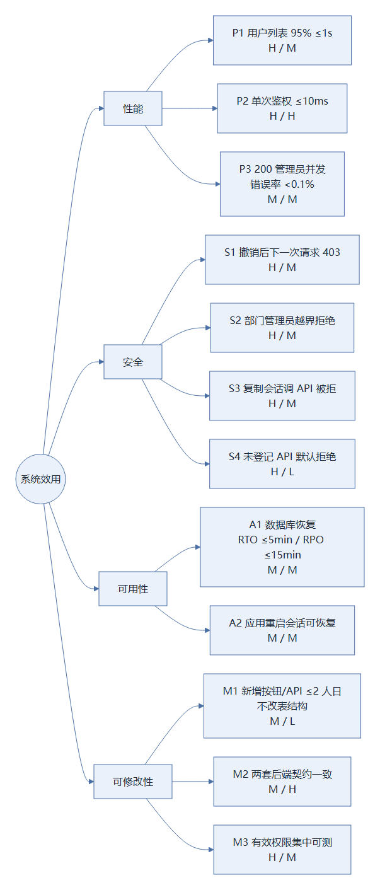

**图 2-2 质量属性效用树**

| 叶节点 | 质量属性 | 场景 | 对应故事 | 重要性 | 实现难度 |
| --- | --- | --- | --- | --- | --- |
| P1 | 性能 | 10,000 员工下用户列表 95% ≤1 秒 | S1 | H | M |
| P2 | 性能 | 单次鉴权查询 ≤10 毫秒 | S1 | H | H |
| P3 | 性能 | 高峰 200 管理员并发，错误率 <0.1% | S1 | M | M |
| S1 | 安全 | 撤销角色后下一次请求 403 | S2 | H | M |
| S2 | 安全 | 部门管理员越界分配被拒绝 | S3 | H | M |
| S3 | 安全 | 会话被复制到 Postman 后越权 API 被拒绝 | S2 | H | M |
| S4 | 安全 | API 未登记/未映射默认拒绝 | S2 | H | L |
| A1 | 可用性 | MySQL 重启/切换后 RTO ≤5 分钟、RPO ≤15 分钟 | S4 | M | M |
| A2 | 可用性 | 应用节点重启后会话可恢复 | S4 | M | M |
| M1 | 可修改性 | 新增按钮/API ≤2 人日、不改表结构 | S5 | M | L |
| M2 | 可修改性 | 两套后端同 OpenAPI 契约测试一致 | S5 | M | H |
| M3 | 可维护性 | 有效权限计算集中、可单元测试 | S2/S5 | H | M |

### 2.4.2 架构方法识别与分析

针对效用树中高优先级（H）场景，说明现有架构采用了什么方法、效果如何、还剩什么风险。

| 叶节点 | 架构方法 | 效果 | 残余风险 |
| --- | --- | --- | --- |
| P1 | 范围下推 + 服务端分页 + 覆盖索引 + DTO 投影 | 避免全表扫描和内存分页；列表只取必要列；范围裁剪在 SQL 完成 | 深翻页仍然较慢；部门树很深时递归 CTE 成本上升 |
| P2 | `authz_version` 键缓存 + 主库单行版本查询 + 有效权限投影 | 缓存命中时避免重复计算；版本查询走主键，成本低 | 缓存冷启动；权限变更瞬间的并发请求可能多算一次 |
| S1 | 服务端会话 + 每请求校验 + 版本递增 + 主库读 | 撤销后下一次请求按新版本判断；不依赖前端 | 已开始执行的请求可能完成；需要在业务上接受这个边界 |
| S2 | `admin_type/admin_dept_id` + 递归子树 + 管理类角色实时判定 + 事务 | 行政边界和功能权限双重校验；越界零写入 | 部门树调整后需要重新计算；`admin_dept_id` 指向的部门被移动时要校验 |
| S3 | `operationId` + `sys_permission_api` + 默认拒绝 + 启动校验 | 直接调 API 也要过权限检查；未登记端点拒绝 | 人工映射可能漏；需要契约测试和启动校验兜底 |
| S4 | 未登记/未映射拒绝；API 权限模式 ANY/ALL | 缺口默认关闭，不会因为忘记配置而放行 | 合法 API 忘记映射会被误拒绝，需要监控 403 异常 |
| M1 | 目录数据驱动 + 不改表结构 + 统一权限码 | 新增按钮是配置和测试工作，不是模型改造 | 需要维护目录和映射数据；需要防止重复权限码 |
| M2 | OpenAPI + 同一表结构 + 两套独立实现 + 契约测试 | 两套后端行为可对比；接口变更同步 | 两套实现可能长期漂移；需要 CI 同时跑契约测试 |
| M3 | 领域服务纯函数 + 集中授权入口 + 单元测试 | 有效权限、范围合并、继承、约束可独立测试 | 领域服务与数据库视图可能不一致，需要一致性校验 |

### 2.4.3 评估发现

#### 2.4.3.1 风险点

风险点按“决策 + 论证 + 质量影响”描述，不写“可能性能不足”这类没有论证的结论。

| 编号 | 风险点（决策 + 论证 + 质量影响） | 可能性 | 影响 | 缓解措施 |
| --- | --- | --- | --- | --- |
| R-01 | **决策**：权限—API 映射由人工在 `sys_permission_api` 中维护。**论证**：新增 API 或调整 Controller 时，开发人员可能忘记登记或映射，导致端点未受保护或合法请求被误拒。**质量影响**：削弱安全性（未映射端点若被默认放行）和可用性（合法请求 403）。 | 中 | 高 | 启动时扫描 Controller 与 `sys_api` 对比；CI 契约测试覆盖每个端点；未登记默认拒绝；403 监控告警 |
| R-02 | **决策**：每次请求按当前版本计算有效权限，缓存未命中时回源主库。**论证**：在 200 管理员并发、缓存冷启动或版本频繁变化时，主库会承受集中查询；角色继承和约束计算会增加 CPU。**质量影响**：削弱响应时间达标能力（NFR-PERF-01/02）。 | 中 | 中 | 版本键缓存；索引优化；必要时加只读副本做报表，但鉴权仍读主库；压测后调 TTL |
| R-03 | **决策**：单主 MySQL 承载业务数据和会话。**论证**：主库故障时，所有鉴权和写入不可用；单机部署没有自动切换。**质量影响**：削弱可用性（A1）和可靠性（NFR-DATA-04）。 | 中 | 高 | 每日全量 + binlog；可选备库；健康检查和快速恢复演练；课程部署明确 RTO 放宽 |
| R-04 | **决策**：前端在 Pinia 中缓存权限树，路由切换时刷新。**论证**：撤销权限后，用户当前页面仍可能显示旧按钮；直到下一次路由切换或 403 才刷新。**质量影响**：削弱安全体验（用户可能误以为仍有权限），但不削弱后端安全。 | 高 | 低 | 后端每次请求拒绝；收到 403 强制刷新；短 TTL；敏感操作前刷新 |
| R-05 | **决策**：部门管理范围用递归 CTE 实时查询。**论证**：部门树有 111 个节点，层级不深，当前成本可控；但如果部门树变深或查询频繁，递归 CTE 会成为热点。**质量影响**：削弱列表响应时间（P1）和部门管理员操作体验。 | 低 | 中 | 部门子树结果缓存；必要时增加闭包表；限制树深度 |
| R-06 | **决策**：领域服务计算有效权限，数据库视图 `v_user_permission` 仅用于核对。**论证**：两套实现可能对“范围合并、停用角色、继承断链”的处理不一致，导致核对结果与鉴权结果不同。**质量影响**：削弱可维护性和可审计性，极端情况下导致误判。 | 中 | 中 | 领域服务为唯一授权来源；视图只做报表；一致性测试比对两者；文档明确口径 |
| R-07 | **决策**：两套后端独立实现核心授权逻辑。**论证**：面向功能和面向对象的代码结构不同，容易出现一边修复、另一边遗漏。**质量影响**：削弱可修改性和契约一致性（M2）。 | 中 | 中 | 同一 OpenAPI；同一契约测试套件；CI 对两套后端都跑；共享测试数据 |
| R-08 | **决策**：菜单/按钮/权限/API 映射作为数据维护。**论证**：数据可能重复、缺失或与界面不一致；权限码一旦变化会使已有授权失效。**质量影响**：削弱安全性和可维护性。 | 中 | 中 | 权限码稳定规则；唯一约束；目录导入校验；界面原型与目录逐项核对 |

#### 2.4.3.2 非风险点

| 编号 | 非风险点 | 对质量属性的正面影响 |
| --- | --- | --- |
| N-01 | 后端默认拒绝，未登记/未映射 API 不放行 | 安全：缺口默认关闭，避免“忘记配置=放行” |
| N-02 | 服务端会话，不信任前端权限 | 安全：复制 Cookie 也不能绕过权限检查 |
| N-03 | 整组替换 + 版本号 + `@Transactional` | 数据一致性：不会出现“加了一半、撤了一半” |
| N-04 | 部门管理员双标识（行政边界 + 功能角色） | 安全：只改角色或只改边界都不能越权 |
| N-05 | 权限码稳定，不随显示名称变化 | 可维护性：改名不影响已有授权 |
| N-06 | Spring Session JDBC 持久化会话 | 可用性：应用重启后会话可恢复 |
| N-07 | 菜单/按钮/API 数据驱动 | 可修改性：新增操作主要是配置，不改表 |
| N-08 | 有效权限计算集中在领域服务 | 可维护性：规则一处修改，所有接口一致 |

#### 2.4.3.3 敏感点

敏感点是对某个质量属性影响显著的决策；改动它可能显著改善或恶化质量属性。

| 编号 | 敏感点 | 影响的质量属性 | 说明 |
| --- | --- | --- | --- |
| SP-01 | `sys_permission_api` 映射的正确性和完整性 | 安全 | 多一条映射可能放行越权 API，少一条映射可能误拒合法请求 |
| SP-02 | `sys_authz_version` 的递增时机 | 安全、性能 | 漏递增会导致撤权不生效；过度递增会导致缓存频繁失效 |
| SP-03 | `admin_dept_id` 子树查询和部门移动 | 安全、性能 | 范围算错会越权；递归查询成本影响列表响应 |
| SP-04 | 有效权限缓存的 TTL 和键设计 | 安全、性能 | TTL 太长会延迟撤权；太短会增加主库压力 |
| SP-05 | JPA 查询的抓取策略和分页方式 | 性能 | N+1 查询或内存分页会拖慢列表 |
| SP-06 | 角色继承闭包的计算方式 | 性能、正确性 | 多父 DAG 的闭包计算错误会导致权限多算或少算 |
| SP-07 | 会话存储位置（内存 vs MySQL） | 可用性、性能 | 内存会话重启丢失；MySQL 会话增加一次读写 |

#### 2.4.3.4 权衡点

权衡点同时影响多个质量属性，需要折中。

| 编号 | 权衡点 | 选择 | 受益 | 代价 |
| --- | --- | --- | --- | --- |
| TP-01 | 权限缓存 vs 撤销立即生效 | 版本键缓存 + 短 TTL + 主库版本读 | 性能提升，撤销仍及时 | 实现复杂度增加；每次请求多一次版本查询 |
| TP-02 | 模块化单体 vs 微服务 | 模块化单体 | 部署简单、事务强一致、团队成本低 | 不能按模块独立扩缩容；单进程故障影响全部模块 |
| TP-03 | JPA vs 手写 JDBC | JPA 为主，复杂查询用 JPA 原生查询 | 符合课程要求、事务和映射清晰、可移植 | 复杂 SQL 调优不如手写灵活；需要防止 N+1 |
| TP-04 | 规范化目录 vs 冗余权限码 | 规范化资源/权限/映射，权限码稳定冗余在权限表 | 数据一致、可追溯 | 连接查询多；需要索引和投影优化 |
| TP-05 | 服务端会话 vs JWT | 服务端会话 + Spring Session JDBC | 可即时撤销、可审计 | 需要共享会话存储；每次请求有会话读 |
| TP-06 | 领域服务 vs 数据库视图鉴权 | 领域服务为唯一授权来源，视图做核对 | 可测试、可表达复杂规则 | 两套实现需要一致性校验 |
| TP-07 | 管理范围实时递归 vs 闭包表 | 当前用递归 CTE，规模增长再引入闭包表 | 实现简单、无冗余 | 深树查询成本较高 |

### 2.4.4 评估结论与改进

**结论。** 当前架构能满足高优先级场景：菜单/按钮权限与应用、API 的映射直接落实检查意见；服务端会话、默认拒绝和版本键缓存保证撤销及时；部门管理员双标识防止分级管理越权；JPA + 事务保证整组替换的一致性；模块化单体在课程规模下是合理选择。主要残余风险是“人工映射可能漏”“单主 MySQL 可用性”“两套后端可能漂移”，需要通过工程门禁和运维措施控制。

**改进建议：**

| 编号 | 改进建议 | 针对风险 | 是否已反映在设计中 | 落地阶段 |
| --- | --- | --- | --- | --- |
| I-01 | 启动时扫描所有受保护 Controller 方法，与 `sys_api` 对比；缺失 `operationId` 或映射时生产环境启动失败；CI 增加“每个端点都有契约测试”的检查 | R-01、SP-01 | 已反映：2.2.3、5.2、8.2 | 阶段一/二 |
| I-02 | 有效权限缓存键必须包含 `authz_version`；授权变更必须在同一事务递增版本；鉴权读主库；增加缓存命中率和 403 异常监控 | R-02、SP-02、SP-04、TP-01 | 已反映：2.2.5、6.3.3、8.1 | 阶段一/三 |
| I-03 | 部署增加 MySQL 备库或至少每日全量 + binlog，定期做恢复演练；应用节点无状态化，会话放 Spring Session JDBC | R-03、SP-07、TP-05 | 已反映：7.2、7.4、8.3 | 阶段三/部署 |
| I-04 | 两套后端共用同一套契约测试和测试数据；CI 同时跑两套；接口变更必须同时更新 OpenAPI 和两边测试 | R-07、M2 | 已反映：2.1.4、8.4 | 阶段二起 |
| I-05 | 部门树深度和角色继承深度设上限；当部门数或角色数显著增长时引入闭包表；对递归查询做 EXPLAIN 和压测 | R-05、SP-03、SP-06、TP-07 | 部分反映：6.3.4 预留扩展；当前不引入闭包表 | 阶段三/后续 |

改进建议 1~3 是验收前必须完成的；4 是阶段二起的持续要求；5 是条件触发，不作为当前验收阻塞项。
# 3 模块设计与逻辑架构

## 3.1 包图/组件图与分层划分

系统采用“分层 + 按业务模块纵向切分”的包结构。图 3-1 展示逻辑分层和模块归属：上层依赖下层，领域层不依赖 Web 和基础设施实现；模块之间通过应用服务或领域端口调用，不跨模块直接访问对方的表。

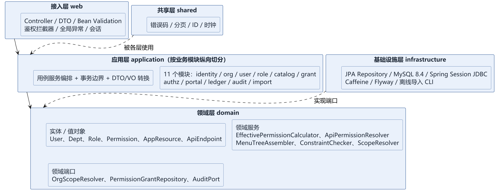

**图 3-1 系统包图/组件图**

### 3.1.1 分层划分

| 层 | 包名（逻辑） | 主要内容 | 依赖规则 |
| --- | --- | --- | --- |
| 接入层 | `web` | Controller、请求 DTO、参数校验、会话、鉴权拦截器、全局异常处理、OpenAPI 注解 | 只能依赖应用层；不直接依赖仓库实现 |
| 应用层 | `application` | 用例服务、事务边界、跨模块编排、DTO/VO 转换、审计事件发布 | 依赖领域层和领域端口；不包含 HTTP 细节 |
| 领域层 | `domain` | 实体、值对象、领域服务、仓库接口、领域异常 | 不依赖 Web；不依赖具体数据库；不读环境变量 |
| 基础设施层 | `infrastructure` | JPA 仓库实现、MySQL 查询、Spring Session JDBC、Caffeine 缓存、Flyway、导入脚本 | 实现领域端口；不承载业务规则 |
| 共享层 | `shared` | 错误码、分页、ID、时钟、通用校验 | 不依赖任何业务模块 |

### 3.1.2 业务模块

| 模块 | 包名（逻辑） | 主要子包 | 说明 |
| --- | --- | --- | --- |
| 认证与会话 | `identity` | `web/application/domain/infrastructure` | 登录、退出、改密、应用切换、会话、登录日志 |
| 组织与部门 | `org` | 同上 | 部门树、负责人、部门管理员任命、子树范围 |
| 用户管理 | `user` | 同上 | 用户查询、新增、编辑、启停、重置密码、删除、保护规则 |
| 角色管理 | `role` | 同上 | 角色增删改、启停、继承、约束、有效权限 |
| 权限目录 | `catalog` | 同上 | 应用、菜单、按钮、权限、API 登记、权限—API 映射 |
| 授权 | `grant` | 同上 | 用户角色、角色权限、数据范围、整组替换、版本冲突 |
| 鉴权 | `authz` | 同上 | 有效权限计算、继承闭包、范围合并、API 权限解析、菜单树、决策缓存 |
| 门户 | `portal` | 同上 | 门户应用清单、菜单、占位页、我的权限 |
| 员工台账 | `ledger` | 同上 | 员工列表、电话/邮箱编辑、真实数据范围示例 |
| 审计 | `audit` | 同上 | 登录日志、授权变更日志、查询和导出 |
| 数据导入 | `import` | 同上 | 离线 Excel 导入、清洗、幂等、核对报告 |

### 3.1.3 模块依赖规则

1. **单向依赖。** Web → Application → Domain；Infrastructure 实现 Domain 定义的端口；Domain 不反向依赖任何外层。
2. **业务模块之间不直接访问对方的表。** 需要读取其他模块的数据时，通过对方提供的应用服务或领域查询端口；鉴权模块通过只读端口读取角色、授权、目录和部门范围，不修改这些数据。
3. **无循环依赖。** 依赖方向为：`authz` 不依赖 `grant/role/catalog` 的具体实现；`grant/role/catalog` 在需要校验时调用 `authz` 的领域接口；`portal` 依赖 `authz` 和 `catalog`；`ledger` 依赖 `authz`；`audit` 只被其他模块通过 `AuditPort` 调用，不反向依赖业务模块。
4. **事务只在应用层。** 跨模块写操作由发起方应用服务开启事务，通过领域端口调用其他模块；被调用方不自行提交事务。
5. **共享层最小化。** `shared` 只放无业务含义的工具和错误码；不把业务实体放进去，避免变成“什么都依赖”的垃圾桶。

## 3.2 模块职责与功能分配

| 模块 | 职责 | 核心输入 | 核心输出 | 对应需求 |
| --- | --- | --- | --- | --- |
| 认证与会话 `identity` | 工号/手机号登录、统一失败提示、会话建立与失效、首次改密、密码修改、登录失败锁定、应用切换、登录日志 | 登录凭据、`appCode`、旧/新密码 | 会话、当前应用、权限树摘要、登录结果、登录日志 | LOGIN-01 ~ LOGIN-07、LOG-01 |
| 组织与部门 `org` | 部门树查询、负责人、部门成员、部门管理员任命/撤销、管理范围子树计算 | 部门 ID、用户 ID、任命请求 | 部门树、成员列表、管理范围判定、任命结果 | DEPT-01 ~ DEPT-02、GRANT-03、USER-03 |
| 用户管理 `user` | 用户列表（范围裁剪、分页、筛选）、新增、编辑、启停、重置密码、删除、账号保护 | 筛选条件、用户表单、目标用户 ID | 用户视图、分页结果、操作结果、保护规则拒绝 | USER-01 ~ USER-07、PORTAL-04 ~ PORTAL-05 |
| 角色管理 `role` | 角色增删改、启停、内置角色保护、角色成员、继承关系、约束、有效权限查看 | 角色表单、继承关系、约束参数 | 角色视图、成员列表、有效权限及来源、约束校验结果 | ROLE-01 ~ ROLE-15 |
| 权限目录 `catalog` | 应用、菜单、按钮、权限目录查询；API 登记；权限—API 映射维护；目录完整性校验 | 目录筛选、API 登记、映射请求 | 应用/菜单/按钮树、权限列表、API 列表、映射结果、校验报告 | CAT-01 ~ CAT-03、AUTHZ-01 ~ AUTHZ-02 |
| 授权 `grant` | 用户角色整组替换、角色权限整组替换、数据范围、版本冲突、部门管理员可授出范围、约束校验 | 目标集合、版本号、目标用户/角色 | 已保存集合、新版本、冲突/拒绝原因、授权变更日志 | GRANT-01 ~ GRANT-06、ROLE-10 ~ ROLE-14 |
| 鉴权 `authz` | 有效权限计算、角色继承闭包、停用角色断链、范围合并、API 权限解析、菜单树装配、决策缓存 | 用户 ID、`appCode`、`operationId`、目标对象 | 允许/拒绝、有效权限、范围、菜单树、拒绝原因 | AUTHZ-01 ~ AUTHZ-05、GRANT-04 ~ GRANT-05、PORTAL-01/03 |
| 门户 `portal` | 门户应用清单、菜单、占位页、我的权限、应用切换入口 | 当前用户、`appCode`、菜单码 | 应用清单、菜单树、占位页状态、我的权限 | PORTAL-01 ~ PORTAL-03、PORTAL-06 |
| 员工台账 `ledger` | 员工列表、按查看范围查询、电话/邮箱编辑、按编辑范围检查；真实业务示例 | 筛选、目标员工 ID、电话/邮箱 | 员工列表、更新结果、范围拒绝 | PORTAL-04 ~ PORTAL-05 |
| 审计 `audit` | 登录日志、授权变更日志、按时间/操作人筛选、导出；只增不改 | 审计事件、筛选条件 | 日志列表、导出文件、审计回执 | LOG-01 ~ LOG-03 |
| 数据导入 `import` | 读取原始 Excel、清洗、生成部门/用户/目录/授权、幂等、核对报告、有效权限快照 | 原始 Excel、初始密码参数、映射配置 | 初始数据、导入报告、差异报告、回滚说明 | IMPORT-01 ~ IMPORT-06、ROLE-09 |

**模块与需求组的对应关系：**

- 登录、会话、锁定：`identity`；
- 门户、菜单、占位页、我的权限：`portal` + `authz`；
- 用户、部门、角色、授权：`user`、`org`、`role`、`grant`；
- 权限目录、API 映射：`catalog`；
- 鉴权、有效权限、数据范围：`authz`；
- 台账真实业务：`ledger`；
- 日志：`audit`；
- 导入：`import`。

## 3.3 模块间接口契约（概要级）

本节只列接口名称、功能、核心输入/输出大类和协议；不写代码级函数签名，不贴 JSON 样例。完整 REST 定义见第 5.2 节和 OpenAPI。

| 接口 | 提供模块 | 使用模块 | 功能 | 核心输入大类 | 核心输出大类 | 协议 |
| --- | --- | --- | --- | --- | --- | --- |
| `AuthFacade` | identity | web、portal | 登录、退出、应用切换、会话校验 | 登录凭据、`appCode`、会话标识 | 会话、当前应用、权限摘要、失败原因 | REST/JSON + 进程内 |
| `PasswordCommand` | identity | web | 修改本人密码、重置他人密码 | 旧密码、新密码、目标用户 | 成功/失败、须改密标记 | REST/JSON |
| `AuthorizationPolicy` | authz | web、ledger、portal、grant | 对一次操作做最终允许/拒绝判定 | 主体、`operationId`、目标对象、`appCode` | 允许/拒绝、拒绝原因、所需范围 | 进程内 Java 接口 |
| `EffectivePermissionQuery` | authz | portal、identity、grant | 计算用户在某应用的有效权限及来源 | 用户 ID、`appCode`、授权版本 | 权限码集合、范围、来源角色 | 进程内 Java 接口 |
| `MenuTreeQuery` | authz / catalog | portal | 装配当前用户在某应用的菜单/按钮树 | 用户 ID、`appCode` | 菜单树、按钮状态、范围标签 | 进程内 Java 接口 |
| `OrgScopeQuery` | org | authz、grant、user | 判断部门子树、用户是否在管理范围 | 用户 ID、部门 ID、目标用户 ID | 布尔值、部门 ID 集合 | 进程内 Java 接口 |
| `CatalogQuery` | catalog | authz、grant、portal | 查询应用、菜单、按钮、权限、API 映射 | 应用 ID、权限码、`operationId` | 目录树、权限列表、API 要求、映射 | 进程内 Java 接口 |
| `GrantCommand` | grant | web | 替换用户角色、替换角色权限 | 目标 ID、完整集合、版本号、数据范围 | 已保存集合、新版本、冲突/拒绝原因 | 进程内 Java 接口 |
| `RolePolicyCommand` | role | web、grant | 设置继承、保存约束、启停角色 | 角色 ID、上级/下级、约束参数 | 结果、违反约束说明 | 进程内 Java 接口 |
| `DeptAdminCommand` | org | web | 任命/撤销部门管理员 | 目标用户、管理根部门、操作者 | 结果、更新后的 `admin_type` | 进程内 Java 接口 |
| `LedgerQuery` / `LedgerCommand` | ledger | web | 台账列表、电话/邮箱编辑 | 筛选、目标员工、编辑字段 | 列表、更新结果、范围拒绝 | REST/JSON + 进程内 |
| `AuditPort` | audit | 所有模块 | 追加登录/授权审计事件 | 事件类型、操作者、目标、摘要 | 回执 | 进程内接口（可异步） |
| `ImportJob` | import | 运维/CLI | 离线导入、核对、回滚 | Excel 路径、初始密码、映射配置 | 导入报告、差异、回滚说明 | CLI/批处理 |

**接口契约的共同约定：**

- 进程内接口的输入输出使用领域对象或只读视图，不把 JPA 实体直接暴露给其他模块；跨模块只传 ID 和必要字段。
- REST 接口统一 `/api/v1` 前缀，JSON；成功直接返回对象/数组，分页统一 `items/page/pageSize/total`；错误统一 `error.code/message/requestId/details`。
- 身份只从服务端会话取得；请求体中的用户 ID、角色 ID、权限码、数据范围不作为授权依据。
- 所有写接口都要幂等或可检测重复；整组替换带版本号；失败不部分写入。
- 模块间调用不跨越事务边界自行提交；由发起方应用服务统一提交或回滚。

## 3.4 模块协作与事务规则

| 场景 | 发起模块 | 协作模块 | 事务与顺序 |
| --- | --- | --- | --- |
| 登录 | identity | authz、audit | 校验账号 → 建会话 → 计算当前应用权限摘要 → 写登录日志；同一事务 |
| 进入应用/切换应用 | identity | authz、catalog | 校验会话 → 校验账号状态 → 计算目标应用权限树 → 更新会话应用上下文 |
| 用户列表 | user | authz、org | 鉴权 → 解析管理范围 → 范围下推查询 → 分页返回；只读事务 |
| 分配角色 | grant | authz、org、role、audit | 鉴权 → 目标用户范围 → 角色可授出性 → 约束 → 版本 → 替换 → 递增版本 → 审计；同一事务 |
| 修改角色授权 | grant | authz、catalog、audit | 鉴权 → 角色保护 → 权限码合法 → 查看权限兜底 → 版本 → 替换 → 递增版本 → 审计；同一事务 |
| 任命部门管理员 | org | role、authz、audit | 超级管理员校验 → 目标用户 → 设置 `admin_type/admin_dept_id` → 分配/撤销 `DEPT_ADMIN` → 递增版本 → 审计；同一事务 |
| 菜单/按钮查询 | portal | authz、catalog | 鉴权 → 计算有效权限 → 装配菜单树 → 返回；只读 |
| 台账编辑 | ledger | authz | 鉴权 → 读取目标 → 检查编辑范围 → 只更新电话/邮箱；同一事务 |
| 登录/授权日志查询 | audit | — | 鉴权 → 按时间/操作人筛选 → 分页/导出；只读 |

<!-- pagebreak -->

# 4 设计模型

本章在《需求规格说明书》的分析模型基础上做面向设计的转换。需求阶段的用例图、用例详述、活动图不重复绘制，只在本章和第 9 节引用其编号。

## 4.1 核心设计类图（粗粒度）

图 4-1 是核心设计类图，展示边界类、控制类、实体类、值对象和领域服务之间的关系。为避免一张图过宽、在纸面上难以辨认，拆为两个子图：图 4-1(a) 展示核心实体、关联对象和泛化/聚合关系；图 4-1(b) 展示边界类、控制类和领域服务之间的协作。两图共同构成核心设计类图。图中只列关键属性和关键业务方法，不列 getter/setter、私有辅助方法和数据库外键字段；完整字段见第 6 节概要表结构。

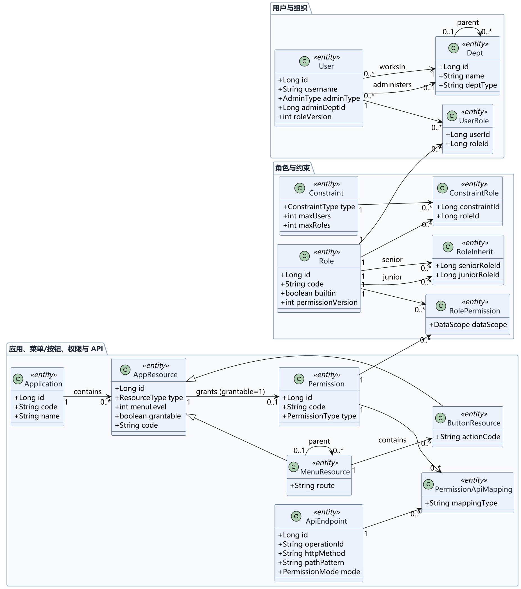

**图 4-1(a) 核心实体类图**

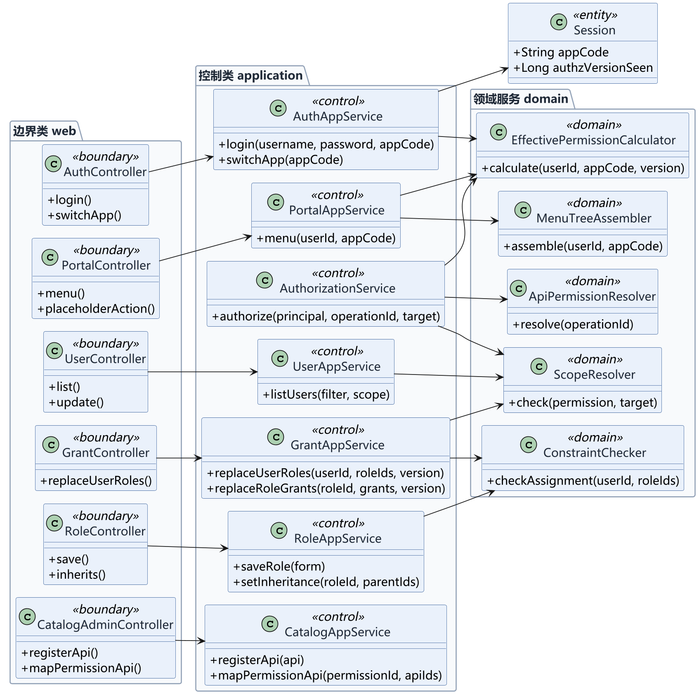

**图 4-1(b) 边界类与控制类协作图**

### 4.1.1 类的职责

| 类别 | 类 | 职责 | 关键关系 |
| --- | --- | --- | --- |
| 边界类 | `AuthController` | 登录、退出、应用切换、改密等 HTTP 入口；DTO 校验；把结果转成响应 | 调用 `AuthAppService` |
| 边界类 | `PortalController` | 门户应用清单、菜单、占位页、我的权限 | 调用 `PortalAppService`、`AuthorizationPolicy` |
| 边界类 | `UserController` | 用户列表、详情、新增、编辑、启停、重置密码、删除、角色分配入口 | 调用 `UserAppService`、`GrantAppService` |
| 边界类 | `DepartmentController` | 部门树、部门成员、部门管理员任命 | 调用 `DepartmentAppService` |
| 边界类 | `RoleController` | 角色 CRUD、启停、继承、约束、有效权限 | 调用 `RoleAppService` |
| 边界类 | `CatalogAdminController` | 应用/菜单/按钮/权限查询、API 登记、权限—API 映射、完整性校验 | 调用 `CatalogAppService` |
| 边界类 | `LedgerController` | 员工台账查询和编辑 | 调用 `LedgerAppService` |
| 边界类 | `AuditController` | 登录日志、授权变更日志、导出 | 调用 `AuditAppService` |
| 控制类 | `AuthAppService` | 登录用例编排、会话建立、应用切换、锁定和改密规则 | 使用 `User`、`Session`、`EffectivePermissionCalculator` |
| 控制类 | `AuthorizationService` | 统一鉴权入口：认证、API 解析、权限、范围、目标、保护规则 | 使用 `ApiPermissionResolver`、`EffectivePermissionCalculator`、`ScopeResolver` |
| 控制类 | `UserAppService` | 用户管理用例编排、范围裁剪、保护规则、删除 | 使用 `User`、`Dept`、`OrgScopeResolver` |
| 控制类 | `DepartmentAppService` | 部门树、成员、部门管理员任命 | 使用 `Dept`、`AdminScope`、`Role` |
| 控制类 | `RoleAppService` | 角色 CRUD、继承、约束、有效权限 | 使用 `Role`、`RoleInherit`、`Constraint` |
| 控制类 | `GrantAppService` | 用户角色/角色权限整组替换、版本冲突、可授出范围 | 使用 `UserRole`、`RolePermission`、`ConstraintChecker` |
| 控制类 | `CatalogAppService` | 目录查询、API 登记、映射维护、完整性校验 | 使用 `Application`、`AppResource`、`Permission`、`ApiEndpoint` |
| 控制类 | `PortalAppService` | 门户应用清单、菜单、占位页、我的权限 | 使用 `MenuTreeAssembler`、`EffectivePermissionCalculator` |
| 控制类 | `LedgerAppService` | 台账查询和编辑 | 使用 `AuthorizationPolicy`、`User` |
| 控制类 | `AuditAppService` | 审计查询和导出 | 使用 `LoginLog`、`GrantLog` |
| 实体类 | `User` | 用户身份、部门、状态、管理标识、版本 | 多个 `UserRole`；`dept`；`adminDept` |
| 实体类 | `Dept` | 部门树、类型、负责人 | 自关联父子；`managerUser` |
| 实体类 | `Role` | 角色编码、内置标记、状态、授权版本 | 多个 `UserRole`、`RolePermission`；继承关系 |
| 实体类 | `Application` | 应用编码、名称、入口 | 多个 `AppResource` |
| 实体类 | `AppResource` | 菜单/按钮统一资源，含类型、层级、可授权标记 | `MenuResource`、`ButtonResource` 继承；仅 `grantable=1` 时 1:1 `Permission` |
| 实体类 | `MenuResource` | 菜单层级、路由、父菜单 | 自关联父菜单；多个 `ButtonResource` |
| 实体类 | `ButtonResource` | 按钮动作码、所属菜单 | 属于 `MenuResource` |
| 实体类 | `Permission` | 权限码、类型、状态；角色授权的目标 | 可授权资源 1:1 `AppResource`；模块节点 0..1；多个 `RolePermission`、`PermissionApiMapping` |
| 实体类 | `ApiEndpoint` | API 的 `operationId`、方法、路径、鉴权模式、权限模式 | 多个 `PermissionApiMapping` |
| 实体类 | `PermissionApiMapping` | 权限与 API 的多对多映射及映射类型 | 连接 `Permission` 和 `ApiEndpoint` |
| 实体类 | `UserRole` | 用户—角色关系 | 连接 `User` 和 `Role` |
| 实体类 | `RolePermission` | 角色—权限关系及数据范围 | 连接 `Role` 和 `Permission` |
| 实体类 | `RoleInherit` | 角色继承关系（senior 继承 junior） | 连接两个 `Role` |
| 实体类 | `Constraint` | 静态互斥、动态互斥、基数约束 | 多个 `Role` |
| 实体类 | `LoginLog` / `GrantLog` | 登录日志、授权变更日志 | 关联操作者/目标 |
| 值对象 | `PermissionCode` | 权限码的解析与校验 | 被 `Permission` 使用 |
| 值对象 | `DataScope` | ALL/DEPT/SELF 及合并规则 | 被 `RolePermission`、`ScopeResolver` 使用 |
| 值对象 | `AdminType` | NONE/SUPER/DEPT 及范围规则 | 被 `User` 使用 |
| 值对象 | `AuthzVersion` | 授权版本号 | 被缓存和会话使用 |
| 领域服务 | `EffectivePermissionCalculator` | 计算有效权限：激活角色、继承闭包、停用断链、范围合并 | 使用 `RolePermission`、`RoleInherit`、`DataScope` |
| 领域服务 | `ApiPermissionResolver` | 由 `operationId` 解析所需权限和匹配模式 | 使用 `ApiEndpoint`、`PermissionApiMapping` |
| 领域服务 | `ScopeResolver` | 判断目标对象是否在权限范围内 | 使用 `DataScope`、`OrgScopeResolver` |
| 领域服务 | `MenuTreeAssembler` | 从权限集合装配菜单/按钮树，执行父菜单规则 | 使用 `MenuResource`、`ButtonResource`、`Permission` |
| 领域服务 | `ConstraintChecker` | 分配时检查 SSD/基数，激活时检查 DSD，沿继承传递 | 使用 `Constraint`、`RoleInherit` |
| 领域端口 | `OrgScopeResolver` | 查询部门子树、判断用户是否在管理范围 | 由 `org` 模块实现 |
| 领域端口 | `PermissionGrantRepository` | 读取角色授权、用户角色、继承关系 | 由 `infrastructure` 实现 |
| 领域端口 | `AuditPort` | 追加审计事件 | 由 `audit` 模块实现 |

### 4.1.2 关键关系与多重性

| 关系 | 多重性 | 说明 |
| --- | --- | --- |
| `Application` — `AppResource` | 1 : 0..* | 一个应用有多个菜单/按钮；一个资源只属于一个应用 |
| `MenuResource` — `MenuResource` | 0..1 : 0..* | 菜单自关联成树；根菜单父为空；最多三级 |
| `MenuResource` — `ButtonResource` | 1 : 0..* | 按钮必须挂在菜单下；菜单可以有多个按钮 |
| `AppResource` — `Permission` | 0..1 : 1 | 可授权资源对应一条权限；模块导航节点（grantable=0）不产生权限 |
| `Permission` — `ApiEndpoint` | 0..* : 0..* | 通过 `PermissionApiMapping` 多对多；一个菜单可对应多个查询 API |
| `Role` — `Permission` | 0..* : 0..* | 通过 `RolePermission`；带数据范围 |
| `User` — `Role` | 0..* : 0..* | 通过 `UserRole`；一个用户多角色，一个角色多用户 |
| `User` — `Dept` | 0..* : 1 | 用户属于一个部门；admin 可为空 |
| `Dept` — `Dept` | 0..1 : 0..* | 部门自关联树；根节点父为空 |
| `User` — `Dept`（管理） | 0..1 : 0..1 | `admin_dept_id` 指向部门管理员的管理根部门 |
| `Role` — `Role` | 0..* : 0..* | 继承关系；senior 继承 junior；允许多父，但无环 |
| `Constraint` — `Role` | 0..* : 0..* | 约束涉及多个角色；约束沿继承传递 |
| `User` — `LoginLog` | 1 : 0..* | 一个用户多条登录日志 |
| `User` — `GrantLog` | 1 : 0..* | 操作者/目标用户多条授权日志 |

### 4.1.3 设计类图与数据库表的区别

本节是设计模型，不画外键字段；例如 `RolePermission` 在类图中是关联对象，带 `dataScope`，但不写 `role_id`/`permission_id` 外键。外键、唯一键、CHECK 约束和表名在第 6 节给出。这样避免把类图做成表结构图，也符合课程“类图不是数据库表”的边界要求。

## 4.2 关键类状态设计

选取状态变化最复杂的 `User` 账号类。图 4-2 描述账号状态、事件、迁移和守卫条件；这是状态级设计，不展开状态内行为实现。

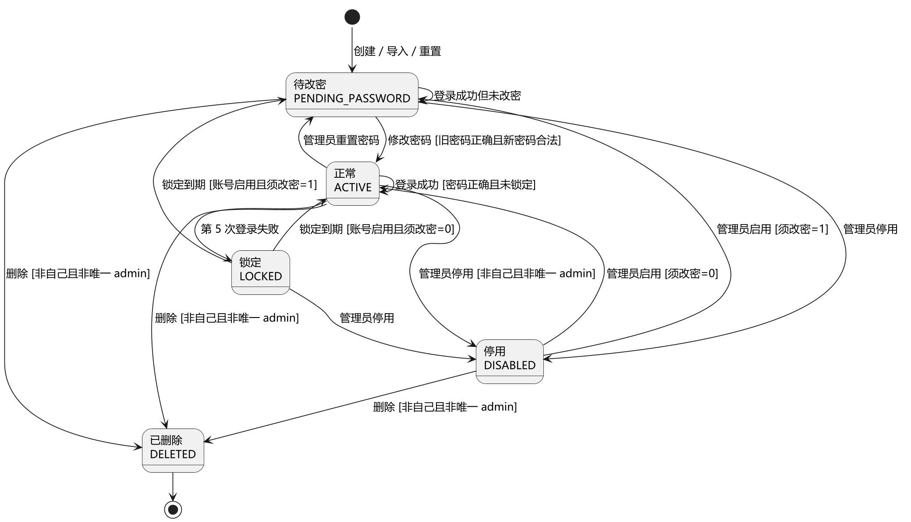

**图 4-2 用户账号状态图**

### 4.2.1 状态定义

| 状态 | 含义 | 关键标记 |
| --- | --- | --- |
| `PENDING_PASSWORD` | 账号已创建/导入/被重置，首次登录必须先改密 | `must_change_password=1`，账号启用 |
| `ACTIVE` | 正常可用 | `must_change_password=0`，未锁定，启用 |
| `LOCKED` | 连续登录失败达到阈值，临时锁定 | `locked_until` 未到期，失败次数 ≥5 |
| `DISABLED` | 管理员停用 | `status=0`；已登录会话下一次请求失效 |
| `DELETED` | 已删除，终态 | 记录不存在；关联关系清理，部门负责人置空 |

### 4.2.2 事件、迁移与守卫

| 当前状态 | 事件 | 守卫条件 | 目标状态 | 动作 |
| --- | --- | --- | --- | --- |
| （创建） | 导入/新增用户/重置密码 | 工号唯一；手机号非空时唯一；初始密码由配置提供 | `PENDING_PASSWORD` | 写初始密码哈希；`must_change_password=1` |
| `PENDING_PASSWORD` | 登录成功但未改密 | 账号启用、未锁定、密码正确 | `PENDING_PASSWORD` | 建立受限会话，只允许 `GET /me`、`PATCH /me/password`、`POST /auth/logout` |
| `PENDING_PASSWORD` | 修改密码 | 旧密码正确；新密码 8~128 字符且不同于旧密码 | `ACTIVE` | 更新哈希；清除须改密标记；其他旧会话失效 |
| `ACTIVE` | 登录成功 | 密码正确、账号启用、未锁定 | `ACTIVE` | 失败次数清零；更新最后登录时间；写登录日志 |
| `ACTIVE` | 登录失败 | 账号存在但密码错误/账号停用/锁定 | `ACTIVE` 或 `LOCKED` | 失败次数 +1；第 5 次进入 `LOCKED`；提示统一为“用户名或密码错误” |
| `ACTIVE` | 管理员停用 | 目标不是自己；不是唯一超级管理员 | `DISABLED` | `status=0`；已登录会话下一次请求 401 |
| `ACTIVE` | 删除用户 | 目标不是自己；不是唯一超级管理员；外键/关联可清理 | `DELETED` | 删除用户角色；部门负责人置空；删除用户；写审计 |
| `LOCKED` | 锁定到期 | 当前时间 ≥ `locked_until`；账号仍启用 | `ACTIVE` 或 `PENDING_PASSWORD` | 清除锁定；保留失败次数清零；不改密码 |
| `LOCKED` | 管理员重置密码/停用 | 权限、范围、保护规则通过 | `PENDING_PASSWORD` 或 `DISABLED` | 重置/停用；清除锁定或保持停用 |
| `DISABLED` | 启用账号 | 管理员有权限；目标在范围内 | `ACTIVE` 或 `PENDING_PASSWORD` | `status=1`；若须改密则进入 `PENDING_PASSWORD` |
| `DISABLED` | 登录 | 任意 | `DISABLED` | 拒绝，提示同密码错误；写失败日志，不泄露原因 |
| `DELETED` | 任意 | — | `DELETED` | 拒绝；对象不存在 |

**守卫说明：**

- 登录失败的四种情况（用户不存在、密码错误、停用、锁定）对外提示完全一致，只在日志中记录真实原因（NFR-SEC-03、LOG-01）。
- 锁定是临时状态，不改变账号启停；锁定到期后如果账号仍启用，回到 `ACTIVE` 或 `PENDING_PASSWORD`。
- 停用和删除都受账号保护规则约束：不能停用/删除自己，不能停用/删除唯一超级管理员，不能修改自己的角色（USER-07）。
- 部门管理员任命/撤销不改变账号状态，但会改变 `admin_type/admin_dept_id` 和 `DEPT_ADMIN` 角色，并递增授权版本；这属于权限状态，不是账号状态，因此不在本状态图中展开。

## 4.3 系统级数据流图

本节在需求阶段分层 DFD 基础上给出系统级 DFD：顶层图（图 4-3）和第一层图（图 4-4）。只画到系统级加工，不画模块内部流程；父子输入输出数据流保持一致。

### 4.3.1 顶层图

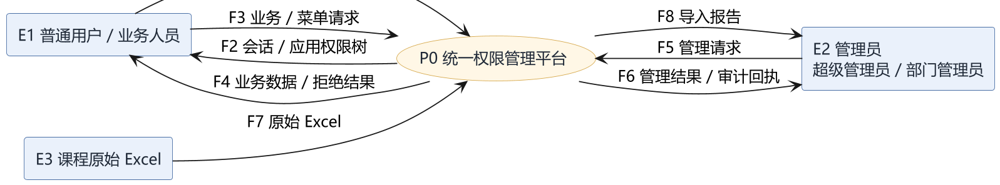

**图 4-3 系统级 DFD 顶层图**

顶层图的外部实体和数据流：

| 编号 | 外部实体/数据流 | 方向 | 说明 |
| --- | --- | --- | --- |
| E1 | 普通用户/业务人员 | 外部实体 | 使用门户、业务占位页、员工台账 |
| E2 | 管理员（超级管理员/部门管理员） | 外部实体 | 管理用户、组织、角色、授权、目录、日志 |
| E3 | 课程原始 Excel | 外部实体 | 离线导入的部门、清单、员工数据 |
| F1 | 登录凭据 + 应用标识 | E1 → P0 | 工号/手机号、密码、`appCode` |
| F2 | 会话 + 应用权限树 | P0 → E1 | 会话 Cookie、当前应用、菜单/按钮树、范围标签 |
| F3 | 业务/菜单请求 | E1 → P0 | 菜单点击、列表查询、台账编辑、占位操作 |
| F4 | 业务数据/拒绝结果 | P0 → E1 | 查询结果、更新结果、401/403/409 等 |
| F5 | 管理请求 | E2 → P0 | 用户/组织/角色/授权/目录/API 映射/日志操作 |
| F6 | 管理结果 + 审计回执 | P0 → E2 | 操作结果、分页列表、审计记录 |
| F7 | 原始 Excel | E3 → P0 | 部门信息表、功能权限清单、员工信息表 |
| F8 | 导入报告 | P0 → E2 | 数据量、清洗差异、有效权限快照、回滚说明 |

### 4.3.2 第一层图

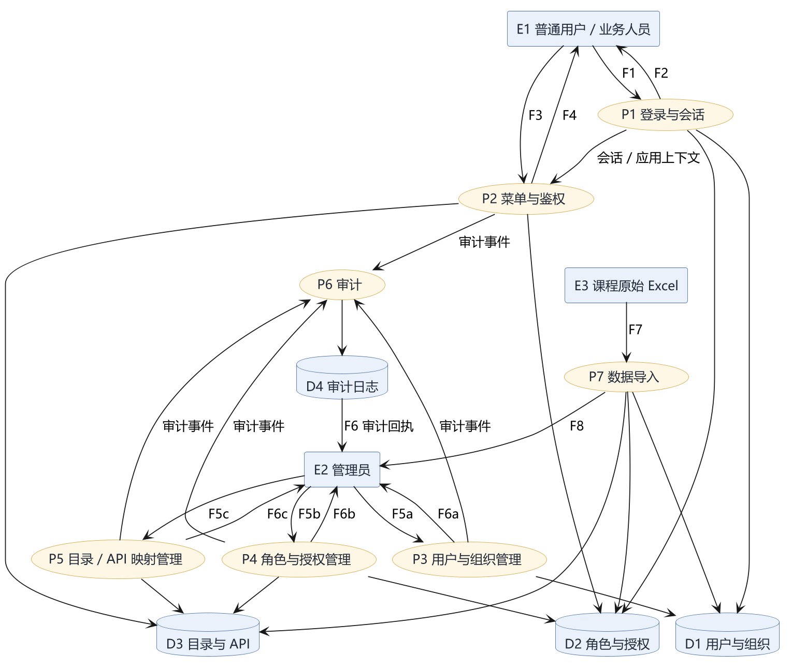

**图 4-4 系统级 DFD 第一层图**

第一层的加工和数据存储：

| 编号 | 加工 | 对应模块 | 主要输入 | 主要输出 |
| --- | --- | --- | --- | --- |
| P1 | 登录与会话 | `identity` | F1 登录凭据+应用标识；D1 用户；D2 角色授权 | F2 会话+应用权限树；登录日志；会话上下文 |
| P2 | 菜单与鉴权 | `authz`、`portal` | F3 业务/菜单请求；D2 角色授权；D3 目录/API；会话上下文 | F4 数据/拒绝；菜单树；审计事件 |
| P3 | 用户与组织管理 | `user`、`org` | F5a 用户/组织管理请求；D1 用户组织 | F6a 管理结果；审计事件 |
| P4 | 角色与授权管理 | `role`、`grant` | F5b 角色/授权请求；D2 角色授权；D3 目录 | F6b 管理结果；审计事件 |
| P5 | 应用/菜单/按钮/API 目录管理 | `catalog` | F5c 目录/API 映射请求；D3 目录/API | F6c 管理结果；审计事件 |
| P6 | 审计 | `audit` | 各加工产生的审计事件 | D4 审计日志；F6 审计回执 |
| P7 | 数据导入 | `import` | F7 原始 Excel | D1/D2/D3 初始数据；F8 导入报告 |

| 编号 | 数据存储 | 内容 |
| --- | --- | --- |
| D1 | 用户与组织库 | 用户、部门、部门负责人、部门管理员标识 |
| D2 | 角色与授权库 | 角色、用户角色、角色权限、数据范围、继承、约束、授权版本 |
| D3 | 目录与 API 库 | 应用、菜单、按钮、权限、API 端点、权限—API 映射 |
| D4 | 审计日志库 | 登录日志、授权变更日志 |

### 4.3.3 父子平衡说明

顶层图与第一层图的边界输入输出必须一致。第一层把顶层的 F5“管理请求”分解为 F5a/F5b/F5c，把 F6“管理结果+审计回执”分解为 F6a/F6b/F6c + F6；分解后的并集与顶层相同：

| 顶层数据流 | 第一层对应 | 平衡说明 |
| --- | --- | --- |
| F1 登录凭据+应用标识 | P1 输入 F1 | 完全一致 |
| F2 会话+应用权限树 | P1 输出 F2 | 完全一致 |
| F3 业务/菜单请求 | P2 输入 F3 | 完全一致 |
| F4 业务数据/拒绝结果 | P2 输出 F4 | 完全一致 |
| F5 管理请求 | F5a（P3）+ F5b（P4）+ F5c（P5） | 按管理对象分解，并集一致 |
| F6 管理结果+审计回执 | F6a（P3）+ F6b（P4）+ F6c（P5）+ F6（P6） | 按管理对象分解并增加审计回执，并集一致 |
| F7 原始 Excel | P7 输入 F7 | 完全一致 |
| F8 导入报告 | P7 输出 F8 | 完全一致 |

第一层内部还有 P1→P2 的“会话身份+应用上下文”、P3/P4/P5→P6 的“审计事件”、P7→D1/D2/D3 的“初始数据”等内部数据流；这些不跨越系统边界，因此不影响父子平衡。

## 4.4 关键运行时设计

本节绘制 3 个系统级时序图，均从 2.3 的高优先级故事中选取，标注故事编号和效用树叶节点，与 2.4 的 ATAM 评估形成闭环。时序图以模块/组件为生命线，不画到类方法级调用，不展开循环和条件内部算法。

### 4.4.1 时序图 1：撤销角色后下一次请求立即拒绝（故事 S2 / 叶节点 S1、S3）

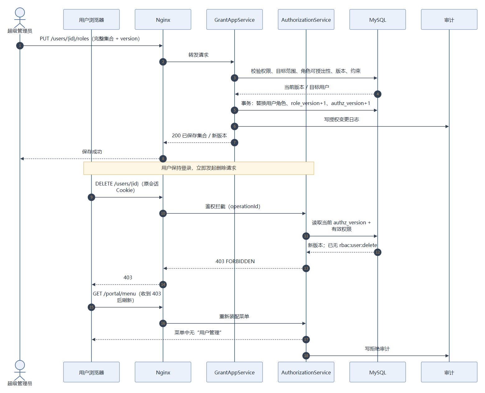

**图 4-5 撤销角色后立即生效时序图**

**场景。** 超级管理员撤销用户的“用户管理”角色；用户保持登录，立即尝试调用删除用户 API。时序如下：

1. 管理员浏览器向 Nginx 发送 `PUT /users/{id}/roles`，提交完整的角色集合和新版本。
2. Nginx 转发到 `GrantAppService`；该服务校验操作者权限、目标用户范围、角色可授出性、版本和约束。
3. `GrantAppService` 在一个事务中替换 `sys_user_role`、递增 `sys_user.role_version`、递增 `sys_authz_version`，写授权日志；事务提交。
4. 用户浏览器发送 `DELETE /users/{id}`，携带原会话 Cookie。
5. Nginx 转发到 `AuthorizationService`（鉴权拦截器）。拦截器从会话取用户和 `appCode`，读取当前 `sys_authz_version`；发现版本已变化，缓存未命中，回源主库计算有效权限。
6. `AuthorizationService` 通过 `ApiPermissionResolver` 找到删除用户 API 要求 `rbac:user:delete` + `rbac:user:read`；用户有效权限中已没有 `rbac:user:delete`，返回 403。
7. 用户浏览器收到 403，刷新菜单/权限树，删除按钮消失；审计记录拒绝。

**关键点。** 撤销事务提交后，下一次请求一定读取新版本；正在执行的旧请求可能完成，但不接受撤销后的新请求继续成功。前端隐藏按钮只是体验，后端 403 才是安全边界。

### 4.4.2 时序图 2：部门管理员越界分配角色被拒绝（故事 S3 / 叶节点 S2）

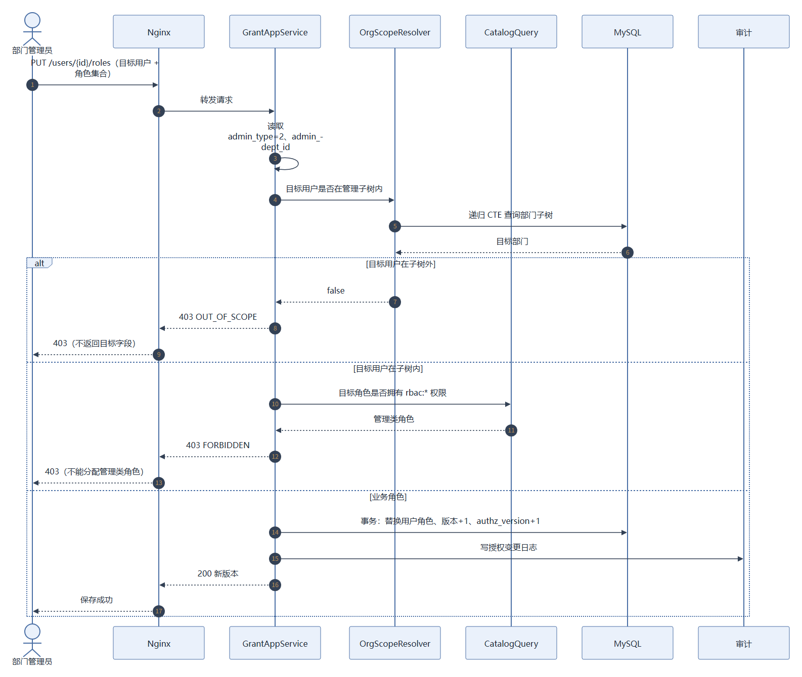

**图 4-6 部门管理员越界分配角色时序图**

**场景。** 部门管理员尝试给另一个分公司的用户分配角色，或给范围内用户分配 `DEPT_ADMIN` 角色。时序如下：

1. 部门管理员浏览器向 Nginx 发送 `PUT /users/{id}/roles`。
2. `GrantAppService` 从会话取操作者，读取 `admin_type=2` 和 `admin_dept_id`；如果操作者不是部门管理员，跳过部门边界检查，按超级管理员规则处理。
3. `GrantAppService` 调用 `OrgScopeResolver`，用递归 CTE 计算 `admin_dept_id` 子树，判断目标用户是否在子树内；不在则返回 403 `OUT_OF_SCOPE`，不返回目标用户字段。
4. 如果在子树内，继续检查目标角色：通过 `CatalogQuery`/角色查询判断角色是否拥有任一 `rbac:*` 权限；是管理类角色则返回 403 `FORBIDDEN`。
5. 如果目标角色是业务角色，继续检查版本、约束、重复 ID；全部通过才在事务中替换角色集合，递增版本，写审计。
6. 任一拒绝分支都不写入任何行；事务未开始或已回滚。

**关键点。** 管理范围（`admin_dept_id` 子树）和功能权限（`DEPT_ADMIN` 角色）分开校验；管理类角色实时按 `rbac:*` 判定，不能靠角色名称或人工标记绕过。

### 4.4.3 时序图 3：高峰期的菜单/API 鉴权（故事 S1 / 叶节点 P1、P2、P3）

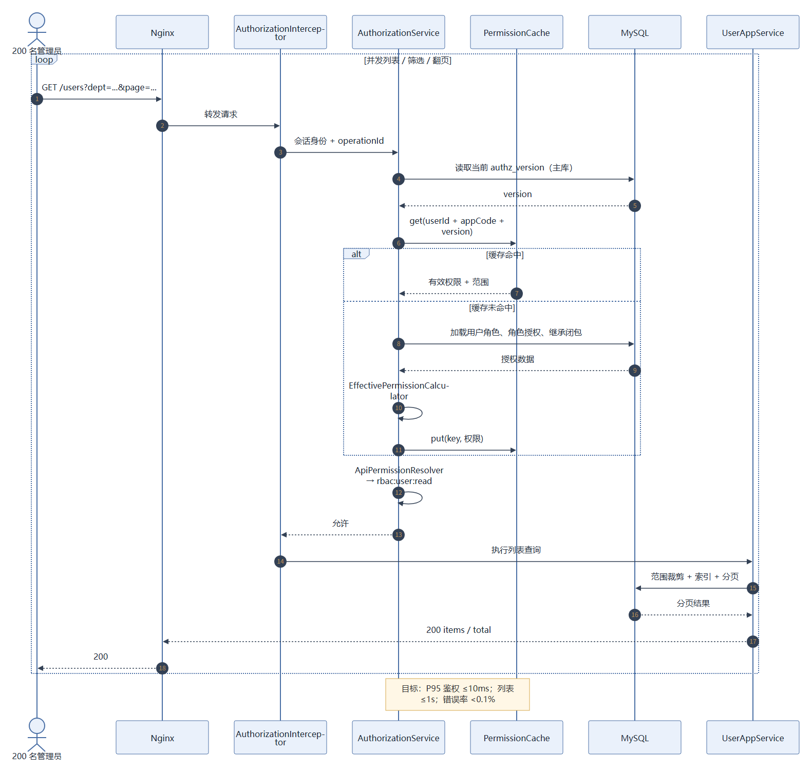

**图 4-7 高峰期菜单/API 鉴权时序图**

**场景。** 200 名管理员同时打开用户列表、筛选、翻页；每个请求都要鉴权和范围裁剪。时序如下：

1. 多个浏览器通过 Nginx 并发发送 `GET /users?...`。
2. `AuthorizationService` 从会话取用户和 `appCode`，读取当前授权版本；构造缓存键 `userId + appCode + authzVersion`。
3. 先查 `PermissionCache`（Caffeine 本地缓存）：
   - 命中：直接得到有效权限和范围；
   - 未命中：回源主库，加载用户角色、角色权限、继承闭包，调用 `EffectivePermissionCalculator` 计算，写入缓存。
4. `AuthorizationService` 通过 `ApiPermissionResolver` 找到 `GET /users` 要求 `rbac:user:read`；用户有权限，继续。
5. `UserAppService` 解析管理范围（超级管理员为全部；部门管理员为 `admin_dept_id` 子树），把范围条件下推到 SQL，使用覆盖索引和分页查询。
6. 返回分页结果；列表只包含范围内用户；响应时间目标 95% ≤1 秒，单次鉴权 ≤10 毫秒。

**关键点。** 缓存只缓存有效权限，不缓存“是否允许某个目标对象”的最终结果；目标对象的范围检查每次按当前数据做。缓存键包含版本，撤销后旧键不再命中。鉴权读主库，避免主从延迟。
# 5 接口设计

本章聚焦系统骨架的对接契约：谁和谁通信、通信的规约是什么。完整的请求字段、响应字段和错误码以 OpenAPI 目标契约 v0.4.0 为准；本章只列接口名称、功能、核心输入/输出大类和协议，不写代码级函数签名，不贴 JSON 样例。

## 5.1 外部接口设计

### 5.1.1 用户界面接口

| 项目 | 设计 |
| --- | --- |
| 形态 | 桌面浏览器 Web 单页应用（Vue 3 + Vue Router + Element Plus），不做移动端适配 |
| 入口 | 统一门户 `/`；管理后台 `/admin`；占位页 `/apps/{appCode}/{menuCode}`；员工台账 `/ledger` |
| 浏览器 | 最新版 Chrome / Edge；最低分辨率 1366×768，推荐 1440×900 以上 |
| 交互风格 | 左侧导航 + 顶部用户区 + 内容区；菜单按权限树生成；按钮无权时置灰并显示范围标签；删除/撤销二次确认 |
| 状态 | 加载中、空结果、失败、无权限、版本冲突五类状态都有明确显示；不把空数组当故障 |
| 身份 | 登录后由服务端设置 `JSESSIONID` Cookie；前端不保存密码、令牌或权限作为授权依据 |
| 可访问性 | 键盘可操作；颜色不是唯一的状态标识；错误提示可读 |

**页面与菜单/按钮的对应：**

| 页面 | 主要菜单/按钮 | 相关需求 |
| --- | --- | --- |
| 登录 / 修改密码 | 登录、退出、修改密码 | LOGIN-01 ~ LOGIN-05 |
| 统一门户 | 应用清单、我的权限、修改密码、退出 | PORTAL-01、PORTAL-03 |
| 业务系统占位页 | 菜单、6 个操作按钮、范围标签 | PORTAL-02、PORTAL-06 |
| 员工台账 | 列表、筛选、编辑（电话/邮箱）、占位按钮 | PORTAL-04 ~ PORTAL-06 |
| 用户管理 | 列表、筛选、新增、编辑、启停、重置密码、删除、分配角色、任命部门管理员 | USER-01 ~ USER-07、GRANT-01/03 |
| 组织架构 | 部门树、成员列表 | DEPT-01 ~ DEPT-02 |
| 角色管理 | 角色列表、新增、编辑、启停、删除、成员、继承、约束、有效权限 | ROLE-01 ~ ROLE-15 |
| 角色授权 | 目录勾选、数据范围、保存 | GRANT-02 |
| 权限目录 / API 映射 | 应用、菜单、按钮、权限、API 登记、映射、完整性校验 | CAT-01 ~ CAT-03 |
| 审计日志 | 登录日志、授权变更日志、筛选、导出 | LOG-01 ~ LOG-03 |
| 403 / 404 | 无权限、对象不存在 | AUTHZ-01 |

### 5.1.2 硬件接口

本系统不直接连接读卡器、生物识别仪、打印机等专用硬件。员工台账的导出是浏览器下载文件，不直接驱动打印设备。若后续接入硬件，按“设备网关 → 后端 API → 权限检查”的方式扩展，不在本设计范围内。

### 5.1.3 软件接口

| 外部软件/系统 | 接口方式 | 用途 | 约束 |
| --- | --- | --- | --- |
| MySQL 8.4 | JDBC/MySQL 协议，内网 | 业务数据、会话、日志、迁移历史 | 不对公网开放；专用账号最小权限；参数绑定 |
| Nginx | HTTP/HTTPS 反向代理 | 静态资源、TLS、`/api` 代理、限流 | 只暴露 80/443；后端和数据库端口不发布 |
| 浏览器 | HTTP/HTTPS、Cookie | 用户界面 | 同源 Cookie；HTTPS 下 Secure |
| Springdoc / Swagger UI | HTTP | 开发期查看/调试 OpenAPI | 生产环境限制访问或关闭 |
| 课程原始 Excel | 文件系统，离线 | 初始化导入 | 只放受控目录；不进仓库；导入脚本幂等 |
| 监控/日志系统（可选） | HTTP/文件 | 健康检查、指标、日志采集 | 不采集密码、Cookie、真实手机号 |

**不接入的第三方系统：** 微信支付、国家认证中心、短信、邮件、外部业务系统。需求范围内没有真实外部系统；如果未来接入，必须新增外部接口权限和审计，不沿用内部会话。

## 5.2 内部系统级接口设计

### 5.2.1 通用约定

- 路径前缀 `/api/v1`；JSON；成功直接返回对象/数组；分页 `{items, page, pageSize, total}`。
- 身份使用服务端会话 Cookie `JSESSIONID`；浏览器同源发送；登录成功轮换会话 ID；退出使旧会话失效。
- 每个受保护 API 必须有 `operationId`，并与 `sys_api`、OpenAPI、Controller 注解一致。
- 鉴权顺序：认证 → API 解析 → 权限码 → 数据范围 → 目标对象 → 业务规则；默认拒绝。
- 未登录 401；无权限 403；不存在 404；版本/唯一键/保护规则/约束冲突 409；参数错误 400；服务端错误 500。
- 响应不返回密码、哈希、会话、范围外对象字段；错误信息不泄露目标是否存在。
- 所有写接口在应用服务层事务内执行；整组替换带版本号；失败不部分写入。

### 5.2.2 API 清单

**认证、本人和门户**

| 编号 | 方法与路径 | 功能 | 核心输入大类 | 核心输出大类 | 权限要求 |
| --- | --- | --- | --- | --- | --- |
| API-AUTH-01 | `POST /auth/login` | 登录，建立会话，返回当前应用权限树 | 工号/手机号、密码、`appCode` | 会话 Cookie、用户摘要、应用信息、权限树、须改密标记、授权版本 | 公开 |
| API-AUTH-02 | `POST /auth/logout` | 退出，会话失效 | 会话 | 204 | 已登录 |
| API-AUTH-03 | `POST /auth/switch-app` | 切换当前应用上下文 | `appCode` | 应用信息、权限树、授权版本 | 已登录 |
| API-AUTH-04 | `POST /auth/activate-roles` | 阶段三：切换激活角色 | 角色 ID 集合 | 激活角色、权限树 | 已登录 |
| API-ME-01 | `GET /me` | 当前用户资料 | — | 用户安全字段 | 已登录 |
| API-ME-02 | `PATCH /me/password` | 修改本人密码 | 旧密码、新密码 | 204 | 已登录（须改密会话可用） |
| API-ME-03 | `GET /me/permissions` | 当前用户有效权限及来源 | 可选 `appCode` | 权限码、范围、来源角色 | 已登录 |
| API-PORTAL-01 | `GET /portal/applications` | 可访问应用清单 | — | 应用列表 | 已登录 |
| API-PORTAL-02 | `GET /portal/menu` | 当前应用菜单/按钮树 | `appCode` | 菜单树、按钮状态、范围标签 | 已登录 |
| API-PORTAL-03 | `GET /portal/functions/{menuCode}` | 功能点占位页详情 | 菜单码 | 功能点信息、按钮状态、范围 | 菜单 `read` |
| API-PORTAL-04 | `POST /portal/placeholder-actions` | 占位系统按钮的统一受控端点 | 权限码、目标标识 | 操作结果/未实现提示 | 请求中的权限码 |

**用户、部门**

| 编号 | 方法与路径 | 功能 | 核心输入大类 | 核心输出大类 | 权限要求 |
| --- | --- | --- | --- | --- | --- |
| API-USER-01 | `GET /users` | 用户列表，范围裁剪、筛选、分页 | 部门、工号、姓名、角色、页码 | 用户列表、总数 | `rbac:user:read` |
| API-USER-02 | `POST /users` | 新增用户 | 工号、姓名、部门、岗位、电话、邮箱 | 用户视图 | `rbac:user:create` + `rbac:user:read` |
| API-USER-03 | `GET /users/{id}` | 用户详情 | 用户 ID | 用户视图 | `rbac:user:read` |
| API-USER-04 | `PATCH /users/{id}` | 编辑用户基本信息 | 用户 ID、可编辑字段 | 用户视图 | `rbac:user:update` + `rbac:user:read` |
| API-USER-05 | `PATCH /users/{id}/status` | 启用/停用用户 | 用户 ID、状态 | 用户视图 | `rbac:user:update` + `rbac:user:read` |
| API-USER-06 | `POST /users/{id}/password-reset` | 重置密码为初始密码 | 用户 ID | 204 | `rbac:user:update` + `rbac:user:read` |
| API-USER-07 | `DELETE /users/{id}` | 删除用户 | 用户 ID、确认标记 | 204 | `rbac:user:delete` + `rbac:user:read` |
| API-USER-08 | `GET /users/{id}/roles` | 读取用户角色集合和版本 | 用户 ID | 角色集合、版本 | `rbac:user:read` + `rbac:role:read` |
| API-USER-09 | `PUT /users/{id}/roles` | 整组替换用户角色 | 角色 ID 集合、版本 | 已保存集合、新版本 | `rbac:user:assign-role` + `rbac:user:read` + `rbac:role:read` |
| API-USER-10 | `POST /users/{id}/dept-admin` | 任命/撤销部门管理员 | 用户 ID、动作、管理根部门 | 用户视图、管理范围 | 超级管理员专用 |
| API-DEPT-01 | `GET /departments` | 部门树、负责人、员工数 | — | 部门树 | `rbac:department:read` |
| API-DEPT-02 | `GET /departments/{id}/members` | 部门及下级成员 | 部门 ID、筛选、页码 | 成员列表、总数 | `rbac:department:read` + `rbac:user:read` |

**角色、授权**

| 编号 | 方法与路径 | 功能 | 核心输入大类 | 核心输出大类 | 权限要求 |
| --- | --- | --- | --- | --- | --- |
| API-ROLE-01 | `GET /roles` | 角色列表 | 筛选、页码 | 角色列表、总数 | `rbac:role:read` |
| API-ROLE-02 | `POST /roles` | 新增角色 | 角色编码、名称、说明 | 角色视图 | `rbac:role:create` |
| API-ROLE-03 | `GET /roles/{id}` | 角色详情 | 角色 ID | 角色视图 | `rbac:role:read` |
| API-ROLE-04 | `PATCH /roles/{id}` | 编辑角色 | 角色 ID、可编辑字段 | 角色视图 | `rbac:role:update` |
| API-ROLE-05 | `DELETE /roles/{id}` | 删除自建角色 | 角色 ID、确认标记 | 204 | `rbac:role:delete` |
| API-ROLE-06 | `PATCH /roles/{id}/status` | 启用/停用角色 | 角色 ID、状态 | 角色视图 | `rbac:role:update` |
| API-ROLE-07 | `GET /roles/{id}/users` | 角色下的用户 | 角色 ID、分页 | 用户列表、总数 | `rbac:role:read` + `rbac:user:read` |
| API-ROLE-08 | `GET /roles/{id}/permissions` | 角色直接授权 | 角色 ID | 权限集合、版本 | `rbac:role:read` + `rbac:permission:read` |
| API-ROLE-09 | `PUT /roles/{id}/permissions` | 整组替换角色授权 | 权限码+范围集合、版本 | 已保存集合、新版本 | `rbac:role:grant` + `rbac:role:read` |
| API-ROLE-10 | `GET /roles/{id}/effective-permissions` | 角色有效权限及继承来源 | 角色 ID | 权限、范围、来源角色 | `rbac:role:read` |
| API-ROLE-11 | `GET /roles/{id}/inherits` | 角色继承关系 | 角色 ID | 上级/下级角色 | `rbac:role:read` |
| API-ROLE-12 | `PUT /roles/{id}/inherits` | 设置角色继承 | 上级/下级角色、版本 | 保存结果、新版本 | `rbac:role:update` |
| API-ROLE-13 | `GET /roles/{id}/constraints` | 角色相关约束 | 角色 ID | 约束列表 | `rbac:role:read` |
| API-ROLE-14 | `PUT /roles/{id}/constraints` | 保存约束 | 约束类型、角色集合、参数、版本 | 保存结果、违反说明 | `rbac:role:update` |

**目录、API 登记与映射**

| 编号 | 方法与路径 | 功能 | 核心输入大类 | 核心输出大类 | 权限要求 |
| --- | --- | --- | --- | --- | --- |
| API-CAT-01 | `GET /catalog/applications` | 应用列表 | — | 应用列表 | `rbac:permission:read` |
| API-CAT-02 | `GET /catalog/menus` | 应用下菜单/按钮树 | 应用 ID | 菜单/按钮树 | `rbac:permission:read` |
| API-CAT-03 | `GET /catalog/permissions` | 权限目录查询 | 关键词、应用、菜单、分页 | 权限列表、总数 | `rbac:permission:read` |
| API-CAT-04 | `GET /catalog/apis` | API 登记列表 | 应用、模块、分页 | API 列表、总数 | `rbac:permission:read` |
| API-CAT-05 | `POST /catalog/apis` | 登记 API | `operationId`、方法、路径、鉴权模式、权限模式 | API 视图 | `rbac:permission:update` |
| API-CAT-06 | `PUT /catalog/apis/{id}` | 修改 API 登记 | 同登记字段 | API 视图 | `rbac:permission:update` |
| API-CAT-07 | `PUT /catalog/permissions/{id}/apis` | 设置权限—API 映射 | API ID 集合、映射类型 | 映射结果 | `rbac:permission:update` |
| API-CAT-08 | `POST /catalog/validate` | 校验目录/API 完整性 | — | 缺失/重复/未映射报告 | `rbac:permission:read` |

**员工台账、审计、健康检查**

| 编号 | 方法与路径 | 功能 | 核心输入大类 | 核心输出大类 | 权限要求 |
| --- | --- | --- | --- | --- | --- |
| API-LEDGER-01 | `GET /ledger/employees` | 员工台账列表 | 筛选、页码 | 员工列表、总数 | `hr:f046:read` |
| API-LEDGER-02 | `PATCH /ledger/employees/{id}` | 编辑电话/邮箱 | 员工 ID、电话、邮箱 | 员工视图 | `hr:f046:edit` + `hr:f046:read` |
| API-AUDIT-01 | `GET /audit/login-logs` | 登录日志查询 | 时间、账号、结果、分页 | 日志列表、总数 | `rbac:log:read` |
| API-AUDIT-02 | `GET /audit/grant-logs` | 授权变更日志查询 | 时间、操作人、目标、分页 | 日志列表、总数 | `rbac:log:read` |
| API-AUDIT-03 | `GET /audit/export` | 日志导出 | 日志类型、筛选 | 文件流 | `rbac:log:export` |
| API-HEALTH-01 | `GET /health` | 健康检查 | — | 状态、数据库连通性 | 公开（仅内网） |

### 5.2.3 菜单/按钮与 API 的对应原则

| 界面对象 | 对应 API | 说明 |
| --- | --- | --- |
| 应用入口 | `GET /portal/applications` | 由用户在各应用的权限推导，不是独立权限 |
| 一级/二级菜单 | `GET /portal/menu`、对应查询 API | 菜单 `read` 权限映射查询 API；一个菜单可映射多个查询 API |
| 页面按钮 | 对应命令 API | 新增→POST，编辑→PATCH，删除→DELETE，审批/导出按业务 API |
| 占位系统按钮 | `POST /portal/placeholder-actions` | 统一受控端点；校验权限码，不产生业务数据 |
| 员工台账编辑 | `PATCH /ledger/employees/{id}` | 真实业务；只允许电话/邮箱；按编辑范围检查目标 |
| 管理部门 | 用户/部门/角色/授权 API | 管理后台按钮对应管理 API；管理类权限 `rbac:*` |

**`permission_mode` 的使用：**

- `ANY`：用户拥有映射权限中的任意一个即可调用；用于查询类 API。
- `ALL`：用户必须拥有映射的全部权限；用于“编辑/删除/分配”等需要同时具备菜单查看权限和操作权限的 API。
- 未配置或映射为空：拒绝。
- 同一 API 被多个菜单/按钮复用时，必须确认所有调用场景的权限要求一致；不一致时拆成不同 API 或使用不同的 `operationId`。

### 5.2.4 错误码与状态码

| HTTP | 错误码 | 含义 | 前端处理 |
| --- | --- | --- | --- |
| 400 | `VALIDATION` | 格式、长度、枚举、重复 ID 等参数错误 | 显示字段错误，保留草稿 |
| 400 | `BAD_OLD_PASSWORD` | 修改密码时旧密码错误 | 提示重新输入 |
| 400 | `FIELD_NOT_EDITABLE` | 台账提交了电话/邮箱以外的字段 | 提示只允许编辑电话/邮箱 |
| 400 | `UNKNOWN_PERMISSION` | 提交了目录中不存在的权限码 | 刷新目录，保留草稿 |
| 400 | `READ_REQUIRED` | 授予非查看操作时缺少查看权限 | 自动勾选查看或提示 |
| 400 | `APP_CONTEXT_REQUIRED` | 请求缺少当前应用上下文 | 重新登录或切换应用 |
| 401 | `INVALID_CREDENTIALS` | 登录失败（不区分原因） | 统一提示“用户名或密码错误” |
| 401 | `UNAUTHENTICATED` | 会话不存在/失效 | 跳转登录 |
| 403 | `FORBIDDEN` | 缺少权限 | 显示无权限；刷新权限树 |
| 403 | `OUT_OF_SCOPE` | 目标在数据/管理范围外 | 不显示目标字段；返回列表 |
| 403 | `PASSWORD_CHANGE_REQUIRED` | 须先修改密码 | 跳转改密页 |
| 403 | `API_NOT_REGISTERED` | API 未登记或未映射，默认拒绝 | 显示系统错误；记录 requestId；告警 |
| 404 | `NOT_FOUND` | 角色/目录/对象不存在 | 返回列表或重选 |
| 409 | `VERSION_CONFLICT` | 授权集合版本已变化 | 重新读取后人工复核，不盲目重试 |
| 409 | `DUPLICATE_USERNAME` / `DUPLICATE_PHONE` / `DUPLICATE_ROLE_CODE` | 唯一键冲突 | 提示具体字段 |
| 409 | `PROTECTED_ACCOUNT` | 违反账号保护规则 | 说明不能停用/删除自己或唯一超级管理员 |
| 409 | `PROTECTED_ROLE` | 内置角色不可删除/超级管理员角色不可改 | 说明原因 |
| 409 | `ROLE_HAS_USERS` | 删除有用户的自建角色未确认 | 二次确认 |
| 409 | `CONSTRAINT_VIOLATION` | 违反 SSD/DSD/基数/继承约束 | 说明违反的约束和冲突角色 |
| 409 | `INVALID_ROLE_INHERITANCE` | 继承形成环或导致约束冲突 | 说明环路/冲突，保持原关系 |
| 500 | `INTERNAL` | 未预期错误 | 显示 requestId；不暴露堆栈 |

## 5.3 接口设计约束

1. **不写代码级签名。** 本章只到接口名称、输入/输出大类和协议；详细方法签名在详细设计。
2. **不贴 JSON 样例。** 字段类型、示例和校验规则由 OpenAPI 和详细设计给出。
3. **契约唯一。** OpenAPI 是权威；Controller、前端客户端、测试和 `sys_api` 都以 `operationId` 对齐。接口变更必须同步 OpenAPI、两套后端、前端和契约测试。
4. **版本化。** 破坏性变更提升契约主版本；新增字段保持向后兼容；旧客户端至少保留一个迭代的兼容期。
5. **安全默认值。** 新增 API 默认 `PERMISSION` 鉴权；只有登录、健康检查等明确标记 `PUBLIC` 的端点可以匿名访问。
6. **错误不泄露。** 403/404 不返回目标对象字段；登录失败不区分账号不存在、密码错误、停用、锁定；日志记录真实原因，响应只给统一提示。
7. **分页与导出。** 列表统一分页；导出走独立权限和审计；导出文件不包含密码、哈希、会话或范围外数据。

# 6 数据设计与存储策略

## 6.1 全局数据逻辑结构设计

图 6-1 是系统级高级 ER 图，只展示核心全局实体和关联，不列完整字段字典。ER 图体现第一轮检查要求的四条关系：

1. 应用与菜单/按钮一对多；
2. 菜单自关联成树，按钮挂在菜单下；
3. 权限与 API 多对多；
4. 部门管理员在用户表中识别，并指向管理根部门。

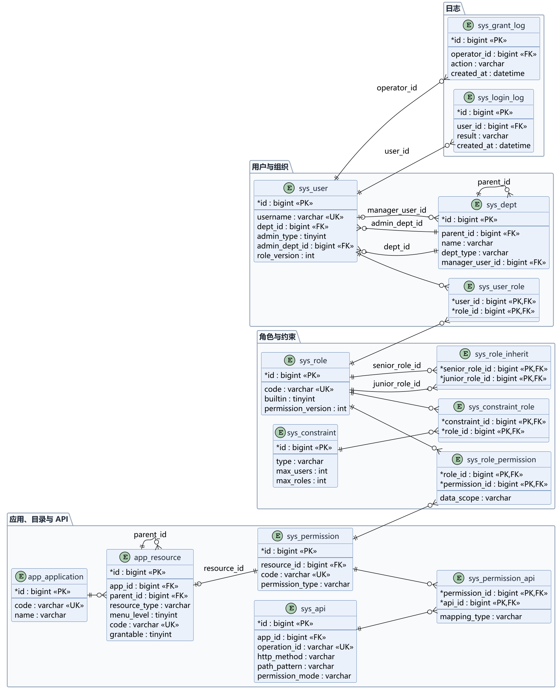

**图 6-1 全局数据逻辑结构 ER 图**

**核心关系说明：**

| 关系 | 基数 | 说明 |
| --- | --- | --- |
| 应用—资源 | 1 : 0..* | 一个应用有多个菜单/按钮；资源归属唯一应用 |
| 菜单—菜单 | 0..1 : 0..* | 菜单树；最多三级；根菜单父为空 |
| 菜单—按钮 | 1 : 0..* | 按钮必须属于一个菜单 |
| 资源—权限 | 0..1 : 1 | 可授权资源对应一条权限；模块导航节点（grantable=0）不产生权限 |
| 权限—API | 0..* : 0..* | 通过权限—API 映射表；菜单可映射多个查询 API |
| 角色—权限 | 0..* : 0..* | 通过角色权限关系；带数据范围 |
| 用户—角色 | 0..* : 0..* | 通过用户角色关系 |
| 用户—部门 | 0..* : 1 | 用户属于一个部门；admin 可为空 |
| 部门—部门 | 0..1 : 0..* | 部门树 |
| 用户—管理部门 | 0..* : 0..1 | `admin_dept_id`；部门管理员指向管理根部门 |
| 角色—角色 | 0..* : 0..* | 继承；senior 继承 junior；多父 DAG；无环 |
| 约束—角色 | 0..* : 0..* | 约束涉及多个角色；沿继承传递 |

**为什么把菜单和按钮放在一张资源表。** 菜单和按钮都需要权限码、名称、状态、排序和应用归属，差别只在类型、层级和动作码。用一张 `app_resource` 表加 `resource_type` 区分，可以避免两套重复的权限逻辑，也便于菜单树装配和权限—API 映射。JPA 映射可以用单表继承：`MenuResource` 和 `ButtonResource` 是 `AppResource` 的子类，数据库仍是一张表。

**为什么权限单独一张表。** 资源是界面对象，权限是授权对象；可授权资源与权限 1:1，但职责不同：资源可以停用/改名/调整路由，权限码必须稳定；角色授权引用权限而不是资源，保证界面调整不影响已有授权。模块导航节点是 `grantable=0` 的资源，不生成权限，因此不会虚构原始清单中不存在的授权。

## 6.2 概要级表结构设计

本节只列主要字段、主外键和关键约束，不列完整字段字典，不写 `CREATE TABLE`。字段类型和默认值在详细设计/迁移文件中确定。

### 6.2.1 用户、组织、角色

| 表名 | 作用 | 主要字段 | 主键/外键 | 关键约束 |
| --- | --- | --- | --- | --- |
| `sys_user` | 用户账号 | id、username、password_hash、real_name、dept_id、phone、email、status、must_change_password、failed_login_count、locked_until、admin_type、admin_dept_id、role_version、last_login_at、created_at、updated_at | PK id；FK dept_id→sys_dept；FK admin_dept_id→sys_dept | username 唯一；phone 非空唯一；status/must_change_password/admin_type CHECK；admin_type=2 时 admin_dept_id 非空；唯一超级管理员由保护规则/唯一索引保证 |
| `sys_dept` | 部门树 | id、parent_id、name、short_name、dept_type、level、manager_user_id、sort_no | PK id；FK parent_id→sys_dept；FK manager_user_id→sys_user | dept_type CHECK；根节点 parent 为空；负责人删除时置空；禁止环由应用/导入校验 |
| `sys_role` | 角色 | id、code、name、description、builtin、status、permission_version、created_at | PK id | code 唯一；builtin/status CHECK；内置角色不可删除 |
| `sys_user_role` | 用户—角色 | user_id、role_id、created_at | PK(user_id, role_id)；FK 双方 | 组合唯一；用户/角色删除时级联清理 |
| `sys_role_inherit` | 角色继承 | senior_role_id、junior_role_id、created_at | PK(senior_role_id, junior_role_id)；FK 双方 | senior≠junior；禁止自环/间接环；多父 DAG |
| `sys_constraint` | 约束定义 | id、type、name、max_users、max_roles、status、created_at | PK id | type CHECK（SSD/DSD/CARDINALITY）；基数参数非负 |
| `sys_constraint_role` | 约束—角色 | constraint_id、role_id | PK(constraint_id, role_id)；FK 双方 | 约束删除时清理关系 |

### 6.2.2 应用、菜单/按钮、权限、API

| 表名 | 作用 | 主要字段 | 主键/外键 | 关键约束 |
| --- | --- | --- | --- | --- |
| `app_application` | 应用 | id、code、name、entry_url、status、sort_no | PK id | code/name 唯一；18 个清单应用 + 平台管理应用 |
| `app_resource` | 菜单/按钮资源树 | id、app_id、parent_id、resource_type、menu_level、code、name、route、action_code、grantable、sort_no、status | PK id；FK app_id→app_application；FK parent_id→app_resource | (app_id, code) 唯一；MENU 的 menu_level 1~3；BUTTON 的 parent 必须是 MENU；模块节点 grantable=0；按钮动作码合法 |
| `sys_permission` | 权限 | id、resource_id、code、permission_type、status、created_at | PK id；FK resource_id→app_resource；UK resource_id | code 唯一；resource_id 唯一；MENU/BUTTON 类型与资源一致 |
| `sys_api` | API 登记 | id、app_id、operation_id、http_method、path_pattern、module、api_type、auth_mode、permission_mode、status、description | PK id；FK app_id→app_application | operation_id 唯一；method 合法；auth_mode/permission_mode CHECK；受保护 API 必须有映射 |
| `sys_permission_api` | 权限—API 映射 | permission_id、api_id、mapping_type、created_at | PK(permission_id, api_id)；FK 双方 | 组合唯一；映射类型合法；删除权限/API 时清理 |
| `sys_role_permission` | 角色—权限授权 | role_id、permission_id、data_scope、created_at | PK(role_id, permission_id)；FK 双方 | data_scope CHECK（ALL/DEPT/SELF）；同一角色同一权限唯一 |
| `sys_authz_version` | 全局授权版本 | id、version、updated_at | PK id（单行） | 版本单调递增；授权变更同事务更新 |

### 6.2.3 日志与基础设施

| 表名 | 作用 | 主要字段 | 主键/外键 | 关键约束 |
| --- | --- | --- | --- | --- |
| `sys_login_log` | 登录日志 | id、user_id、username、ip、result、reason、created_at | PK id；FK user_id 可空 | 只增不改；按时间/账号索引；失败原因只存日志 |
| `sys_grant_log` | 授权变更日志 | id、operator_id、target_type、target_id、action、detail_summary、created_at | PK id；FK operator_id→sys_user | 只增不改；记录操作人、目标、动作、摘要 |
| `spring_session` | Spring Session 会话 | 标准会话字段 | PK primary_id | 框架表，不参与业务 ER |
| `spring_session_attributes` | 会话属性 | session_id、attribute_name、attribute_bytes | PK(session_id, attribute_name) | 框架表 |
| `flyway_schema_history` | 迁移历史 | 标准 Flyway 字段 | PK installed_rank | 框架表；只追加 |

**删除策略：**

- 用户删除：`sys_user_role` 级联删除；`sys_dept.manager_user_id` 置空；`sys_grant_log` 保留（操作者为空或保留历史标识）；不物理删除日志。
- 角色删除：`sys_user_role`、`sys_role_permission`、`sys_role_inherit`、`sys_constraint_role` 级联/清理；内置角色禁止删除；有用户时需二次确认。
- 应用/资源删除：级联清理权限、权限—API 映射、角色授权；当前目录只读，由导入维护，删除操作不开放给普通管理员。
- 权限删除：清理角色授权和权限—API 映射；已授权用户下一次请求按新权限判断。
- 部门删除：有下级或有用户时拒绝；负责人删除时置空；当前部门只读，由导入维护。

## 6.3 存储方案与物理策略

### 6.3.1 存储选型

| 数据类别 | 存储技术 | 选型理由 |
| --- | --- | --- |
| 用户、组织、角色、目录、授权、约束、日志 | MySQL 8.4 InnoDB，utf8mb4 | 关系模型成熟；事务、外键、CHECK、唯一键、递归 CTE 满足权限模型；课程和云服务器都易部署；两套后端共用 |
| 会话 | Spring Session JDBC，存同一 MySQL | 应用节点无状态；重启/多节点会话可恢复；不引入 Redis 运维成本 |
| 有效权限缓存 | Caffeine 本地缓存 | 单节点/小规模足够；键含授权版本，撤销即时失效；不引入分布式缓存 |
| 迁移历史 | Flyway 表 | 版本化、可审计、可回滚（前向迁移 + 备份） |
| 原始 Excel | 受控文件系统/离线目录 | 只在导入时读取；不进仓库；不参与运行时 |
| 文件导出 | 应用临时目录/流式响应 | 日志和台账导出；不落长期文件；导出受权限和审计控制 |

**为什么当前不引入 Redis。** 课程部署是单应用节点 + 单 MySQL，Caffeine 本地缓存 + Spring Session JDBC 已满足性能和会话恢复；Redis 会增加一个需要配置、监控、备份的组件。若未来多节点且缓存命中率成为瓶颈，可把 Caffeine 替换为 Redis，缓存键和版本策略不变。

**为什么不做分库分表。** 数据量约 1 万用户、2 千权限、3.5 千授权、百万级日志（按 180 天估算），单库足以支撑；分片会带来跨片查询、分布式事务和运维复杂度。日志表可按月分区或归档，不改变业务表。

### 6.3.2 事务、并发与一致性

| 场景 | 机制 | 说明 |
| --- | --- | --- |
| 整组替换用户角色 | `@Transactional` + 版本号 + 行锁/条件更新 | 读取版本 → 校验 → 删除旧关系 → 插入新关系 → 版本+1 → 全局版本+1；版本不符 409，全部回滚 |
| 整组替换角色授权 | 同上 | 同一角色同一权限唯一；非查看操作必须伴随查看权限；失败回滚 |
| 部门管理员任命 | 单事务更新用户标识 + 角色关系 + 版本 + 审计 | 两边必须同时成功；防止只改一边 |
| 删除用户/角色 | 单事务清理关联 + 更新版本 + 审计 | 外键保证引用完整；保护规则在事务内重新读取 |
| 登录失败计数 | 单事务更新失败次数/锁定 + 写日志 | 并发失败也要计数；锁定时间以数据库时间为准 |
| 导入 | 分批事务 + 幂等键 + 前后快照 | 每批可重试；重复导入结果一致；对比有效权限 |
| 缓存 | `authz_version` 键 + 短 TTL | 授权变更递增版本；旧键自然失效；TTL 兜底 |
| 鉴权读 | 主库读 | 避免主从延迟导致撤权延迟；报表可读副本 |

**版本号规则：**

- `sys_user.role_version`：用户角色集合版本；每次替换用户角色 +1。
- `sys_role.permission_version`：角色授权集合版本；每次替换角色授权 +1。
- `sys_authz_version.version`：全局授权版本；任何影响鉴权的变更（用户角色、角色授权、角色继承、约束、角色启停、部门管理员任命/撤销、权限/API 映射变更）+1。
- 客户端提交的版本来自对应 GET；服务端比较后决定 409；`details.currentVersion` 返回当前值，客户端重新读取后人工确认。

### 6.3.3 缓存更新策略与一致性保障

| 项目 | 策略 |
| --- | --- |
| 缓存内容 | 有效权限（权限码、数据范围、来源角色）、API 权限要求、菜单树骨架（可选） |
| 缓存键 | `userId + appCode + authzVersion`；API 映射用 `operationId + mappingVersion` |
| 失效方式 | 授权变更同事务递增 `authz_version`；缓存键变化，旧键不再命中；不依赖逐节点删除 |
| TTL | 5 分钟兜底；撤销不依赖 TTL；TTL 只防止极端情况下的陈旧数据 |
| 最大容量 | 按在线用户数配置；超出时按 LRU 淘汰；淘汰后回源，不返回空权限 |
| 空值 | 不缓存“无权限”的空结果为永久值；空结果也带版本和短 TTL，防止权限新增后长期误拒绝 |
| 一致性校验 | 定时抽样比较领域服务结果与 `v_user_permission` 视图；差异告警 |
| 多节点 | 每个节点本地缓存；版本键保证一致；会话在 MySQL；不需要缓存广播 |

### 6.3.4 索引、分页与数据量

| 表 | 关键索引 | 用途 |
| --- | --- | --- |
| `sys_user` | `uk_username`、`uk_phone`、`idx_user_dept_status(dept_id,status)`、`idx_user_real_name` | 登录、范围列表、按部门筛选 |
| `sys_dept` | `idx_dept_parent(parent_id)`、`uk_dept_name` | 部门树、递归子树 |
| `sys_user_role` | PK(user_id,role_id)、`idx_ur_role(role_id)` | 按用户查角色、按角色查用户 |
| `sys_role_permission` | PK(role_id,permission_id)、`idx_rp_permission(permission_id)` | 按角色取授权、按权限反查 |
| `app_resource` | `uk_resource_app_code(app_id,code)`、`idx_resource_parent(app_id,parent_id)` | 菜单树、权限码 |
| `sys_permission` | `uk_permission_code(code)`、`uk_permission_resource(resource_id)` | 鉴权、目录查询 |
| `sys_api` | `uk_api_operation(operation_id)`、`idx_api_app(app_id)` | API 解析、目录 |
| `sys_permission_api` | PK(permission_id,api_id)、`idx_pa_api(api_id)` | 权限→API、API→权限 |
| `sys_login_log` | `idx_login_time(created_at)`、`idx_login_user(user_id,created_at)` | 日志查询 |
| `sys_grant_log` | `idx_grant_time(created_at)`、`idx_grant_operator(operator_id,created_at)` | 日志查询 |

**分页：** 用户、角色、目录、日志统一服务端分页；默认每页 20，最大 100；范围裁剪在分页之前完成。深翻页优先使用基于排序键的游标分页；课程阶段可先用 offset，但必须用 `EXPLAIN ANALYZE` 验证。

**数据量估算与扩展：**

| 数据 | 估算 | 策略 |
| --- | --- | --- |
| 用户 | 10,001 | 单表；按 dept/status 索引 |
| 部门 | 111 | 单表；递归 CTE |
| 应用/菜单/按钮/权限 | 18 / 115+359 / 1,795 / 2,154+平台权限 | 单表；目录只读，变更少 |
| 角色/授权 | 6 内置 + 少量自建；约 3,555 条 | 单表；按角色/权限索引 |
| 登录/授权日志 | 每年百万级 | 按月分区/归档；保留 180 天可配置 |
| 会话 | 在线用户数千 | Spring Session 表；过期清理 |

### 6.3.5 备份与恢复

- **备份：** 每日全量备份 + binlog 持续归档；备份文件加密，存放在与数据库不同的存储；保留至少 30 天。
- **恢复：** 先恢复到独立库验证，再切换；Flyway 校验迁移版本；恢复后跑健康检查和关键鉴权冒烟。
- **RPO/RTO：** 目标 RPO ≤15 分钟，RTO ≤5 分钟（有备库自动切换）；课程单机部署可接受 RTO ≤30 分钟，但已提交数据不能丢。
- **演练：** 每学期至少一次恢复演练，记录时间、数据一致性和问题；没有演练的备份不能视为可靠。
- **导入前备份：** 全量导入或迁移前手动备份；迁移文件前向修正，不改写已应用迁移；涉及数据损失的操作先备份。

## 6.4 数据安全与隐私

| 项目 | 措施 |
| --- | --- |
| 密码 | PBKDF2 加盐慢哈希，带算法前缀；不存明文；不返回前端；导入初始密码由参数提供，不写仓库 |
| 登录失败 | 不区分账号不存在、密码错误、停用、锁定；真实原因只写日志；连续 5 次锁定 15 分钟 |
| 会话 | `HttpOnly`、`SameSite=Lax`；HTTPS 下 `Secure`；登录轮换会话 ID；退出失效；超时 30 分钟 |
| SQL 注入 | JPA 参数绑定/原生查询参数绑定；不拼接用户输入；数据库账号最小权限 |
| 越权 | 后端逐请求鉴权；数据范围/管理范围双重检查；不返回范围外对象字段 |
| 敏感数据 | 真实姓名、电话、邮箱、密码哈希不进公开仓库；日志脱敏；导出受权限和审计 |
| 数据库 | 不对公网开放；专用账号只授予本库增删改查；root 不用于应用 |
| 密钥/配置 | 环境变量/密钥管理；`.env` 不提交；部署文件不含明文密码 |
| 审计 | 登录、授权变更、部门管理员任命、API 映射变更写日志；日志只增不改 |
| 数据保留 | 日志默认 180 天，可配置；到期归档/删除；删除操作留审计 |

## 6.5 从需求阶段模型到本设计的映射

### 6.5.1 旧目录模型到菜单/按钮模型

| 需求阶段/旧版 | 本设计 | 说明 |
| --- | --- | --- |
| `app_system`（18 个应用） | `app_application` | 应用码、名称、入口保留 |
| `app_module`（115 个模块） | `app_resource`，`resource_type=MENU`，`menu_level=1`，`grantable=0` | 模块是导航分组，不是独立授权单元；可见性由后代权限推导 |
| `app_function`（359 个功能点） | `app_resource`，`resource_type=MENU`，`menu_level=2`，`grantable=1` | 功能点成为二级菜单；保留 `fNNN` 资源码 |
| `sys_action`（6 种动作） | `app_resource`，`resource_type=BUTTON`，`action_code` 取动作码 | 每个功能点的 5 个非查看动作生成 5 个按钮；查看是菜单权限 |
| `sys_permission`（2154 条） | `sys_permission` 1:1 可授权资源 | 权限码保持不变：`hr:f046:edit` 等 |
| `sys_role_permission` | 保留 | 授权关系和数据范围不变；角色迁移后有效权限不变 |
| `rbac:*` 管理权限 | `sys_permission` 平台权限 + 导入映射 | 清单第 18 个系统的 f339/f340/f341/f342/f348/f349 授权按 CAT-03 映射为 `rbac:*`；映射在导入时固化，运行时只读 |

**数量核对：**

- 115 个模块 → 115 个 `grantable=0` 的菜单资源；
- 359 个功能点 → 359 个 `grantable=1` 的菜单权限；
- 359 × 5 = 1,795 个按钮权限；
- 359 + 1,795 = 2,154 条清单权限；
- 5 个清单角色 + 部门管理员 = 6 个内置角色；
- 清单授权 3,549 条 + 部门管理员 6 条 = 3,555 条角色权限关系（最终数据以全量导入核对为准）。

### 6.5.2 迁移步骤（概要级）

1. **新建表**：`app_application`、`app_resource`、`sys_api`、`sys_permission_api`、`sys_authz_version`；扩展 `sys_user` 的 `admin_type/admin_dept_id/failed_login_count/locked_until`。
2. **回填资源**：从 `app_system`、`app_module`、`app_function` 生成应用和菜单资源；从 `sys_action` 生成按钮资源和权限；保留旧权限码。
3. **回填映射**：为每个已实现 API 登记 `sys_api`，建立 `sys_permission_api`；对 17 个占位系统，登记统一占位端点并建立映射。
4. **回填部门管理员**：根据现有 `DEPT_ADMIN` 角色和部门负责人信息，设置 `admin_type=2`、`admin_dept_id`；无法确定的记录列入核对报告，不猜测。
5. **初始化版本**：创建 `sys_authz_version` 单行；所有用户/角色版本从现有值开始。
6. **快照对比**：迁移前后各生成一份有效权限快照（用户、应用、权限码、范围）；双向 `EXCEPT` 比较为空才算通过。
7. **回滚**：保留旧表和迁移前备份；回滚脚本恢复旧结构；不在生产直接改写已应用迁移，用新迁移修正。
8. **验收**：数量核对（111 组织、18 应用、115 模块、359 功能点、2,154 权限、3,555 授权、10,001 用户）；重复导入结果一致；关键拒绝场景通过。

### 6.5.3 OpenAPI 契约变更（概要级）

| 变更 | 说明 | 兼容性 |
| --- | --- | --- |
| 登录增加 `appCode` | 明确登录应用；门户用 `portal` | 破坏性；前端和后端同步升级 |
| 新增应用切换 | `POST /auth/switch-app` | 新增 |
| 菜单接口返回菜单/按钮树 | `GET /portal/menu` 按应用返回 | 响应结构扩展；旧字段保留一个迭代 |
| 有效权限按应用返回 | `GET /me/permissions?appCode=` | 查询参数新增；不传时返回当前应用 |
| 新增目录/API 登记与映射 | `GET/POST/PUT /catalog/apis`、`PUT /catalog/permissions/{id}/apis` | 新增 |
| 新增部门管理员任命 | `POST /users/{id}/dept-admin` | 新增 |
| 新增占位操作端点 | `POST /portal/placeholder-actions` | 新增 |
| 统一错误码 | 增加 `API_NOT_REGISTERED`、`CONSTRAINT_VIOLATION`、`APP_CONTEXT_REQUIRED` 等 | 新增；旧错误码保留 |

契约版本从 0.3.0 升到 0.4.0；OpenAPI、Controller、前端客户端、`sys_api`、契约测试必须同批更新。
# 7 部署设计

## 7.1 部署图

图 7-1 是系统部署图。实线表示课程单机部署必须存在的节点；虚线表示可扩展/生产增强节点（第二应用节点、MySQL 备库、监控）。所有业务流量从 Internet 进入 Nginx，Nginx 只把 `/api` 转发给应用，应用只通过内网访问 MySQL；数据库端口不对公网发布。

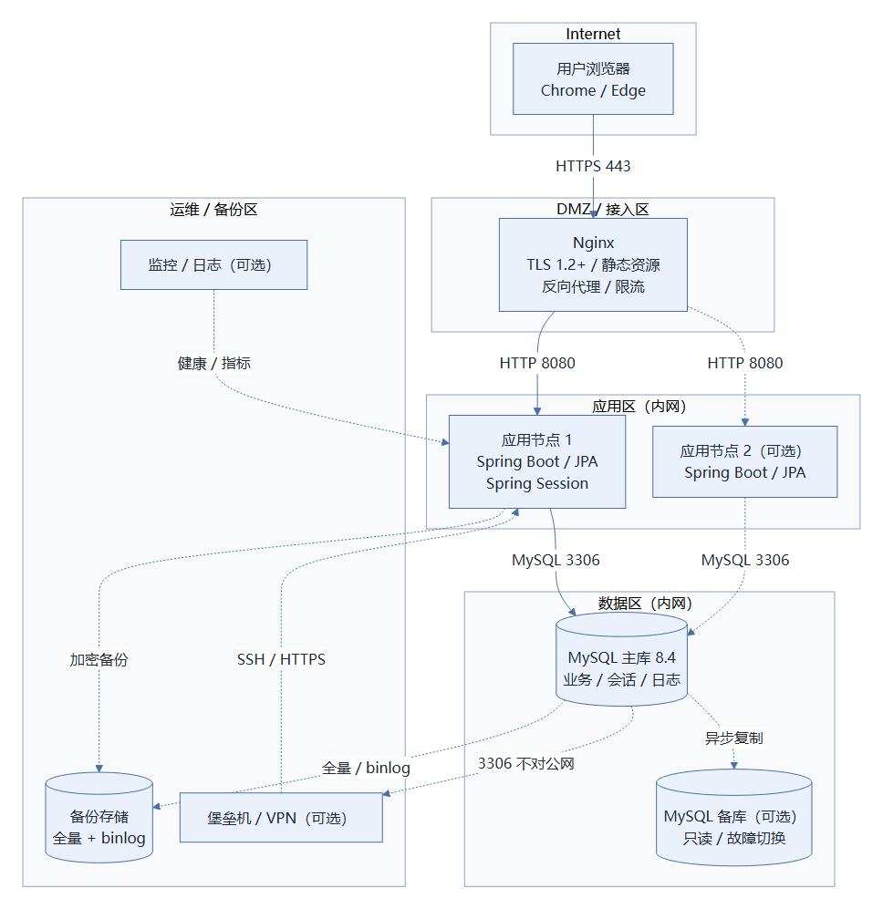

**图 7-1 系统部署图**

## 7.2 物理部署架构说明

| 节点 | 角色 | 软件 | 网络区域 | 端口/协议 | 扩展方式 |
| --- | --- | --- | --- | --- | --- |
| 用户终端 | 浏览器 | Chrome / Edge | Internet | HTTPS 443 | 无 |
| Nginx 节点 | TLS、静态资源、反向代理、限流 | Nginx 1.26+ | DMZ/接入区 | 80/443 对公网；8080 对应用内网 | 多实例 + 负载均衡 |
| 应用节点 1 | Spring Boot 后端、JPA、会话 | JDK 21、Spring Boot 3.3 | 应用区（内网） | 8080 对 Nginx | 水平扩展；会话在 MySQL |
| 应用节点 2（可选） | 同应用节点 1 | 同上 | 应用区（内网） | 8080 对 Nginx | 虚线；生产建议至少 2 节点 |
| MySQL 主库 | 业务数据、会话、日志 | MySQL 8.4 | 数据区（内网） | 3306 只对应用区 | 垂直扩容；备库 |
| MySQL 备库（可选） | 只读/故障切换 | MySQL 8.4 | 数据区（内网） | 3306 只对主库/应用 | 异步复制；手动/自动切换 |
| 备份存储 | 全量备份、binlog | 对象存储/NAS | 独立存储区 | 加密传输 | 保留 30 天 |
| 监控/日志（可选） | 健康检查、指标、日志 | Prometheus/Grafana/ELK 或云监控 | 运维区 | HTTPS/内网 | 按需 |
| 堡垒机/VPN（可选） | 运维入口 | 堡垒机/VPN | 运维区 | SSH/HTTPS | 生产建议 |

**课程单机部署映射：**

| 容器/服务 | 镜像/构建 | 说明 |
| --- | --- | --- |
| `web` | Nginx + 前端静态文件 | 对外暴露 80/443；代理 `/api` 到 `backend` |
| `backend` | Spring Boot 应用镜像 | 只在内网网络；环境变量注入数据库连接和初始密码 |
| `db` | MySQL 8.4 | 只在内网网络；持久卷保存数据；首次启动执行 Flyway/迁移 |

单机部署时，应用节点和数据库在同一台 Linux 服务器的不同容器中，通过 Docker 内部网络通信；只发布 Nginx 端口。生产增强时，把 `backend` 扩展到多节点、`db` 增加备库，Nginx 做上游负载均衡；应用代码不需要改，因为会话在 MySQL、缓存键含版本。

## 7.3 网络隔离与安全

| 区域 | 允许的流量 | 禁止的流量 |
| --- | --- | --- |
| Internet → DMZ | HTTPS 443 到 Nginx；HTTP 80 仅用于跳转 HTTPS | 直接访问应用 8080、数据库 3306、SSH 22 |
| DMZ → 应用区 | Nginx → 应用 8080 | 应用主动访问 Internet（除必要的包更新/监控） |
| 应用区 → 数据区 | 应用 → MySQL 3306 | 其他主机访问 MySQL；数据库访问公网 |
| 运维区 → 各区域 | 堡垒机/VPN → SSH/HTTPS | 公网直接 SSH；共享 root 密码 |
| 备份区 | 数据库/应用 → 备份存储（加密） | 备份文件公开下载 |

**安全措施：**

- TLS 1.2+；HSTS；证书自动续期；HTTP 跳转 HTTPS。
- 数据库专用账号只授予本库增删改查；不使用 root；数据库端口不发布。
- 容器最小权限：`no-new-privileges`、只读根文件系统、临时目录 tmpfs（与现有部署配置一致）。
- 环境变量/密钥管理；`.env` 权限 600；不提交仓库；不把密码写进镜像。
- Nginx 限流、请求体大小限制、超时；应用层 Bean Validation；防暴力登录锁定。
- 生产关闭或限制 Swagger UI；健康检查只暴露必要信息。
- 日志脱敏：不记录密码、Cookie、完整手机号；错误响应带 `requestId`，不返回堆栈。

## 7.4 发布、迁移与回滚

**发布流水线：**

1. 代码提交 → CI：编译、单元测试、契约测试、前端构建、OpenAPI 校验、迁移脚本静态检查。
2. 构建镜像并打 SHA 标签；生成部署清单。
3. 备份数据库；在预发/演练库执行 Flyway 迁移，跑冒烟。
4. 生产发布：先迁移（前向兼容），再滚动更新应用节点；Nginx 健康检查通过后接流量。
5. 冒烟：登录、切换应用、菜单、关键允许/拒绝场景、日志。
6. 记录源码 SHA、镜像标签、迁移版本、执行人、结果。

**迁移规则：**

- 只追加迁移，不改写已应用迁移；用新迁移修正。
- 迁移前备份；迁移与代码发布解耦，保证旧代码在新结构上可运行（扩展-回填-切换-清理）。
- 大表变更使用在线 DDL 或分批回填；避免长时间锁表。
- 迁移后跑有效权限快照对比；差异必须解释。

**回滚：**

- 应用回滚：切换到上一个镜像标签；数据库结构保持前向兼容。
- 数据库回滚：优先用备份恢复到独立库验证，再切换；不使用破坏性 `down -v`。
- 迁移失败：停止发布，保留现场，按备份/回滚脚本恢复；记录原因。
- 回滚后复验：登录、授权、关键 API、日志。

## 7.5 可观测性与运维

| 项目 | 设计 |
| --- | --- |
| 健康检查 | `/api/v1/health` 检查应用和数据库连通性；Nginx 据此摘除节点 |
| 指标 | 请求量、延迟 P50/P95/P99、错误率、缓存命中率、数据库连接池、登录失败、403 比例 |
| 日志 | 结构化 JSON；`requestId` 贯穿请求；不记录敏感字段；按级别/模块检索 |
| 慢查询 | 开启 MySQL 慢查询日志；定期 `EXPLAIN ANALYZE` 核心查询 |
| 审计 | 登录、授权变更、部门管理员任命、API 映射变更写审计；只增不改 |
| 告警 | 健康检查失败、5xx 比例、`API_NOT_REGISTERED`、登录失败激增、磁盘/连接池告警 |
| 容量 | 监控用户数、会话数、日志增长；日志按月归档；数据库磁盘预警 |
| 备份 | 每日全量 + binlog；定期恢复演练；备份加密和异地保存 |

<!-- pagebreak -->

# 8 非功能需求的实现方案

本章逐条说明性能、安全、可靠性、可维护性和可移植性需求在架构与模块设计中的落实，与第 2 节的 ATAM 评估相互呼应。第 8.6 节给出逐条对照表。

## 8.1 性能

| 需求 | 设计措施 | 验证方式 |
| --- | --- | --- |
| NFR-PERF-01 单次鉴权查询 ≤10 ms | 鉴权读主库；`sys_api(operation_id)`、`sys_permission(code)`、`sys_role_permission(role_id)` 索引；有效权限按 `userId+appCode+authzVersion` 缓存；缓存未命中时用投影查询，避免加载完整实体图 | `EXPLAIN ANALYZE`；压测脚本测单次鉴权；记录 P95 |
| NFR-PERF-02 常用页面 ≤1 s | 范围裁剪下推 SQL；服务端分页；列表投影；避免 N+1（JPA fetch join/EntityGraph 或原生投影）；连接池；前端懒加载 | 10,000 员工数据量下测用户列表、角色列表、台账列表、授权保存；记录 P95 |
| NFR-PERF-03 EXPLAIN/慢查询/缓存失效 | 核心查询出 `EXPLAIN ANALYZE` 报告；开启慢查询日志；缓存键含版本，授权变更即失效；监控缓存命中率 | 报告归档；慢查询阈值告警；缓存命中率看板 |

**性能设计要点：**

1. **范围先裁剪、再筛选、再分页。** 不能先查出全部用户再在内存中过滤，否则数据量一大就超时，也容易泄露范围外数据。
2. **列表用投影。** 用户列表只取 id、工号、姓名、部门、岗位、电话、邮箱等展示字段；不加载密码哈希、角色全集等大对象。
3. **避免 N+1。** 角色/权限/菜单树查询使用批量查询或 EntityGraph；菜单树一次查当前应用的资源，再一次查用户权限，内存装配。
4. **缓存只缓存有效权限，不缓存最终允许/拒绝。** 目标对象范围每次检查，避免缓存导致越权。
5. **深翻页。** 日志和大列表优先用基于排序键的游标分页；课程阶段可先用 offset，但必须有索引和上限。
6. **压测。** 用 10,000 员工、2,154 权限、3,555 授权的数据量做基线；记录环境、SQL、并发数、P95，不用合成小数据代替。

## 8.2 安全

| 需求 | 设计措施 | 验证方式 |
| --- | --- | --- |
| NFR-SEC-01 密码慢哈希 | PBKDF2 加盐慢哈希，带算法前缀；导入和后端统一；不存明文；不返回前端 | 单元测试校验哈希；登录成功/失败；数据库抽查无明文 |
| NFR-SEC-02 SQL 参数绑定 | JPA/原生查询全部参数绑定；不拼接用户输入；排序字段白名单 | 代码扫描；注入用例；CRUD 测试 |
| NFR-SEC-03 统一登录失败提示 | 用户不存在、密码错误、停用、锁定统一提示；真实原因只写日志；首次登录改密 | 四类失败响应一致；日志有真实原因；改密门禁测试 |
| NFR-SEC-04 数据库不暴露公网 | 数据库只在内网；专用账号最小权限；Nginx 只暴露 80/443 | 端口扫描；网络策略检查；账号权限检查 |
| NFR-SEC-05 仓库不含敏感数据 | 原始 Excel、真实姓名/电话、哈希、备份、密钥、令牌不进仓库；样例全合成 | `.gitignore` + 提交扫描；历史泄露检查 |

**权限与鉴权安全：**

- 默认拒绝；未登记/未映射 API 拒绝；API 启动校验；契约测试覆盖每个端点。
- 前端权限树只是展示；后端从会话取身份；不信任请求中的用户 ID、角色、权限、范围。
- 部门管理员双标识；管理类角色实时按 `rbac:*` 判定；不能分配管理类角色，不能改角色授权。
- 账号保护：不能停用/删除自己，不能修改自己的角色，唯一超级管理员受保护。
- 会话：`HttpOnly`、`SameSite=Lax`、HTTPS `Secure`；登录轮换 ID；退出失效；超时；停用用户下一次请求 401。
- 审计：登录、授权变更、部门管理员任命、API 映射变更；只增不改；导出受权限控制。
- 错误不泄露：403/404 不返回目标字段；登录失败不区分原因；日志脱敏。

## 8.3 可靠性

| 需求 | 设计措施 | 验证方式 |
| --- | --- | --- |
| NFR-DATA-01 外键/CHECK/唯一键 | 用户工号/手机号唯一；角色编码唯一；权限码唯一；数据范围 CHECK；菜单/按钮类型 CHECK；部门/角色继承环由应用校验 | 迁移测试；约束违反用例；导入校验 |
| NFR-DATA-02 事务与版本 | 应用服务 `@Transactional`；整组替换/删除/任命单事务；版本号乐观并发；409 不部分写入 | 集成测试：中途失败回滚；并发版本冲突；重复提交 |
| NFR-DATA-03 Flyway 迁移 | 迁移文件版本化；只追加；每份迁移验证有效权限前后一致；配回滚说明 | 迁移演练；快照对比；回滚演练 |
| NFR-DATA-04 备份 | 每日全量 + binlog；备份加密；恢复演练；导入/迁移前手动备份 | 恢复演练记录；RPO/RTO 测量 |

**可靠性设计要点：**

1. **应用无状态。** 会话在 Spring Session JDBC；应用节点可重启/扩展；文件导出不依赖本地长期状态。
2. **健康检查与摘流。** `/health` 检查数据库；Nginx 摘除不健康节点；恢复后逐步接流量。
3. **数据库故障。** 单机课程部署接受较长 RTO，但必须有备份；生产增强加备库/自动切换；已提交数据不丢。
4. **幂等导入。** 重复导入结果一致；用业务键和快照对比，不靠“再跑一遍看看”。
5. **失败可诊断。** `requestId`、结构化日志、审计；错误响应不泄露内部细节，但日志可定位。
6. **不把 H2/合成数据测试当作生产通过。** 迁移、持久化、性能必须在 MySQL 和全量数据上单独验证。

## 8.4 可维护性

| 需求 | 设计措施 | 验证方式 |
| --- | --- | --- |
| NFR-MAINT-01 新增操作只加数据不改表 | 菜单/按钮/权限/API/映射数据驱动；权限码稳定；鉴权核心只认权限码和 `operationId` | 新增按钮/API 演练；无结构迁移；两套后端契约测试 |
| NFR-MAINT-02 有效权限集中 | `EffectivePermissionCalculator` 唯一授权来源；视图只做核对；所有接口调用同一策略 | 单元测试覆盖并集/范围/继承/停用；一致性抽样 |
| NFR-IMPL-01 两套后端同契约 | 同一 OpenAPI、同一表结构、独立实现；同一契约测试套件；CI 同时跑 | 契约测试；差异对比；接口变更同步检查 |
| NFR-IMPL-02 函数式模块 | 有效权限计算、范围合并、继承展开、约束检查写成纯函数；独立单元测试 | 纯函数测试；无数据库依赖；边界用例 |
| NFR-IMPL-03 数据字典自动生成 | 从 `information_schema` 生成字段字典；与迁移版本对齐 | 生成脚本；文档与库结构 diff |

**可维护性设计要点：**

- 模块边界清晰；不跨模块访问表；应用服务编排事务；领域服务纯函数；基础设施适配。
- 权限码稳定；显示名称、路由、排序可改，权限码不改。
- OpenAPI 是唯一契约；Controller 注解、`sys_api`、前端客户端、测试同源。
- 设计、代码、测试、验收记录用需求编号串联；变更必须更新追溯矩阵。
- AI 生成代码必须过编译、测试、事务边界和权限拒绝场景检查；不能直接合并未审查的生成结果。

## 8.5 可移植性

| 需求 | 设计措施 |
| --- | --- |
| NFR-ENV-01 环境 | JDK 21、Spring Boot 3.3、MySQL 8.4、Vue 3；Docker 镜像；环境变量配置；Linux 云服务器 |
| 数据库可移植 | JPA 为主；递归 CTE 等 MySQL 特性集中在少量原生查询；不把 SQL 散落业务代码 |
| 部署可移植 | Docker Compose/容器；Nginx 配置外置；不绑定云厂商专有服务；备份/监控可选 |
| 前端可移植 | 标准 Web；同源 API；不做移动端；浏览器兼容 Chrome/Edge |
| 配置外置 | 数据库连接、初始密码、CORS、Cookie Secure、演示开关用环境变量；不写死仓库 |

## 8.6 非功能需求落实表

| 编号 | 需求摘要 | 设计落实 | 章节 |
| --- | --- | --- | --- |
| NFR-SEC-01 | 密码加盐慢哈希 | PBKDF2；导入/后端统一；不存明文 | 8.2、6.4 |
| NFR-SEC-02 | SQL 参数绑定 | JPA/参数化原生查询；不拼接 | 8.2、6.4 |
| NFR-SEC-03 | 登录失败不区分原因、首次改密 | 统一提示；须改密会话门禁 | 4.2、8.2 |
| NFR-SEC-04 | 数据库不暴露公网、最小权限 | 内网、专用账号、Nginx 只暴露 80/443 | 7.3、8.2 |
| NFR-SEC-05 | 仓库不含敏感数据 | 忽略规则、提交扫描、合成样例 | 6.4、8.2 |
| NFR-PERF-01 | 单次鉴权 ≤10 ms | 索引、投影、版本键缓存、主库读 | 8.1、6.3.3 |
| NFR-PERF-02 | 常用页面 ≤1 s | 范围下推、分页、投影、避免 N+1 | 8.1、6.3.4 |
| NFR-PERF-03 | EXPLAIN、慢查询、缓存失效 | 报告、慢查询日志、版本失效、命中率 | 8.1、7.5 |
| NFR-DATA-01 | 外键/CHECK/唯一键 | 表约束、应用校验、导入校验 | 6.2、8.3 |
| NFR-DATA-02 | 事务与版本 | `@Transactional`、整组替换、409 | 2.1.3、6.3.2、8.3 |
| NFR-DATA-03 | Flyway 迁移、前后一致 | 版本化迁移、快照对比、回滚 | 6.3.5、6.5.2、8.3 |
| NFR-DATA-04 | 备份 | 全量 + binlog、恢复演练 | 6.3.5、7.4、8.3 |
| NFR-MAINT-01 | 新增操作只加数据 | 目录/权限/API/映射数据驱动 | 2.2.3、6.2、8.4 |
| NFR-MAINT-02 | 有效权限集中 | 领域服务唯一来源、视图核对 | 4.1、6.3.3、8.4 |
| NFR-IMPL-01 | 两套后端同契约 | 同一 OpenAPI/表结构、契约测试 | 2.1.3、8.4 |
| NFR-IMPL-02 | 函数式纯函数 | 有效权限/范围/继承/约束纯函数 + 单测 | 4.1、8.4 |
| NFR-IMPL-03 | 数据字典自动生成 | `information_schema` 生成、版本对齐 | 8.4 |
| NFR-ENV-01 | 技术栈与环境 | JDK 21/Spring Boot 3.3/MySQL 8.4/Vue 3/Docker | 2.1.3、7.2、8.5 |

<!-- pagebreak -->

# 9 附录：需求可追溯性矩阵

本附录确保概要设计中的每个模块、接口、数据策略和架构决策都能追溯到《需求规格说明书》的需求编号。评审时可抽查“需求编号 → 模块/接口/数据实体”的对应是否真实成立。

## 9.1 功能需求追溯表

| 需求编号 | 需求名称 | 架构故事/决策 | 对应设计模块/类 | 对应内部/外部接口 | 对应全局数据实体 |
| --- | --- | --- | --- | --- | --- |
| LOGIN-01 | 登录认证 | S2、D4 | identity / AuthAppService、AuthController | API-AUTH-01 | sys_user、sys_login_log |
| LOGIN-02 | 会话建立与角色激活 | S2、D4 | identity / SessionService | API-AUTH-01 | sys_user_role、sys_role、spring_session |
| LOGIN-03 | 退出登录 | D4 | identity / AuthAppService | API-AUTH-02 | spring_session |
| LOGIN-04 | 修改本人密码 | D4、D6 | identity / PasswordCommand | API-ME-02 | sys_user |
| LOGIN-05 | 首次登录改密 | D4 | identity / AuthAppService | API-AUTH-01、API-ME-02 | sys_user |
| LOGIN-06 | 登录失败锁定 | D4 | identity / AuthAppService | API-AUTH-01 | sys_user、sys_login_log |
| LOGIN-07 | 激活角色 | D4、D5 | identity / AuthAppService、authz / EffectivePermissionCalculator | API-AUTH-04 | sys_user_role、spring_session |
| PORTAL-01 | 门户菜单 | S1、D3 | portal / MenuTreeAssembler | API-PORTAL-02 | app_resource、sys_permission |
| PORTAL-02 | 功能点占位页 | D3 | portal / PortalAppService | API-PORTAL-03、API-PORTAL-04 | app_resource、sys_permission |
| PORTAL-03 | 我的权限 | D3 | authz / EffectivePermissionCalculator、portal | API-ME-03 | sys_role_permission、sys_user_role |
| PORTAL-04 | 员工台账列表 | S1、D3 | ledger / LedgerAppService | API-LEDGER-01 | sys_user、sys_dept、sys_role_permission |
| PORTAL-05 | 员工台账编辑 | S2、D3 | ledger / LedgerAppService、authz / ScopeResolver | API-LEDGER-02 | sys_user、sys_role_permission |
| PORTAL-06 | 台账按钮状态 | D3 | portal / PortalAppService | API-PORTAL-03、API-PORTAL-04 | app_resource、sys_permission |
| USER-01 | 用户列表 | S1、D5 | user / UserAppService、org / OrgScopeResolver | API-USER-01 | sys_user、sys_dept |
| USER-02 | 新增用户 | D6 | user / UserAppService | API-USER-02 | sys_user |
| USER-03 | 编辑用户 | D5、D6 | user / UserAppService、org | API-USER-04 | sys_user、sys_dept |
| USER-04 | 启停用户 | D4、D5 | user / UserAppService | API-USER-05 | sys_user、spring_session |
| USER-05 | 重置密码 | D4、D6 | user / UserAppService、identity | API-USER-06 | sys_user |
| USER-06 | 删除用户 | D5、D6 | user / UserAppService | API-USER-07 | sys_user、sys_user_role、sys_dept |
| USER-07 | 账号保护 | D5 | user / UserAppService、authz | API-USER-05、API-USER-06、API-USER-07、API-USER-09 | sys_user |
| DEPT-01 | 部门树 | D5 | org / DepartmentAppService | API-DEPT-01 | sys_dept |
| DEPT-02 | 部门成员 | D5 | org / DepartmentAppService、user | API-DEPT-02 | sys_dept、sys_user |
| ROLE-01 | 角色列表/新增/编辑 | D6 | role / RoleAppService | API-ROLE-01、API-ROLE-02、API-ROLE-03、API-ROLE-04 | sys_role |
| ROLE-02 | 启停角色 | D7 | role / RoleAppService、authz | API-ROLE-06 | sys_role、sys_role_permission |
| ROLE-03 | 内置角色保护/删除 | D5、D6 | role / RoleAppService | API-ROLE-05 | sys_role、sys_user_role、sys_role_permission |
| ROLE-04 | 角色成员 | D5 | role / RoleAppService、user | API-ROLE-07 | sys_user_role、sys_user |
| ROLE-05 | 设置上级角色 | D6 | role / RoleAppService、authz | API-ROLE-12 | sys_role_inherit |
| ROLE-06 | 禁止继承环 | D6 | role / ConstraintChecker | API-ROLE-12 | sys_role_inherit |
| ROLE-07 | 有效权限来源 | D3 | role / RoleAppService、authz | API-ROLE-10 | sys_role_permission、sys_role_inherit |
| ROLE-08 | 停用角色断链 | D7 | authz / EffectivePermissionCalculator | API-ROLE-10、API-ME-03 | sys_role、sys_role_inherit |
| ROLE-09 | 公共能力角色迁移 | D6、D9 | import / ImportJob、role | 离线导入 CLI | sys_role、sys_role_permission、sys_role_inherit |
| ROLE-10 | 静态互斥 SSD | D5、D6 | role / ConstraintChecker、grant / GrantAppService | API-ROLE-14、API-USER-09 | sys_constraint、sys_constraint_role |
| ROLE-11 | 动态互斥 DSD | D5、D6 | role / ConstraintChecker、identity | API-ROLE-14、API-AUTH-04 | sys_constraint、spring_session |
| ROLE-12 | 基数约束 | D5、D6 | role / ConstraintChecker、grant | API-ROLE-14、API-USER-09 | sys_constraint |
| ROLE-13 | 约束沿继承传递 | D6 | role / ConstraintChecker | API-ROLE-12、API-ROLE-14 | sys_role_inherit、sys_constraint_role |
| ROLE-14 | 新增约束检查现有数据 | D6 | role / ConstraintChecker | API-ROLE-14 | sys_constraint、sys_user_role |
| ROLE-15 | 约束样例 | D6 | import / ImportJob | 离线导入 CLI | sys_constraint、sys_role |
| CAT-01 | 资源目录 | D3、D8 | catalog / CatalogAppService | API-CAT-01、API-CAT-02、API-CAT-03 | app_application、app_resource、sys_permission |
| CAT-02 | 权限码格式 | D3、D8 | catalog / CatalogAppService、shared / PermissionCode | API-CAT-03 | sys_permission、app_resource |
| CAT-03 | 管理后台映射 | D3 | catalog、import | API-CAT-03、离线导入 | sys_permission、sys_role_permission |
| GRANT-01 | 分配/撤销角色 | S2、D6 | grant / GrantAppService | API-USER-08、API-USER-09 | sys_user_role、sys_user |
| GRANT-02 | 角色授权 | S2、D6 | grant / GrantAppService | API-ROLE-08、API-ROLE-09 | sys_role_permission、sys_role |
| GRANT-03 | 部门管理员可授出范围 | S3、D5 | grant / GrantAppService、org / OrgScopeResolver | API-USER-09 | sys_user（admin_type/admin_dept_id）、sys_user_role |
| GRANT-04 | 多角色合并 | D3、D7 | authz / EffectivePermissionCalculator | API-ME-03 | sys_role_permission、sys_user_role |
| GRANT-05 | 授权变更立即生效 | S2、D7 | authz、grant、identity | 所有受保护 API | sys_authz_version、sys_user_role、sys_role_permission |
| GRANT-06 | 约束检查与触发器兜底 | D5、D6 | grant / GrantAppService、role / ConstraintChecker | API-USER-09、API-ROLE-14 | sys_constraint、sys_user_role（数据库触发器） |
| AUTHZ-01 | 鉴权顺序 | S2、S3、D3 | authz / AuthorizationService | 所有受保护 API | sys_api、sys_permission_api、sys_role_permission |
| AUTHZ-02 | 默认拒绝 | S2、D3 | authz / AuthorizationService、ApiPermissionResolver | 所有受保护 API | sys_api、sys_permission_api |
| AUTHZ-03 | 数据范围检查 | S3、D5 | authz / ScopeResolver、org | 所有数据 API | sys_dept、sys_role_permission、sys_user |
| AUTHZ-04 | 继承后鉴权 | D6 | authz / EffectivePermissionCalculator | 所有受保护 API | sys_role_inherit |
| AUTHZ-05 | 仅激活角色 | D4 | authz、identity | API-AUTH-04 | spring_session、sys_user_role |
| IMPORT-01 | 部门导入 | D8、D6 | import / ImportJob | 离线导入 CLI | sys_dept |
| IMPORT-02 | 目录/角色导入 | D8、D3 | import / ImportJob、catalog | 离线导入 CLI | app_application、app_resource、sys_permission、sys_role_permission |
| IMPORT-03 | 数据范围导入 | D8 | import / ImportJob | 离线导入 CLI | sys_role_permission |
| IMPORT-04 | 员工导入 | D8 | import / ImportJob | 离线导入 CLI | sys_user、sys_user_role |
| IMPORT-05 | 导入幂等 | D8、D6 | import / ImportJob | 离线导入 CLI | 全部主数据 |
| IMPORT-06 | 初始密码 | D8 | import / ImportJob、identity | 离线导入 CLI | sys_user |
| LOG-01 | 登录日志 | D4 | audit / AuditAppService | API-AUTH-01、API-AUDIT-01 | sys_login_log |
| LOG-02 | 授权变更日志 | S2、D6 | audit / AuditAppService、grant | API-USER-09、API-ROLE-09、API-AUDIT-02 | sys_grant_log |
| LOG-03 | 日志查询与导出 | D6 | audit / AuditAppService | API-AUDIT-01、API-AUDIT-02、API-AUDIT-03 | sys_login_log、sys_grant_log |

## 9.2 非功能需求追溯表

| 需求编号 | 需求名称 | 对应架构故事/决策 | 对应设计模块/机制 | 对应全局数据/部署 |
| --- | --- | --- | --- | --- |
| NFR-SEC-01 | 密码慢哈希 | D4、D6 | identity / 密码编码器 | sys_user.password_hash |
| NFR-SEC-02 | SQL 参数绑定 | D6 | infrastructure / JPA 仓库 | 全部业务表 |
| NFR-SEC-03 | 统一登录失败、首次改密 | D4 | identity / AuthAppService | sys_user.must_change_password、sys_login_log |
| NFR-SEC-04 | 数据库不暴露公网、最小权限 | D10 | 部署 / Nginx、MySQL 账号 | 7.3 网络与账号 |
| NFR-SEC-05 | 仓库不含敏感数据 | D8 | import / 受控目录、提交扫描 | 原始 Excel、备份、密钥 |
| NFR-PERF-01 | 鉴权 ≤10 ms | D7 | authz / EffectivePermissionCalculator、Caffeine | 索引、sys_authz_version |
| NFR-PERF-02 | 页面 ≤1 s | D7 | user/role/ledger 查询、分页、投影 | 索引、分页查询 |
| NFR-PERF-03 | EXPLAIN/慢查询/缓存失效 | D7 | 运维、authz 缓存 | 慢查询日志、缓存键 |
| NFR-DATA-01 | 外键/CHECK/唯一键 | D6 | 迁移 / 表约束 | 6.2 全部表 |
| NFR-DATA-02 | 事务与版本 | D6 | application / `@Transactional`、版本号 | sys_user.role_version、sys_role.permission_version、sys_authz_version |
| NFR-DATA-03 | Flyway 迁移、前后一致 | D6、D8 | 迁移 / 快照对比 | flyway_schema_history、有效权限快照 |
| NFR-DATA-04 | 备份 | D10 | 运维 / 全量 + binlog | 备份存储 |
| NFR-MAINT-01 | 新增操作只加数据 | D3、D8 | catalog / 资源、权限、API、映射 | app_resource、sys_permission、sys_api、sys_permission_api |
| NFR-MAINT-02 | 有效权限集中 | D3 | authz / EffectivePermissionCalculator | sys_role_permission、视图核对 |
| NFR-IMPL-01 | 两套后端同契约 | D9 | 两套后端 / OpenAPI、契约测试 | 同一表结构 |
| NFR-IMPL-02 | 函数式纯函数 | D6 | authz / 纯函数模块 | 无数据库依赖 |
| NFR-IMPL-03 | 数据字典自动生成 | D8 | 运维 / information_schema | 全部业务表 |
| NFR-ENV-01 | 技术栈与环境 | D1、D10 | 部署 / JDK21、Spring Boot 3.3、MySQL 8.4、Vue3 | 7.2 节点 |

## 9.3 引用大作业一分析模型图编号清单

下表列出本设计引用的需求阶段分析模型。编号为本设计为引用方便所赋，提交前应与《需求规格说明书》最终图号核对统一；内容以需求规格为准。

| 引用编号 | 分析模型 | 主要内容 | 本设计使用位置 |
| --- | --- | --- | --- |
| R-01 | 用例图 | UC-01 登录、UC-02 查询用户、UC-03 赋予/撤销角色、UC-04 配置角色权限、UC-05 配置继承、UC-06 配置约束、UC-07 激活角色、UC-08 执行受保护操作 | 2.3、5.2、9.1 |
| R-02 | 用例详述 | 上述 8 个用例的参与者、前置条件、正常/异常流程、后置条件、相关规则 | 4.4、5.2 |
| R-03 | 活动图 | 登录、用户查询、角色授权的主要活动流 | 4.2、4.4 |
| R-04 | 概念类图 | 用户、部门、角色、权限、用户角色、角色权限、资源目录 | 4.1、6.1 |
| R-05 | 状态图 | 用户账号状态与登录/锁定/停用/改密事件 | 4.2 |
| R-06 | 分层数据流图 | 顶层图和第一层图，加工与数据存储 | 4.3 |
| R-07 | 数据需求/数据字典 | 实体、关系、数据规模、清洗规则 | 6.1、6.2、6.5 |
| R-08 | 非功能需求场景 | 性能、安全、可靠性、可维护性指标 | 2.3、2.4、第 8 章 |

## 9.4 追溯矩阵维护规则

1. **需求变更先改需求规格，再改本矩阵。** 新增/删除/修改需求编号时，必须同步更新对应的模块、接口、实体和测试。
2. **新增 API 必须四件套。** OpenAPI `operationId`、Controller 注解、`sys_api` 登记、`sys_permission_api` 映射；缺一不可。
3. **新增按钮必须三件套。** `app_resource` 按钮资源、`sys_permission` 权限、`sys_permission_api` 映射；同时在前端加权限码判断。
4. **新增权限码保持稳定。** 显示名称、路由、排序可变；权限码格式和资源码不可变。
5. **每阶段验收前抽查。** 按需求编号随机抽取 5~10 条，检查模块、接口、实体是否真实存在；不能只查表格。
6. **设计与代码一致。** 如果代码实现与本文不一致，先确认是设计变更还是缺陷；设计变更要更新本文和 OpenAPI，缺陷要修复代码。
7. **AI 生成内容同样追溯。** AI 生成的 API、实体、测试必须能回到需求编号和界面动作；不能出现“文档里有、界面没有”的资源。
