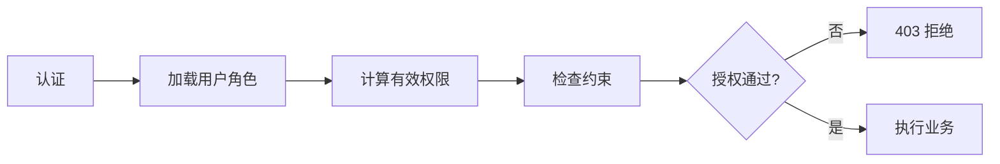

# 成员 4（王信凯）与成员 5（胡俊朗）：RBAC0 阶段完成内容与学习说明

本文解释成员 4、成员 5 这次交付（面向功能后端由王信凯与胡俊朗共同完成）：做了什么、为什么这样做、怎样验证，以及怎样交给其他成员接入。

依据是仓库最新的 [六人分工](../planning/team.md)、[首次任务](../planning/first-tasks.md)。当前按 2026 年 10 月 11 日的准备阶段处理，阶段一内部截止为 10 月 26 日，老师验收窗口为 10 月 27—29 日；时间以老师通知为准。

## 1. 你现在应该完成什么

面向功能/过程的后端。第一阶段重点是功能分解、后端接口草案和基础授权——把登录、角色、授权流程拆成过程，写清接口输入输出、认证与失败分支，并说明 RBAC0 权限并集怎样计算。角色继承属于 RBAC1，约束与激活角色属于后续阶段。

老师确认前先按 **Java 21 + Spring Boot** 的默认假设实现后端；所选默认值待全组统一后再修改。RBAC0 验收要求交付「面向功能基础后端」，代码已落在 `backend-procedural/`，并完成编译、集成测试与运行验证（47 个用例全部通过，JaCoCo 指令覆盖率 95%）。

| 交付 | 解决什么问题 | 位置 |
| --- | --- | --- |
| 功能分解与授权设计 | 授权过程、职责分层、基础授权算法、失败分支 | [设计说明](../design/member4-procedural-rbac0-design.md) |
| 后端接口草案 | 登录、角色、用户角色、目录等接口的输入输出与认证 | [接口草案](../../api/proposals/member4-procedural-backend-api.md) |
| 详细设计 | 架构、机制、模块、接口与测试设计 | [详细设计说明书](../design/detailed-design.md) |
| 自检记录 | 文档一致性、仓库检查、验证结果 | [验证记录](../testing/member4-procedural-rbac0-verification.md) |

当前交付已包含 Java / Spring 后端（含 H2 内存库与合成演示数据），已通过集成测试与运行时冒烟验证，可用 Swagger UI 在线调试。代码按同一设计实现，技术栈确认后只需调整默认假设（见 [后端 README](../../backend-procedural/README.md)）。

## 2. 为什么先做功能分解与接口草案

成员 2、3 已经给出前端页面与接口使用方需求，成员 6 需要统一契约，成员 5 要做 OO 后端。如果一开始就写代码，会因为语言、框架、ID、错误码、会话方式都没定而反复返工，还会让前端“猜字段”。

所以先把后端“怎样工作”写清楚：一个请求进来按什么顺序走、每一步输入输出是什么、成功返回什么、失败返回什么状态。这样前端可以照草案建 Mock，成员 6 可以写验收预期，成员 5 可以按同一契约做 OO 实现。设计定稿后，代码按同一设计实现，后续只改默认假设，返工面最小。

## 3. 先把 RBAC0 后端理解清楚

面向功能后端把一次受保护请求拆成一条流水线：

RBAC0 里“计算有效权限”就是**用户所有已分配、已启用角色权限的去重并集**。一个合成例子：

- 员工分配“文员”角色（`oa:document:read`、`oa:document:create`），再分配“审批员”角色（`oa:document:read`、`oa:document:approve`）。
- 有效权限是并集：查看、新建、审批；重复的 `read` 只保留一份。
- 撤销“审批员”后，审批权限消失，但来自“文员”的查看与新建仍保留。

这里没有继承、没有显式拒绝、没有约束。岗位名称也不是授权算法，不能因为某人是领导就自动补齐权限。

## 4. 基础授权怎样工作

核心是**默认拒绝**：没有精确匹配的权限码就拒绝；权限没加载、元数据无效也拒绝。后端只从会话取身份，忽略请求里自报的 `userId`、`roleIds`、`permissionCodes`。

两个容易踩的坑：

- **前端权限只用于展示**。菜单隐藏、按钮禁用、路由拦截都不能代替后端在每次请求时重新授权。
- **本人范围不能只靠前端**。`hr:self:read`、`oa:document:edit(self)` 必须在后端把目标记录归属与会话身份比对，否则改一下 URL 里的 ID 就能看别人的数据。

## 5. 接口草案怎样与前端、成员 6 对接

成员 3 提出前端要哪些字段，成员 2 提出登录、用户、部门接口，后端把它们合并成一份可实现的草案，统一了：

- 前缀 `/api/v1`、ID 用字符串、页码从 1 开始。
- 错误包络 `{ error: { code, message, requestId, details } }`。
- 状态码与错误码表（400/401/403/404/409）。
- 替换集合用 PUT 传完整集合 + `version`，用 409 处理并发冲突。

接口草案已按确认结论写入权威契约 [api/openapi.yaml](../../api/openapi.yaml)（13 路径 17 操作，与实现、测试三方一致）；后端维护的“准备按什么实现”以该契约为准，不另建互相矛盾的标准。

## 6. 怎样验证与演示

后端代码已完成编译、集成测试与运行验证，可以直接演示：

1. `mvn clean test`：47 个集成测试全部通过，自动生成 JaCoCo 覆盖率报告（`backend-procedural/target/site/jacoco/index.html`，指令覆盖 95%）。
2. `mvn spring-boot:run` 启动后：Swagger UI `http://localhost:8080/swagger-ui.html` 用演示账号在线调接口；H2 控制台 `http://localhost:8080/h2-console`（JDBC URL `jdbc:h2:mem:rbac`）查看 7 张表数据。
3. 运行时冒烟已验证：登录 200 → 查询本人权限（14 个权限码）→ 越权请求 403 → 创建用户 201 → 停用 200 → 删除 204 → 未登录 401。
4. 静态检查：`python scripts/check_repository.py`、`git diff --check`。

## 7. 怎样和其他成员合成一个应用

- **交给成员 2、3**：按 OpenAPI 契约建 Mock 与统一 API 客户端；前端不自己发明字段。
- **交给成员 6**：把确认结论写入 OpenAPI，写独立验收用例，直接发 HTTP 验证后端拒绝。
- **交给成员 5**：同一外部契约、等价独立数据，OO 后端独立实现核心授权，不调用本后端的权限计算来冒充第二种实现。
- **交给成员 1**：提供稳定的用户 ID、角色 ID、资源 ID 和岗位到角色的映射，支撑真实数据导入。

## 8. OOAD 课程里怎样解释你的设计

老师考察的不是能跑代码，而是需求、模型和设计为什么一致。可以这样讲：

> 一次受保护操作进入后端后，先认证身份，再加载该用户的角色，计算有效权限（角色权限并集），检查操作权限与本人范围，最后在事务里执行业务。前端负责输入与错误反馈，后端是唯一可信的授权依据，数据库保存用户与角色关系。

面向功能与面向对象是两种组织方式：本文后端按过程流水线分解，另一个后端按 User/Role/Permission/Policy 等领域对象组织，两者对外契约一致、结果等价，用来说明同一种需求可以有不同设计思路。

## 9. 后续阶段需要你继续完成什么

| 阶段 | 后续工作 | 当前边界 |
| --- | --- | --- |
| RBAC0 | 真实数据库联调、补齐会话失效与部门范围过滤 | 已编译并测试通过；切 MySQL 后按方言核对 |
| RBAC1 | 继承闭包计算、单父树/多父 DAG 校验 | 只保留“计算有效权限”前的扩展位置 |
| 约束阶段 | SSD 分配冲突、DSD 会话激活冲突 | 只保留“检查约束”步骤的扩展位置，不实现算法 |

## 10. GitHub 交付流程

按全组约定走「任务分支 → 作者自检及必要自动检查 → 提交或 PR 记录 → 负责人合并」，不设强制人工评审。接口、数据和公共组件的约定仍需与对应负责人统一，避免前后端无法连接。

你能亲自解释并演示：面向功能后端的功能分解、权限并集与默认拒绝、认证→授权→业务的三层判断、失败分支与并发版本，以及未来写代码时这套设计落在哪个过程上。这份说明和设计文档可以一起作为课程答辩材料。
