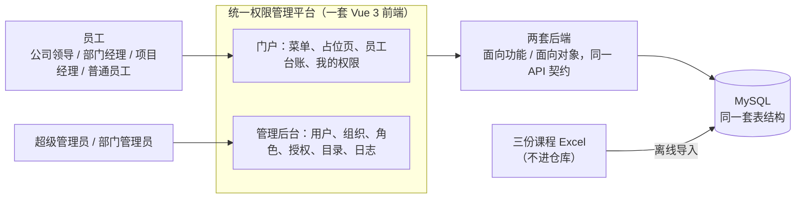

# 需求规格说明书（Req-spec）

状态：v1.1 组内结论，2026-10-15。成员 1 用 grill-me 需求访谈整理（v1.1 加入员工信息表后补了第 6 轮），待组长确认；3 个问题待老师确认（见 2.5）。

来源：[需求访谈记录](grill-record.md)（5 轮 40 题，每条结论的理由都在那里）、[需求范围](scope.md)、[待确认问题](questions.md)、三份课程 Excel、各成员的设计文档。

本文规定系统**做什么、做到什么程度算完成**。字段和接口细节分别在[数据字典](../database/data-dictionary.md)和 [OpenAPI](../../api/openapi.yaml) 中确定，与本文冲突时先改本文再改下游。

---

## 1 引言

### 1.1 编写目的与读者

- **老师**：对照三次验收检查每个阶段的完成情况。
- **全组**：按需求编号分工、写测试用例。本文是后续阶段的输入：界面原型、API 设计、数据库设计、详细设计（任务分解）、测试、编码。

### 1.2 项目背景

市政公司共有 111 个组织单元：1 个总公司、11 个总部部门、9 个分公司、54 个分公司下属部门、36 个项目经理部。公司在用 18 个软件系统，共 115 个功能模块、359 个功能点。各系统的权限目前写在 Excel 清单里，难以统一维护。

本项目建设一个**统一权限管理平台**：集中管理员工、角色和授权；员工登录后只能看到、只能使用自己有权限的功能；每次操作都由后端检查权限和数据范围。

课程提供三份原始资料：《部门信息表》《应用软件功能权限清单》《员工信息表》。三份都已拿到，员工信息表共 10,000 名员工。原始资料不进入本仓库（见 [数据说明](../../data/README.md)）。

### 1.3 术语

| 术语 | 含义 |
| --- | --- |
| 功能点 | 清单中最小的功能单元，如“员工台账管理”。按 系统 > 模块 > 功能点 三级组织 |
| 操作 | 对功能点能做的事，共 6 种：查看、新增、编辑、审批、导出、删除 |
| 权限 / 权限码 | 功能点 × 操作。权限码是稳定标识，格式为 `系统码:资源:动作`，如 `hr:f046:edit`（见 CAT-02） |
| 数据范围 | 拥有某项权限时能处理哪些数据：**全部**、**本部门**（用户所在部门及其全部下级部门）、**本人** |
| 有效权限 | 用户通过激活的角色，以及这些角色继承的角色，所获得权限的并集 |
| 业务角色 / 管理类角色 | 清单 5 列中除系统管理员外的 4 个角色及自建能力角色是业务角色；超级管理员、部门管理员是管理类角色 |
| 内置角色 | 清单的 5 个角色加部门管理员，共 6 个，不能删除 |
| 角色层级 | senior（上级）继承 junior（下级）的全部权限。允许一个角色有多个上级，即有向无环图（DAG） |
| 静态职责分离（SSD） | 两个互斥的角色不能分给同一个人 |
| 动态职责分离（DSD） | 两个角色可以同时拥有，但不能在同一会话里同时激活 |
| 基数约束 | 一个角色最多分给几个人，或一个人最多拥有几个角色 |

### 1.4 参考资料

1. Sandhu R. S. 等，*Role-Based Access Control Models*，IEEE Computer，1996（RBAC96，提出 RBAC0 ~ RBAC3）。
2. ANSI INCITS 359-2004 *Role Based Access Control*（NIST RBAC 标准）。
3. GB/T 8567-2006《计算机软件文档编制规范》。
4. 组内资料：[单仓库与双后端决定](../decisions/0001-monorepo.md)、[API 约定](../standards/api-contract.md)、[验收矩阵](../testing/acceptance-matrix.md)、[成员 2 前端约定](../design/member2-frontend-contract.md)、[成员 3 RBAC0 设计](../design/member3-rbac0-design.md)。

---

## 2 总体描述

### 2.1 系统定位与边界

只有一个系统、一次登录，分成两部分：

- **门户**：所有启用的账号都能登录。按权限生成 系统 > 模块 > 功能点 的菜单；17 个业务系统的功能点都是**占位页**，只展示按钮能否使用、数据范围是什么，不实现真实业务。唯一的例外是“员工台账管理”，它做成真实业务，用来演示数据范围不能被绕过。
- **管理后台**：用户、组织、角色、授权、权限目录、日志。只对拥有管理权限（`rbac:*`）的人显示。清单第 18 个系统“系统管理后台”就是这部分，它的授权映射成管理权限（见 CAT-03）。

### 2.2 参与者与角色

| 参与者 | 来源 | 在本系统中能做的事 |
| --- | --- | --- |
| 超级管理员 | 清单“系统管理员”列 | 全部功能。系统只预置一个账号 `admin`，界面上不能把这个角色授给别人 |
| 部门管理员 | **非清单角色**，平台为分级管理而设 | 管理本部门及全部下级部门的用户；给这些用户分配或撤销业务角色。不能分配管理类角色，不能修改角色授权。由超级管理员任命 |
| 公司领导 | 清单 | 门户中按清单使用各系统；管理后台只读（清单对系统管理后台只给了查看，日志另有导出） |
| 部门经理 / 项目经理 | 清单 | 门户中按清单使用各系统：查看为全部，管理类操作限本部门 / 本项目部（见 5.4） |
| 普通员工 | 清单 | 门户中按清单使用各系统；人力资源系统中 6 个功能点限本人 |

账号与角色独立：岗位名称不会自动带来权限，一个人可以有多个角色。

### 2.3 阶段规划

以组仓库 [README](../../README.md) 的阶段表为准：

| 阶段 | 内部截止 / 验收 | 交付 | 本文需求 |
| --- | --- | --- | --- |
| 一（RBAC0） | 10/26 / 10/27—10/29 | 界面设计、数据库设计、面向功能基础后端、清单全量导入 | 阶段为“一”的需求，见附录 A |
| 二（RBAC1） | 11/23 / 11/24—11/27 | 角色层级、两套后端、部分前端、比较测试 | 阶段为“二” |
| 三（约束与最终） | 12/21 / 12/22—12/24 | 约束与会话、前端、函数式模块、日志与优化、完整材料 | 阶段为“三” |

最终系统同时保留层级和约束，理论上属于 RBAC3；文档沿用课程叫法，并在验收时说明对应关系（RBAC96：RBAC1 = RBAC0 + 层级，RBAC2 = RBAC0 + 约束，RBAC3 = 两者合并）。

后一阶段在前一阶段的基础上扩展，已验收的需求在后续阶段仍须满足。

### 2.4 运行环境与技术约束

- **前端**：一套 Vue 3 前端，按配置连接任一后端。是否必须使用 TS + Tailwind（老师板书）待老师确认（Q-14）；成员 2 现用 JS + Element Plus。
- **后端**：两套，外部契约一致、核心授权逻辑分别实现（[ADR-0001](../decisions/0001-monorepo.md)）。`backend-procedural/` 为面向功能；`backend-oo/` 为面向对象，函数式模块放在其中。技术栈 JDK 21 + Spring Boot 3.3。
- **数据库**：MySQL 8.4。全组只有**一套表结构**，由成员 1 用迁移文件维护（Flyway 命名）；两套后端都使用它，各连独立的库实例。
- **部署**：最终部署到 Linux 云服务器。
- **仓库**：公开仓库。原始 Excel、真实员工信息、密码与哈希、数据库备份不提交（见 7.1）。

### 2.5 待确认事项

**需要问老师**（详见 [questions.md](questions.md)）：

| 编号 | 问题 | 组内建议 |
| --- | --- | --- |
| Q-02、Q-03 | 两套后端允许用什么框架，需要独立到什么程度，范式差异怎么评分 | 都用 Java 21 + Spring Boot；共享接口契约和数据库结构，不共享业务代码 |
| Q-13 | 约束类型老师有没有指定；样例能否自行构造；函数式模块验收时看什么 | SSD + DSD + 基数，样例自建；函数式为有效权限计算的纯函数 + 单元测试 |
| Q-14 | 界面原型是否必须用 Vue3 + TS + Tailwind | 希望允许沿用 JS + Element Plus |

**需要问组员**：成员 2，“临时运维账号”的出处（在得到依据前不做账号类别）；组长，评分照片上第三阶段“两种约束实现”的原文含义（两类约束，还是两套后端都要实现约束）。

---

## 3 功能需求

通用规则：每个受保护的接口都由后端检查权限和数据范围，前端隐藏或置灰按钮只是展示；没有明确授予的一律拒绝（默认拒绝）。

每条需求包含 编号、需求、阶段（一 / 二 / 三）和验收标准。验收标准使用以下演示账号，姓名不写入本仓库：

| 账号 | 角色 |
| --- | --- |
| `admin` | 超级管理员 |
| `SG000001` | 公司领导（董事长） |
| `SG000011` | 部门经理（综合办公室主任） |
| `SG000013` | 普通员工（综合办公室干事） |
| `SG000281` | 项目经理（道路工程分公司第一项目经理部） |

### 3.1 登录与会话

| 编号 | 需求 | 阶段 | 验收标准 |
| --- | --- | --- | --- |
| LOGIN-01 | 用工号或手机号加密码登录。用户不存在、密码错误、账号停用、账号锁定，一律提示“用户名或密码错误” | 一 | 四种失败情况的提示完全相同；用工号和手机号都能登录同一账号 |
| LOGIN-02 | 登录成功后建立会话，激活该用户全部已分配且启用的角色 | 一 | 会话中的角色与该用户启用中的角色一致 |
| LOGIN-03 | 退出登录后会话失效 | 一 | 退出后用原会话访问任何受保护接口返回 401 |
| LOGIN-04 | 修改本人密码，需要校验旧密码 | 一 | 旧密码错误时拒绝；修改后旧密码不能登录、新密码能登录 |
| LOGIN-05 | 首次登录（以及被重置密码后）必须先修改密码，才能使用其他功能 | 一 | 导入账号首次登录后只能进入修改密码页 |
| LOGIN-06 | 连续 5 次登录失败，账号锁定 15 分钟 | 三 | 第 5 次失败后即使密码正确也无法登录；15 分钟后恢复；登录成功后失败次数清零 |
| LOGIN-07 | 激活角色：登录时默认激活全部角色；有动态互斥的角色时必须先选择；会话中可以切换激活的角色，只能激活已分配的角色 | 三 | 同时拥有两个动态互斥角色的用户只能激活其中一个；尝试激活未分配的角色被拒绝 |

### 3.2 门户

| 编号 | 需求 | 阶段 | 验收标准 |
| --- | --- | --- | --- |
| PORTAL-01 | 菜单：只显示有“查看”权限的 系统 > 模块 > 功能点 | 一 | `SG000013` 的菜单里没有“系统管理后台”；直接输入无权页面的地址被拒绝 |
| PORTAL-02 | 占位页：显示功能点名称和描述，6 个操作按钮按权限可用或置灰，并显示每个操作的数据范围 | 一 | `SG000013` 打开“考勤管理”，查看、编辑可用并标“本人”，其余 4 个置灰 |
| PORTAL-03 | 我的权限：显示当前用户的全部有效权限，以及每条来自哪个角色（阶段二起显示继承来源） | 一 | 条数与后端计算的有效权限一致 |
| PORTAL-04 | 员工台账（真实业务）列表：字段为工号、姓名、部门、岗位、电话、邮箱（员工表没有邮箱列，导入后为空，可在编辑时填写），按查看范围显示 | 一 | `SG000013` 只看到自己一行；`SG000011` 看到全部员工 |
| PORTAL-05 | 员工台账编辑：只能修改电话和邮箱，按编辑权限的数据范围检查 | 一 | `SG000013` 能改自己的；`SG000011` 能改综合办公室员工，改其他部门员工被拒绝；修改请求中的 ID 去改范围外的记录，被拒绝且不返回该记录的任何内容 |
| PORTAL-06 | 员工台账的新增、删除、审批、导出按钮按权限显示，点击为占位 | 一 | 按钮状态与权限一致 |

### 3.3 用户管理

| 编号 | 需求 | 阶段 | 验收标准 |
| --- | --- | --- | --- |
| USER-01 | 用户列表：按部门（含下级）、工号、姓名、角色筛选，服务端分页；只列出管理范围内的用户（超级管理员为全部，部门管理员为本部门及下级） | 一 | 部门管理员看不到范围外的用户，改筛选参数也看不到 |
| USER-02 | 新增用户：工号唯一；手机号可以为空，不为空时唯一；使用初始密码 | 一 | 工号或手机号重复时被拒绝 |
| USER-03 | 编辑用户基本信息（姓名、部门、岗位、电话、邮箱） | 一 | 部门管理员不能把用户调到自己范围之外的部门 |
| USER-04 | 启用、停用用户。停用后不能登录，已登录的会话在下一次请求时失效 | 一 | 停用 `SG000013` 后，已登录的 `SG000013` 下一次请求返回 401 |
| USER-05 | 重置密码为初始密码，重置后首次登录须修改（LOGIN-05） | 一 | 重置后用初始密码登录，进入修改密码页 |
| USER-06 | 删除用户：其角色关系一并删除；如果他是部门负责人，该部门负责人置空 | 一 | 删除后库中没有该用户的角色记录 |
| USER-07 | 账号保护：不能停用、删除自己，不能修改自己的角色；唯一的超级管理员账号不能被停用、删除或修改角色。违反时拒绝并说明原因 | 一 | `admin` 停用自己被拒绝；部门管理员修改自己的角色被拒绝 |

### 3.4 组织架构

| 编号 | 需求 | 阶段 | 验收标准 |
| --- | --- | --- | --- |
| DEPT-01 | 部门树（只读，由导入维护）：总公司 > 总部部门 / 分公司 > 分公司下属部门 / 项目经理部；节点显示类型、负责人、上级、员工数 | 一 | 显示 111 个组织单元，层级与部门信息表一致 |
| DEPT-02 | 查看某部门及其全部下级部门的人员 | 一 | 选一个分公司，列出其下属部门和项目经理部的全部人员 |

### 3.5 角色管理

| 编号 | 需求 | 阶段 | 验收标准 |
| --- | --- | --- | --- |
| ROLE-01 | 角色列表、新增、编辑，角色编码唯一 | 一 | 编码重复时被拒绝 |
| ROLE-02 | 启用、停用角色。停用后，这个角色的权限对所有人都不生效 | 一 | 停用普通员工角色后，`SG000013` 菜单为空、鉴权一律拒绝；启用后恢复 |
| ROLE-03 | 内置角色（6 个）不能删除；超级管理员角色不能停用，也不能修改其授权。自建角色可以删除，删除时其授权和用户关系一并删除，角色下还有用户时需二次确认 | 一 | 删除内置角色被拒绝；修改超级管理员角色的授权被拒绝 |
| ROLE-04 | 查看某角色下有哪些用户 | 一 | 人数与该角色的用户-角色记录数一致 |
| ROLE-05 | 设置上级角色：一个角色可以有多个上级，上级自动拥有下级的全部权限 | 二 | 设置“A 继承 B”后，拥有 A 的用户能通过 B 全部权限的鉴权；多层继承和重复路径的权限正确且不重复（T-04） |
| ROLE-06 | 禁止自环和间接环 | 二 | 已有 A 继承 B、B 继承 C 时，设置“C 继承 A”被拒绝，原有关系保持不变（T-05） |
| ROLE-07 | 查看角色的有效权限，标明每条是直接授予，还是继承自哪个角色 | 二 | 继承来的权限显示来源角色 |
| ROLE-08 | 停用的角色不贡献权限，经过它的继承路径也断开 | 二 | A 继承 B、B 继承 C，停用 B 后，A 不再拥有 B 和 C 的权限（另有路径的除外） |
| ROLE-09 | 从清单 5 个角色中抽取公共能力角色，把授权迁移到继承结构。迁移后每个用户的有效权限（含数据范围）与迁移前完全一致，并配回滚脚本 | 二 | 迁移前后各存一份有效权限快照，双向 `EXCEPT` 比较均为空；执行回滚后数据恢复到迁移前 |
| ROLE-10 | 静态互斥（SSD）：设置两个角色互斥后，不能分给同一个人 | 三 | 给已拥有其中一个的用户分配另一个，被拒绝并说明与哪个角色冲突（T-06） |
| ROLE-11 | 动态互斥（DSD）：两个角色可以同时拥有，但不能在同一会话里同时激活（见 LOGIN-07） | 三 | 分配不受影响；同时激活被拒绝（T-07） |
| ROLE-12 | 基数约束：设置一个角色最多几个人、一个人最多几个角色 | 三 | 超过上限的分配被拒绝；并发分配也不能突破上限（T-08） |
| ROLE-13 | 约束沿继承传递：B、C 互斥且 A 继承 B，则 A、C 也互斥；修改继承关系导致违反约束的，同样拒绝 | 三 | 给拥有 C 的用户分配 A 被拒绝；让一个角色同时继承两个互斥角色被拒绝（T-10） |
| ROLE-14 | 新增约束时检查现有数据，已有人违反就拒绝保存，并列出违反的用户 | 三 | 已有用户同时拥有 B、C 时，新增“B、C 互斥”被拒绝并列出这些用户 |
| ROLE-15 | 约束样例使用自建能力角色，不声称来自清单：如“付款经办”与“付款复核”静态互斥，“申请提交”与“申请审批”动态互斥 | 三 | 演示数据中有这两组样例 |

### 3.6 权限目录

| 编号 | 需求 | 阶段 | 验收标准 |
| --- | --- | --- | --- |
| CAT-01 | 资源目录：系统 > 模块 > 功能点 > 操作，只读（由导入维护），支持关键词、系统、模块筛选和分页 | 一 | 共 18 个系统、115 个模块、359 个功能点、2154 条权限 |
| CAT-02 | 权限码格式为 `系统码:资源:动作`：18 个系统各取短码（如人力资源管理系统为 `hr`）；清单功能点用编号做资源段（如员工台账管理为 `hr:f046:edit`），清单行顺序变化时编号不变；动作为 `read / create / edit / approve / export / delete`，对应查看、新增、编辑、审批、导出、删除。管理后台使用 `rbac:*` 权限码（如 `rbac:user:read`）。权限码不随显示名称变化 | 一 | 修改功能点的显示名称后，已有授权仍然有效 |
| CAT-03 | 清单“系统管理后台”中已实现的模块（用户管理、角色管理、权限配置、组织架构管理、登录日志管理、操作日志管理）的授权，映射为对应的 `rbac:*` 权限；系统 18 的其余功能点做占位页。映射表在接口设计阶段写入契约 | 一 | `SG000001` 能打开用户管理，但新增、编辑、删除不可用，直接调用接口返回 403 |

### 3.7 授权

| 编号 | 需求 | 阶段 | 验收标准 |
| --- | --- | --- | --- |
| GRANT-01 | 给用户分配、撤销角色：提交完整的角色集合（整组替换，`[A,B]→[B,C]` 表示撤销 A、保留 B、分配 C），并带版本号；版本不符时拒绝（409），且不做任何部分写入 | 一 | 两个管理员同时修改同一用户，后提交的收到冲突提示，数据为先提交的结果 |
| GRANT-02 | 给角色授权：在资源目录上勾选每个功能点的操作，每条选择数据范围（全部 / 本部门 / 本人）；勾选查看以外的操作时自动勾选查看；整组替换并带版本号，要么全部成功，要么全部不变 | 一 | 只勾“编辑”时“查看”被自动勾上；由测试模拟保存中途失败，授权与保存前完全相同 |
| GRANT-03 | 部门管理员的可授出范围：只能给本部门及下级的用户分配或撤销业务角色；不能分配超级管理员或部门管理员；不能修改角色授权 | 一 | 部门管理员给范围外用户分配角色、分配部门管理员角色、修改角色授权，均返回 403 |
| GRANT-04 | 多角色合并：权限取并集；同一权限码被多个角色授予时取最大范围（全部 > 本部门 > 本人）；范围只在同一权限码内合并 | 一 | 给 `SG000013` 加一个对员工台账“查看 = 本人、编辑 = 全部”的角色后，编辑范围变为全部，查看范围仍为本人 |
| GRANT-05 | 授权变更立即生效：分配或撤销角色、修改授权后，该用户的下一次请求即按新权限检查，不需要重新登录。阶段三加缓存后仍须满足 | 一 | `SG000013` 保持登录，撤销其角色后下一次请求即被拒绝（T-03） |
| GRANT-06 | 分配角色、设置继承时检查约束（ROLE-10 ~ ROLE-13），违反时拒绝并说明违反了哪一条；数据库层再用触发器兜底静态互斥和基数，绕过接口直接写库也被拦下 | 三 | 在 MySQL 客户端直接插入违反互斥的用户-角色记录同样报错 |

### 3.8 鉴权

| 编号 | 需求 | 阶段 | 验收标准 |
| --- | --- | --- | --- |
| AUTHZ-01 | 每个受保护接口按 认证 → 权限码 → 数据范围 → 目标对象 的顺序检查；未登录返回 401，无权限返回 403 | 一 | 未登录访问用户列表返回 401（T-01）；`SG000013` 直接调用删除用户接口返回 403，数据不变（T-02） |
| AUTHZ-02 | 默认拒绝：没有授予的权限、未知的权限码、权限尚未加载，一律拒绝 | 一 | 请求不存在的权限码时被拒绝 |
| AUTHZ-03 | 数据范围检查：“本人”= 目标记录属于本人；“本部门”= 目标记录所属部门在用户所在部门及其下级部门之内；修改 URL 或请求体中的 ID 不能绕过 | 一 | 见 PORTAL-05（T-09） |
| AUTHZ-04 | 引入角色继承后，鉴权结果包含继承来的权限，接口和调用方不用改 | 二 | 迁移前后运行同一组鉴权测试，结果全部一致 |
| AUTHZ-05 | 鉴权只计算本次会话激活的角色 | 三 | 用户拥有 A、B 但只激活 A 时，只有 B 才有的权限被拒绝 |

### 3.9 数据导入

导入以离线脚本实现：读取本地的原始 Excel（放在被 Git 忽略的 `data/raw/`），生成初始数据，在本地或服务器上执行。

| 编号 | 需求 | 阶段 | 验收标准 |
| --- | --- | --- | --- |
| IMPORT-01 | 从部门信息表导入部门树和负责人；负责人按用户 ID 关联，不按姓名关联 | 一 | 111 个组织单元，层级和负责人与原表一致 |
| IMPORT-02 | 从功能权限清单导入系统、模块、功能点，生成 2154 条权限；清单 5 列成为 5 个内置角色，每个单元格拆成多条角色-权限记录，清洗规则见 5.3 | 一 | 3549 条角色-权限记录；任取清单一行能从库中还原 |
| IMPORT-03 | 导入时按 5.4 的规则写入数据范围 | 一 | 部门经理对员工台账为“查看 = 全部、编辑 = 本部门”；普通员工对薪酬核算为“查看 = 本人” |
| IMPORT-04 | 从员工信息表导入账号并分配初始角色（规则见 5.5），账号用员工表的用户名（如 `SG000001`）。员工表缺失时，脚本退回为用部门表的负责人生成账号 | 一 | 导入 10,000 名员工；“公司领导”部门 10 人都是公司领导；副职是普通员工；抽查各类人员的角色符合规则 |
| IMPORT-05 | 导入可以重复执行，结果不变；每条清洗决定记录原表位置 | 一 | 连续执行两次，除密码哈希外数据完全相同（T-12） |
| IMPORT-06 | 初始密码在导入时通过参数指定，不写进仓库；生成的初始数据（含姓名、密码哈希）不提交 | 一 | 仓库中没有含员工姓名或密码哈希的文件 |

### 3.10 日志审计

| 编号 | 需求 | 阶段 | 验收标准 |
| --- | --- | --- | --- |
| LOG-01 | 登录日志：记录时间、账号、IP、成功或失败。失败原因只记在日志里，不告诉登录的人 | 三 | 一次成功、一次失败的登录各产生一条日志 |
| LOG-02 | 授权变更日志：记录谁、什么时候、对谁、做了什么（分配或撤销角色、修改授权、修改继承或约束） | 三 | 分配一次角色后出现一条日志，包含操作人、时间、目标用户、角色和操作类型 |
| LOG-03 | 日志可按时间、操作人筛选和导出；只能新增，不提供修改和删除 | 三 | 系统中没有修改或删除日志的接口 |

---

## 4 核心用例

按 [用例模板](use-cases.md) 的要求，覆盖登录、查询用户、赋予和撤销角色、配置权限、配置继承、配置约束、激活角色、执行受保护操作。

### UC-01：登录

| 字段 | 内容 |
| --- | --- |
| 参与者 | 所有用户 |
| 目标 | 建立会话，进入门户 |
| 前置条件 | 账号已存在 |
| 触发 | 登录页点击“登录” |
| 正常流程 | 1. 输入工号或手机号和密码。2. 后端校验账号存在、已启用、未锁定，密码哈希匹配。3. 建立会话，激活角色（有动态互斥冲突时先让用户选择）。4. 首次登录或密码被重置时，转到修改密码页。5. 进入首页，显示按权限生成的菜单 |
| 异常流程 | 2a. 任一校验不通过：提示“用户名或密码错误”，失败次数加 1，第 5 次锁定 15 分钟。3a. 没有任何启用的角色：可以登录，菜单为空，提示“暂无权限，请联系管理员” |
| 后置条件 | 成功：会话建立。失败：没有会话，阶段三起记一条登录日志 |
| 相关规则 | LOGIN-01 ~ 07、LOG-01 |
| 验证用例 | T-01；LOGIN 各条验收标准 |

### UC-02：查询用户

| 字段 | 内容 |
| --- | --- |
| 参与者 | 超级管理员、部门管理员、公司领导（只读） |
| 目标 | 按条件找到管理范围内的用户 |
| 前置条件 | 已登录，拥有用户查看权限 |
| 触发 | 打开用户管理页、修改筛选条件或翻页 |
| 正常流程 | 1. 前端提交筛选条件和页码。2. 后端按用户的管理范围过滤后分页返回。3. 前端显示列表和总数 |
| 异常流程 | 没有查看权限：403。筛选参数指向范围外的部门：返回空结果，不泄露范围外的用户。结果为空：显示“暂无匹配用户”，不是错误 |
| 后置条件 | 不修改数据 |
| 相关规则 | USER-01、AUTHZ-01、AUTHZ-03 |
| 验证用例 | T-02、T-09 |

### UC-03：赋予和撤销角色

| 字段 | 内容 |
| --- | --- |
| 参与者 | 超级管理员、部门管理员 |
| 目标 | 把某用户的角色集合改成目标集合 |
| 前置条件 | 已登录，拥有分配角色的权限；目标用户在管理范围内 |
| 触发 | 用户详情页点击“保存角色” |
| 正常流程 | 1. 读取用户当前的角色集合和版本号。2. 勾选目标角色，前端显示将新增、将撤销的角色。3. 提交完整的目标集合和版本号。4. 后端校验权限、目标范围、可授出范围、版本号，阶段三起校验约束。5. 在一个事务中替换并递增版本号，立即生效 |
| 异常流程 | 4a. 无权限、目标在范围外、分配管理类角色（部门管理员）：403。4b. 版本号不符：409，不做任何修改。4c. 违反互斥、基数：拒绝并说明冲突。4d. 修改自己的角色、修改唯一超级管理员的角色：拒绝 |
| 后置条件 | 成功：用户的下一次请求按新角色鉴权；阶段三起写授权变更日志。失败：角色集合保持不变 |
| 相关规则 | GRANT-01、GRANT-03、GRANT-05、GRANT-06、USER-07、ROLE-10 ~ 13 |
| 验证用例 | T-03、T-06、T-08 |

### UC-04：配置角色权限

| 字段 | 内容 |
| --- | --- |
| 参与者 | 超级管理员 |
| 目标 | 把某角色的直接权限改成目标集合 |
| 前置条件 | 已登录，拥有修改角色授权的权限；目标不是超级管理员角色 |
| 触发 | 角色授权页点击“保存” |
| 正常流程 | 1. 选择角色，读取其直接权限集合和版本号。2. 在资源目录上勾选操作并选择数据范围，翻页不丢失勾选。3. 提交完整的权限集合和版本号。4. 后端在一个事务中替换并递增版本号 |
| 异常流程 | 无权限：页面只读，直接调接口返回 403。版本号不符：409。写入中途失败：全部回滚。目标为超级管理员角色：拒绝 |
| 后置条件 | 持有该角色的用户下一次请求即按新授权鉴权；阶段三起写授权变更日志 |
| 相关规则 | GRANT-02、GRANT-04、GRANT-05、ROLE-03 |
| 验证用例 | T-02、T-03 |

### UC-05：配置继承

| 字段 | 内容 |
| --- | --- |
| 参与者 | 超级管理员 |
| 目标 | 建立或删除“senior 继承 junior”的关系 |
| 前置条件 | 阶段二起；已登录，拥有层级配置权限 |
| 触发 | 角色管理的“继承”页签中添加或移除上级角色 |
| 正常流程 | 1. 选择 senior 和 junior。2. 后端检查不形成自环或间接环，阶段三起检查约束是否被继承打破。3. 保存后，持有 senior 的用户获得 junior 的全部权限 |
| 异常流程 | 形成环：拒绝，提示环路，原有关系不变。导致互斥冲突：拒绝并说明 |
| 后置条件 | 有效权限页显示继承来源；阶段三起写授权变更日志 |
| 相关规则 | ROLE-05 ~ 08、ROLE-13、AUTHZ-04 |
| 验证用例 | T-04、T-05、T-10 |

### UC-06：配置约束

| 字段 | 内容 |
| --- | --- |
| 参与者 | 超级管理员 |
| 目标 | 新增、修改或停用一条约束（静态互斥、动态互斥、基数） |
| 前置条件 | 阶段三；已登录，拥有约束配置权限 |
| 触发 | 角色管理的“约束”页签中保存约束 |
| 正常流程 | 1. 选择约束类型、相关角色和参数。2. 后端检查现有数据（含继承）是否已违反。3. 保存，之后的分配和激活都按此约束校验 |
| 异常流程 | 现有数据已违反：拒绝保存，列出违反的用户 |
| 后置条件 | 写授权变更日志 |
| 相关规则 | ROLE-10 ~ 15、GRANT-06 |
| 验证用例 | T-06、T-07、T-08、T-10 |

### UC-07：激活角色

| 字段 | 内容 |
| --- | --- |
| 参与者 | 拥有多个角色的用户 |
| 目标 | 选择本次会话中生效的角色 |
| 前置条件 | 阶段三；已登录 |
| 触发 | 登录时遇到动态互斥冲突，或在会话中切换角色 |
| 正常流程 | 1. 显示已分配的角色和当前激活的角色。2. 用户选择要激活的角色。3. 后端检查所选角色都已分配、彼此不动态互斥。4. 更新会话，前端重新拉取权限 |
| 异常流程 | 选择了动态互斥的两个角色、或未分配的角色：拒绝，激活集合不变 |
| 后置条件 | 之后的鉴权只计算激活的角色 |
| 相关规则 | LOGIN-07、ROLE-11、AUTHZ-05 |
| 验证用例 | T-07 |

### UC-08：执行受保护操作（员工台账编辑）

| 字段 | 内容 |
| --- | --- |
| 参与者 | 有员工台账编辑权限的用户 |
| 目标 | 修改员工的电话或邮箱 |
| 前置条件 | 已登录 |
| 触发 | 员工台账中点击“编辑”并保存 |
| 正常流程 | 1. 提交目标员工 ID 和新的电话、邮箱。2. 后端检查编辑权限码 `hr:f046:edit`。3. 按数据范围检查目标员工：本人 / 本部门及下级 / 全部。4. 保存 |
| 异常流程 | 没有编辑权限：403。目标员工在范围外：拒绝，且不返回该员工的任何信息。修改了电话、邮箱以外的字段：400 |
| 后置条件 | 只有电话、邮箱被修改 |
| 相关规则 | PORTAL-04 ~ 05、AUTHZ-01 ~ 03 |
| 验证用例 | T-09 |

---

## 5 数据需求

### 5.1 实体

| 实体 | 阶段 | 说明 |
| --- | --- | --- |
| 部门 | 一 | 自关联成树；记录负责人（用户 ID） |
| 用户 | 一 | 工号唯一；手机号可空、非空唯一；密码为加盐慢哈希；有“须修改密码”标记 |
| 角色 | 一 | 编码唯一；可停用；区分内置角色 |
| 系统 / 模块 / 功能点 | 一 | 三级资源目录；模块名在同一系统内唯一 |
| 操作 | 一 | 6 种 |
| 权限 | 一 | 功能点 × 操作，带稳定权限码；另有管理后台的 `rbac:*` 权限 |
| 用户-角色 | 一 | 多对多；整组替换用的版本号 |
| 角色-权限 | 一 | 多对多，带数据范围（全部 / 本部门 / 本人）；整组替换用的版本号 |
| 角色层级 | 二 | senior、junior；多继承；无环 |
| 角色约束 | 三 | 类型（静态互斥、动态互斥、基数）、角色集合、参数、启用状态 |
| 登录日志 / 授权变更日志 | 三 | 只增不改 |

会话中激活了哪些角色保存在服务端会话中，不要求入库。字段、类型、键和删除策略在[数据字典](../database/data-dictionary.md)中确定。

### 5.2 数据规模

| 数据 | 数量 |
| --- | --- |
| 组织单元 | 111 |
| 软件系统 / 功能模块 / 功能点 | 18 / 115 / 359 |
| 权限（359 × 6） | 2154，另加管理后台权限 |
| 内置角色 | 6（清单 5 个 + 部门管理员） |
| 清单授权（角色-权限记录） | 3549 |
| 用户 | 10,001（员工表 10,000 人 + `admin`） |

### 5.3 清单清洗规则

| 原始情况 | 处理 |
| --- | --- |
| “软件系统”“功能模块”是合并单元格 | 空单元格沿用上一行 |
| 单元格为“全部” | 授予全部 6 种操作（只出现在系统管理员列） |
| 单元格为“无” | 不授予。不是显式拒绝：RBAC0 只有授权取并集，没有拒绝规则 |
| 单元格为空（I340） | 按“无”处理 |
| 混入英文 `view`（H117、G310） | 视同“查看” |
| 含“本人”：“查看/编辑本人”“查看本人” | 整格的操作都限本人（6 格，都在普通员工列，都属于人力资源系统） |
| 总公司与“公司领导”的负责人是同一人 | 按同一个账号处理 |

清单共 1794 个权限格（359 × 5 − 1 个空白），带“本人”的只有上述两种写法，没有“查看本人/编辑”这类混写。

### 5.4 数据范围导入规则

| 角色 | 查看、导出 | 新增、编辑、审批、删除 |
| --- | --- | --- |
| 系统管理员（超级管理员）、公司领导 | 全部 | 全部 |
| 部门经理、项目经理 | 全部 | **本部门**（项目经理即本项目部） |
| 普通员工 | 全部；带“本人”的格子为本人 | 全部；带“本人”的格子为本人 |

依据是“部门经理只能管自己人、查看信息都可以”。受影响的清单行：部门经理有管理类授权的 255 行，项目经理 88 行。薪酬核算、福利管理、考核结果应用的“查看本人”保持本人。

### 5.5 初始角色分配

- 部门信息表中登记的负责人，按所负责部门的类型分配：项目经理部为项目经理；总公司和“公司领导”为公司领导；其余（含分公司负责人）为部门经理。
- 所在部门为“公司领导”的员工（共 10 人）都是公司领导，不论是否登记为负责人。
- 副职（副部长、项目副经理、副经理、副主任、经理助理）和其他员工为普通员工；副职需要管理权限时，由管理员另加角色。只有数据来源（部门表）能证明的才自动授权。
- 超级管理员只有预置账号 `admin`；部门管理员由超级管理员在系统中任命，导入时不分配。
- 一个人可以有多个角色。

### 5.6 数据安全

- 原始 Excel 只放在本地被忽略的 `data/raw/`；仓库中的样例全部是合成数据。
- 含员工姓名、电话、密码哈希的初始数据只在本地或服务器上生成，不提交。
- 已应用的迁移不直接改写，用新迁移修正；涉及数据损失的操作先备份。

---

## 6 外部接口需求

### 6.1 页面清单（界面原型的输入）

| 页面 | 相关需求 | 阶段 | 访问要求 |
| --- | --- | --- | --- |
| 登录 / 修改密码 / 选择激活角色 | LOGIN-01 ~ 07 | 一 / 三 | 公开 / 登录即可 |
| 首页（门户菜单） | PORTAL-01 | 一 | 登录即可 |
| 功能点占位页 | PORTAL-02 | 一 | 该功能点的查看权限 |
| 员工台账 | PORTAL-04 ~ 06 | 一 | `hr:f046:read` |
| 我的权限 | PORTAL-03 | 一 | 登录即可 |
| 用户管理（含分配角色） | USER-01 ~ 07、GRANT-01、GRANT-03 | 一 | 用户管理类 `rbac:*` 权限 |
| 组织架构 | DEPT-01 ~ 02 | 一 | 部门查看权限 |
| 角色管理（列表、继承页签、约束页签） | ROLE-01 ~ 15 | 一 / 二 / 三 | 角色管理类 `rbac:*` 权限 |
| 角色授权 | GRANT-02 | 一 | 修改角色授权的权限 |
| 资源目录 | CAT-01 | 一 | 目录查看权限 |
| 登录日志 / 授权变更日志 | LOG-01 ~ 03 | 三 | 日志查看权限 |
| 403 / 404 | AUTHZ-01 | 一 | — |

通用规则：没有权限的按钮置灰而不是隐藏；删除和撤销需要二次确认；加载中、空结果、失败三种状态都要有明确的显示（见[成员 2 前端约定](../design/member2-frontend-contract.md)）。

### 6.2 前后端接口

以 [API 约定](../standards/api-contract.md) 和 [OpenAPI](../../api/openapi.yaml) 为准，本文只规定原则：

- 路径前缀 `/api/v1`，数据格式 JSON；两套后端遵循同一份契约。
- 身份从后端验证的会话中取得，不信任前端传来的用户 ID、角色或权限列表。会话用 Cookie 还是 Token 由接口设计确定。
- 未登录 401，无权限 403，版本冲突或违反保护规则 409，参数错误 400 / 422，并带稳定的业务错误码。
- 用户角色、角色权限都是整组替换并带版本号。

### 6.3 数据库接口

后端使用专用的数据库账号，只授予本库的增删改查权限，不使用 root。连接信息从配置或环境变量读取，不提交到仓库。

---

## 7 非功能需求

### 7.1 安全

| 编号 | 要求 | 阶段 |
| --- | --- | --- |
| NFR-SEC-01 | 密码以加盐慢哈希存储。导入脚本生成 Spring Security 能识别的 PBKDF2 哈希，最终算法与面向功能后端统一 | 一 |
| NFR-SEC-02 | SQL 一律参数绑定，不拼接用户输入 | 一 |
| NFR-SEC-03 | 登录失败不区分原因（防止探测哪些工号存在）；首次登录须改密码（LOGIN-05） | 一 |
| NFR-SEC-04 | 云服务器的数据库端口不对公网开放；数据库账号最小权限（6.3） | 三 |
| NFR-SEC-05 | 公开仓库不提交原始 Excel、真实员工信息、密码与哈希、令牌和数据库备份 | 一 |

### 7.2 性能

| 编号 | 要求 | 阶段 |
| --- | --- | --- |
| NFR-PERF-01 | 数据库端单次鉴权查询 ≤ 10 ms（用 `EXPLAIN ANALYZE` 测量） | 一 |
| NFR-PERF-02 | 常用页面操作（打开列表、保存授权）在全部员工数据量下响应 ≤ 1 秒 | 一 |
| NFR-PERF-03 | 核心查询出 `EXPLAIN ANALYZE` 报告，开启慢查询日志；如加权限缓存，授权变更后须让缓存失效（GRANT-05） | 三 |

### 7.3 数据一致性与可靠性

| 编号 | 要求 | 阶段 |
| --- | --- | --- |
| NFR-DATA-01 | 用外键、CHECK、唯一键保证数据合法（如数据范围只能取三种值） | 一 |
| NFR-DATA-02 | 整组替换、数据迁移在事务中执行；整组替换用版本号做乐观并发控制 | 一 |
| NFR-DATA-03 | 结构变更以迁移文件发布（Flyway 命名）；已应用的迁移不改写；每份迁移验证每个用户的有效权限前后一致，并配回滚办法 | 一 / 二 |
| NFR-DATA-04 | 迁移前手动备份；阶段三起定时备份 | 二 / 三 |

### 7.4 可维护性与双后端

| 编号 | 要求 | 阶段 |
| --- | --- | --- |
| NFR-MAINT-01 | 新增一种操作只需增加数据，不改表结构 | 一 |
| NFR-MAINT-02 | 有效权限的计算集中在一处，不散落在各接口里 | 一 |
| NFR-IMPL-01 | 两套后端遵循同一份 OpenAPI；同一套接口测试分别对两套后端运行，各用等价的独立数据库，业务结果和最终状态等价（T-11） | 二 |
| NFR-IMPL-02 | 函数式模块：有效权限计算（继承展开、范围合并、约束检查）写成纯函数，放在面向对象后端中，有独立的单元测试（T-13） | 三 |
| NFR-IMPL-03 | 数据字典从数据库的 `information_schema` 生成，保证文档与库结构一致 | 三 |

### 7.5 环境

| 编号 | 要求 | 阶段 |
| --- | --- | --- |
| NFR-ENV-01 | JDK 21、Spring Boot 3.3、MySQL 8.4、Vue 3；浏览器支持最新版 Chrome / Edge；部署到 Linux 云服务器 | 一 / 三 |

---

## 8 范围外

| 内容 | 原因 |
| --- | --- |
| 17 个业务系统的真实业务（员工台账除外） | 重点是权限模型，业务系统用占位页展示权限效果 |
| 部门、资源目录的增删改 | 由 Excel 导入维护，不是 RBAC 的重点 |
| 网页上传 Excel | 导入只在初始化时执行，离线脚本即可 |
| 授权矩阵页面 | 导入结果用数据库查询核对即可 |
| 账号类别（员工 / 临时运维） | 找不到出处，得到依据前不做（见 2.5） |
| 先决条件约束 | 组内资料和验收矩阵都没有提到，列为可选扩展 |
| 系统管理后台中其余模块：人员同步、数据字典、系统参数、编号规则、异常日志、性能监控、备份恢复页面、缓存管理、接口管理、第三方集成、数据同步、双因素认证、数据脱敏 | 与权限模型无关或没有真实的外部系统；只做占位页 |
| 外部业务系统调用的鉴权接口 | 没有真实的外部系统；鉴权在本系统后端内完成 |
| 移动端适配 | 只支持桌面浏览器 |

---

## 9 对现有原型与分支的影响

本文的结论与几份已有设计不一致，需要相关成员调整：

| 内容 | 现状 | 本文结论 | 涉及 |
| --- | --- | --- | --- |
| 普通员工能否登录 | 成员 2 原型只允许管理员登录 | 所有启用账号都能登录门户 | 成员 2、4 |
| 清单功能点的权限码 | 原型只有合成样例；成员 1 草案用 `F46:edit` | `hr:f046:edit` 形式（CAT-02） | 成员 1、3、4、6 |
| 数据范围 | 现有设计只有全部 / 本人 | 增加“本部门” | 成员 1、4、5 |
| 管理后台与清单系统 18 | 两套码互不相关 | 映射为 `rbac:*`（CAT-03） | 成员 3、6 |
| 账号类别 | 成员 2、4 已加 `accountType` | 得到依据前不做 | 成员 2、4 |
| 表结构 | 面向功能后端分支自带 `schema.sql` | 以成员 1 维护的迁移为准，两套后端共用 | 成员 1、4 |
| 首次登录改密码 | 没有 | 必须（LOGIN-05） | 成员 2、4、5 |

---

## 附录 A 阶段 × 需求

| 阶段 | 需求编号 | 条数 |
| --- | --- | --- |
| 一 | LOGIN-01 ~ 05、PORTAL-01 ~ 06、USER-01 ~ 07、DEPT-01 ~ 02、ROLE-01 ~ 04、CAT-01 ~ 03、GRANT-01 ~ 05、AUTHZ-01 ~ 03、IMPORT-01 ~ 06 | 41 |
| 二 | ROLE-05 ~ 09、AUTHZ-04 | 6 |
| 三 | LOGIN-06 ~ 07、ROLE-10 ~ 15、GRANT-06、AUTHZ-05、LOG-01 ~ 03 | 13 |
| 合计 | | 60 |

非功能需求按第 7 章的“阶段”一列执行。

## 附录 B 建议分工

默认：页面由成员 2、3 负责（成员 2：公共结构、登录、用户与部门；成员 3：角色、授权、层级与约束），两套后端由成员 4、5 负责，接口统筹与验收由成员 6 负责。涉及表结构、迁移、触发器、导入的部分由成员 1 负责：IMPORT 全部、ROLE-09 迁移与回滚、GRANT-06 的触发器、日志表、NFR-PERF-03、NFR-DATA-03 ~ 04、NFR-IMPL-03 和云服务器上的数据库部署。最终分工以 [成员责任表](../planning/team.md) 为准。
