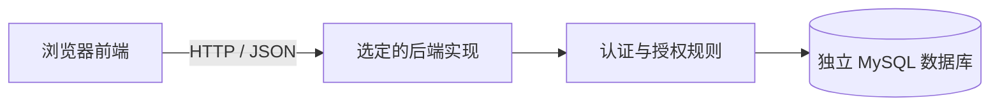

# UML 与架构资料

保留图的可编辑源文件（全部用 mermaid，GitHub 可直接渲染）。图中的关系、多重性和调用应与实现对应。

## 已有资料

| 图 | 文件 | 归属 | 图数 |
|---|---|---|---|
| **用例图** | [use-cases.md](use-cases.md) | 成员 5 | 1 |
| **领域模型**（分析类图） | [domain-model.md](domain-model.md) | 成员 5 | 1 |
| **设计类图与类职责** | [class-responsibility.md](class-responsibility.md) | 成员 5 | 1 |
| **关键序列图**（6 条流程） | [sequence-diagrams.md](sequence-diagrams.md) | 成员 5 | 6 |
| **活动图**（2 条决策流） | [activity-diagrams.md](activity-diagrams.md) | 成员 5 | 2 |
| ER 图 | [数据库数据字典](../database/data-dictionary.md) | 成员 1 | 1 |
| 概念架构图 | 本文件下方 | — | 1 |
| | | **合计** | **13** |

五份成员 5 的图均标注了**与代码、测试的对应关系**，可据此回到 `backend-procedural/` 与
`Stage1ApiTest` 核对，而不是脱离实现的示意图。

## 尚未提供

| 图 | 说明 | 建议归属 |
|---|---|---|
| 组件图（详细） | 现有概念图偏简略，缺少 Vue / Spring / MySQL 的组件接口 | 待认领 |
| 部署图 | `deploy/compose.yaml` 三服务、端口、命名卷 | 部署负责人 |

> 用例图已补，见上表。组件图与部署图属于小组交付物，但不在成员 5 的个人陈述范围内。

> 本表只记录现状，不代表已经安排。补图时请同步更新本文件。

## 概念架构（不代表已部署）

## 维护约定

- 图与代码不一致时，**以代码为准**并更新图，不能反过来迁就图。
- 新增接口或修改数据模型时，同步检查 [domain-model.md](domain-model.md) 与
  [class-responsibility.md](class-responsibility.md) 是否需要更新。
- 序列图只画**关键路径**（有并发、有失败分支、有安全含义的），不追求覆盖每个接口。
