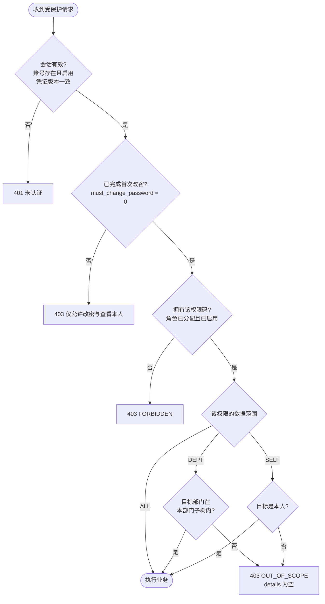
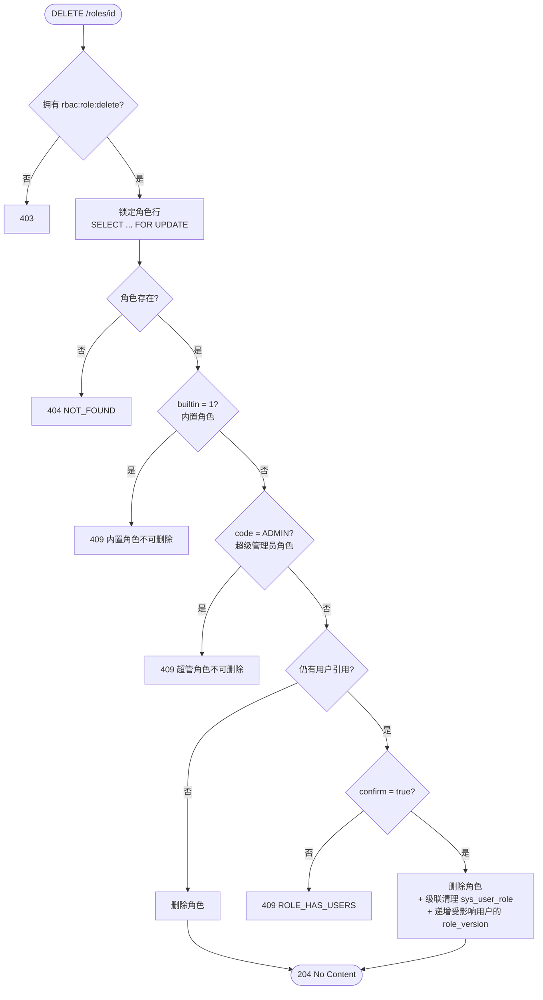

# 活动图（决策流程）

**负责人**：成员 5（胡俊朗）　**依据**：`AuthorizationService`、`RoleService` 实际实现

> **为什么这几处用活动图而不是序列图**：
> 序列图擅长表达「谁在什么时候发什么消息」，但表达不了**多重判断分支**。
> 下面两条流程各有多达 5 个判断节点，用活动图一眼能看出「在哪一步被拒绝」，
> 序列图会画成一堆 `alt/else` 嵌套，反而看不清。

---

## 1. 授权判定决策流

这是全系统**每一次受保护请求**都会走的路径。

### 关键设计点

| 节点 | 设计决策 | 理由 |
|---|---|---|
| **A 会话** | 每次请求从数据库重读账号与凭证版本 | 停用账号、重置密码后旧会话**立即**失效，不等超时 |
| **B 首次改密** | 未改密时只放行极少数操作 | 防止初始密码长期可用 |
| **C 权限码** | 只来自**已分配且已启用**的角色 | 停用角色即刻失去权限 |
| **D 范围** | 同一权限多角色取 `ALL > DEPT > SELF` 最宽 | 不同码独立，不互相污染 |
| **拒绝出口** | 三种拒绝用**不同状态码 + 统一空 details** | 401/403 可区分；`OUT_OF_SCOPE` 不返回对象字段 |

### 讲解时可以强调的一句话

> **「范围外」和「不存在」返回同一个 403，且 details 为空**——
> 否则攻击者可以用状态码差异探测哪些用户 ID 存在。

---

## 2. 角色删除与保护判定流

删除一个角色要连过**五道保护**，任何一道不过就返回 409。

### 关键设计点

| 节点 | 设计决策 | 理由 |
|---|---|---|
| **L 加锁** | 先 `SELECT ... FOR UPDATE` 再读数据 | 避免「判断时没人用，删除时正好被分配」的竞态 |
| **C/D 两级保护** | 内置角色与超管角色分开判断 | 内置 6 个角色不可删；超管角色另有额外限制 |
| **F/G 确认机制** | 有成员时必须显式 `confirm=true` | 防止误删有业务影响的角色 |
| **DEL2 版本递增** | 删除后**批量递增**受影响用户的 `role_version` | 这些用户的角色集合变了，其未提交的并发修改应被 409 拒绝 |

### 讲解时可以强调的一句话

> **删除不是简单的 DELETE**：它要先加锁、过五道保护、并在同一事务里
> 清理关联表、递增受影响用户的版本号——**否则其他管理员手里的旧版本号会继续生效**。

---

## 3. 两条流程的共性

| 共性 | 体现 |
|---|---|
| **拒绝尽可能早** | 认证不过不查权限，权限不过不查范围 |
| **状态码有语义** | 401 认证 / 403 授权 / 404 不存在 / 409 冲突 |
| **不泄漏信息** | 范围外与不存在同码，details 为空 |
| **保护优先于便利** | 宁可多一道判断，不可误删误改 |

---

## 4. 与序列图的配合

| 图 | 回答什么 |
|---|---|
| **本文件的 2 张活动图** | **「在哪一步被拒绝」** —— 判断逻辑与分支 |
| [序列图](sequence-diagrams.md) | **「谁在什么时候发什么消息」** —— 调用时序与参与者 |

讲解时建议：**先放活动图讲清规则，再放序列图讲一次真实调用**。
两张图配合，5 分钟内可以讲完一个完整设计。
