# 设计类图与类职责

**负责人**：成员 5（胡俊朗）　**依据**：`backend-procedural/src/main/java/com/municipal/rbac/procedural/` 实际代码
**版本**：2026-10-18 集成版（`2954385`）

---

## 1. 分层结构

```mermaid
classDiagram
  direction TB

  namespace Controller {
    class AuthController
    class MeController
    class UserController
    class RoleController
    class DepartmentController
    class CatalogController
    class PortalController
    class HealthController
  }

  namespace Service {
    class AuthService
    class AuthorizationService
    class MeService
    class UserService
    class RoleService
    class DepartmentService
    class CatalogService
    class PortalService
    class LedgerService
    class DataInitializer
    class EffectivePermissions
  }

  namespace Mapper {
    class UserMapper
    class RoleMapper
    class DepartmentMapper
    class CatalogMapper
  }

  namespace Data {
    class UserPO
    class RolePO
    class RolePermissionPO
    class DepartmentPO
    class Requests
    class Views
    class ErrorVO
  }

  namespace CrossCutting {
    class ApiException
    class GlobalExceptionHandler
    class SecurityConfig
    class BrowserSecurityConfig
  }

  AuthController --> AuthService
  AuthController --> AuthorizationService
  MeController --> MeService
  MeController --> AuthorizationService

  UserController --> UserService
  UserController --> AuthorizationService
  UserController --> LedgerService

  RoleController --> RoleService
  RoleController --> AuthorizationService

  DepartmentController --> DepartmentService
  DepartmentController --> AuthorizationService

  CatalogController --> CatalogService
  CatalogController --> AuthorizationService

  PortalController --> PortalService
  PortalController --> AuthorizationService

  AuthorizationService --> UserMapper
  AuthorizationService --> RoleMapper
  AuthorizationService --> DepartmentMapper
  AuthorizationService ..> EffectivePermissions

  UserService --> UserMapper
  UserService --> RoleMapper
  UserService --> AuthorizationService

  RoleService --> RoleMapper
  RoleService --> AuthorizationService

  DepartmentService --> DepartmentMapper
  DepartmentService --> AuthorizationService

  CatalogService --> CatalogMapper
  CatalogService --> AuthorizationService

  PortalService --> CatalogMapper
  PortalService --> AuthorizationService

  LedgerService --> UserMapper
  LedgerService --> AuthorizationService

  MeService --> UserMapper
  MeService --> RoleMapper
  MeService --> AuthorizationService

  AuthService --> UserMapper
  AuthService --> AuthorizationService

  UserMapper ..> UserPO
  RoleMapper ..> RolePO
  RoleMapper ..> RolePermissionPO
  DepartmentMapper ..> DepartmentPO

  AuthController ..> ApiException : 抛出
  GlobalExceptionHandler ..> ErrorVO : 转换
```

> 图中只画 `AuthController → ApiException` 一条代表：**所有 Controller 都以同样方式抛出**
> `ApiException`，由 `GlobalExceptionHandler` 统一转换为 `ErrorVO`。
> 不写 `Controller ..> ApiException` 是因为 `Controller` 是 `namespace` 而非类，
> mermaid 10.9.8 在该写法下**解析通过但渲染崩溃**。

---

## 2. 各层职责

### Controller 层（8 个）

**只做三件事**：接收 HTTP、绑定并校验 DTO、调用 Service。
**不做**：业务判断、权限计算、SQL。

| 类 | 职责 | 主要端点 |
|---|---|---|
| `AuthController` | 登录、退出、改密 | `POST /auth/login`、`/auth/logout`、`PUT /me/password` |
| `MeController` | 本人信息与有效权限 | `GET /me`、`GET /me/permissions` |
| `UserController` | 用户增删改查、启停、重置、角色替换 | `/users/**` |
| `RoleController` | 角色增删改查、启停、授权替换、成员 | `/roles/**` |
| `DepartmentController` | 部门树、部门成员（含下级） | `/departments/**` |
| `CatalogController` | 系统/模块/功能点目录、全局统计 | `/catalog/**` |
| `PortalController` | 门户菜单、功能点动作状态 | `/portal/**` |
| `HealthController` | 健康检查 | `/api/v1/health` |

### Service 层（10 个）

**业务逻辑与事务边界的唯一位置。**

| 类 | 行数 | 职责 |
|---|---|---|
| `UserService` | 237 | 范围内查询/增改删、停用/重置、账号保护、**用户角色原子替换** |
| `RoleService` | 190 | 角色管理、保护/删除确认、成员查询、**角色授权原子替换** |
| `CatalogService` | 149 | 目录筛选/分页/全局统计、兼容权限与资源查询 |
| `AuthorizationService` | 145 | **会话有效性、改密限制、权限并集、管理码映射、范围与目标检查** |
| `MeService` | 100 | 本人安全字段、有效权限及来源角色 |
| `PortalService` | 96 | 按 read 权限生成菜单、功能点六动作状态 |
| `DepartmentService` | 96 | 只读树、负责人关联、员工数与全部下级成员 |
| `LedgerService` | 95 | 按 `hr:f046` 范围查询、仅允许改电话/邮箱 |
| `AuthService` | 72 | 工号/手机号登录、通用错误、改密、退出 |
| `EffectivePermissions` | 8 | 权限并集的值对象 |

### Mapper 层（4 个）

**只写参数化 SQL，不含业务判断。** 用 `JdbcTemplate`，不引入 ORM。

| 类 | 负责的表 |
|---|---|
| `UserMapper` | `sys_user`、`sys_user_role` |
| `RoleMapper` | `sys_role`、`sys_role_permission` |
| `DepartmentMapper` | `sys_dept` |
| `CatalogMapper` | `app_system` / `app_module` / `app_function` / `sys_action` / `sys_permission` |

### 数据载体

| 类 | 用途 |
|---|---|
| `UserPO` / `RolePO` / `RolePermissionPO` / `DepartmentPO` | 数据库行映射 |
| `Requests` | 入站 DTO（含校验注解） |
| `Views` | **出站视图**——显式构造，保证不泄漏 `password_hash` |
| `ErrorVO` | 统一错误包络 |

> `Views` 的存在是一条安全边界：**绝不直接序列化 PO**，否则密码哈希会随响应泄漏。

---

## 3. AuthorizationService 的职责全景

这是整个后端最关键的类，所有 Controller 都依赖它。

| 方法 | 作用 |
|---|---|
| `current(session)` | 取当前登录用户 |
| `requireUserId(session)` | 仅取用户 ID，未登录抛 401 |
| `ready(session)` | 会话有效 **且** 已完成首次改密 |
| `effectivePermissions(userId)` | 计算权限并集（角色启用 + 范围取最宽） |
| `require(session, code)` | 要求某权限码，否则 403 |
| `target(session, code, id)` | 要求权限 **且** 目标在该权限范围内 |
| `visible(actor, scope)` | 返回 `Predicate<UserPO>`，用于**先裁剪再分页** |
| `covers(actor, scope, target)` | 单个目标是否在范围内 |
| `coversDepartment(actor, scope, deptId)` | 部门是否在范围内（DEPT 含子树） |
| `superAdmin(user)` / `adminRole(role)` | 保护判定 |
| `widerScope(a, b)` | `ALL > DEPT > SELF` 合并 |
| `managementCodes(code)` | 派生管理类权限码 |

**设计意图**：把「认证 → 权限码 → 范围 → 目标」四步集中成一个可复用流水线，
避免每个 Service 各写一遍导致口径不一致。

---

## 4. 依赖规则（架构约束）

| 规则 | 说明 |
|---|---|
| Controller **不得**直接依赖 Mapper | 全部经过 Service |
| Service **不得**返回 PO 给 Controller | 必须转 `Views` 或 `Map` |
| Mapper **不得**调用 Service | 单向依赖 |
| 权限判断**只能**在 `AuthorizationService` | 客户端传来的角色/权限不参与鉴权 |
| 事务注解**只在** Service 层 | Controller 无 `@Transactional` |

违反上述任一条都会破坏可测试性——现有 29 项集成测试依赖这些边界。

---

## 5. 与测试的对应

`Stage1ApiTest` 是端到端的集成测试（`MockMvc` + 真实 Spring 上下文 + H2），
按**接口**而非按类组织用例，因此覆盖的是「Controller → Service → Mapper → DB」整条链路。

测试方法名与复核项的对应见 [成员5 后端复核记录](../testing/member5-backend-review.md#3-八项重点复核逐项结果)。
