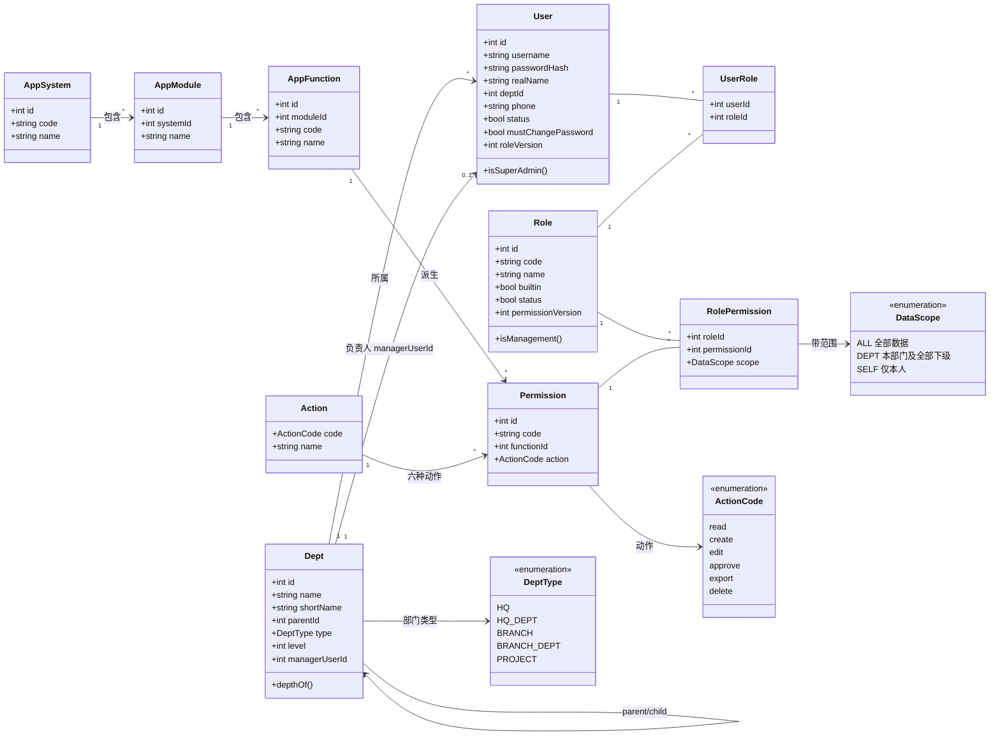

# 领域模型（分析类图）

**负责人**：成员 5（胡俊朗）　**依据**：[需求规格](../requirements/req-spec.md)、[数据字典](../database/data-dictionary.md)、[V001 迁移](../../database/migrations/V001__create_core_tables.sql)
**说明**：本图表达**业务概念与关系**，不表示软件职责划分；类职责见 [class-responsibility.md](class-responsibility.md)。

---

## 1. 核心领域模型



---

## 2. 关键概念说明

### 2.1 为什么数据范围挂在「角色—权限」关系上，而不是「用户」上

`RolePermission.scope` 是**授权关系的属性**，不是角色的属性，也不是用户的属性。

原因：同一个用户在 A 功能上可能有 `ALL`，在 B 功能上只有 `SELF`。范围必须精确到「这个角色的这个权限」，才能表达这种差异。

### 2.2 范围的合并规则

同一权限码被多个角色授予时，取**最宽**的范围：

```
ALL  >  DEPT  >  SELF
```

不同权限码之间**互相独立**，不合并。

这解释了实验中的一个现象：用户同时拥有角色 5（`hr:f046:read` = SELF）和角色 7（`hr:f046:edit` = ALL）后，
`read` 仍是 SELF 而 `edit` 是 ALL——**同码取并集，不同码各管各的**。

### 2.3 DEPT 的含义

`DEPT` ≠ 「本人所在部门」。

`DEPT` = **本人所在部门 + 其全部下级部门**。判断方式是沿 `sys_dept.parent_id` 求出子树，再看目标用户是否落在子树内。

这也是「下级部门」复核项的领域依据。

### 2.4 系统 / 模块 / 功能点 / 权限 的四层结构

权限码由三段组成：`系统码:功能点编号:动作`，例如 `hr:f046:edit`。

```
app_system (18 个)  →  app_module (115 个)  →  app_function (359 个)  →  sys_permission
     hr                   人力                f046 员工信息              hr:f046:read
                                                                        hr:f046:edit
                                                                        ...（6 种动作）
```

**权限总数 = 功能点 × 动作数**，不是人工维护的清单——由 `app_function × sys_action` 派生。

原始清单口径：111 组织 / 18 系统 / 115 模块 / 359 功能点 / 2154 条清单权限。

### 2.5 两个版本号的区别

| 字段 | 所在表 | 管的是什么 |
|---|---|---|
| `sys_user.role_version` | 用户 | 这个用户的**角色集合**版本 |
| `sys_role.permission_version` | 角色 | 这个角色的**授权集合**版本 |

两者独立递增：改用户的角色 → 动 `role_version`；改角色的权限 → 动 `permission_version`。

→ 详见 [序列图：版本冲突](sequence-diagrams.md#3-角色授权整组替换与-409-版本冲突)。

---

## 3. 领域约束一览

| 约束 | 领域含义 | 实现位置 |
|---|---|---|
| `uk_user_username` | 工号全局唯一 | V001 |
| `uk_user_phone` | 手机号非空时唯一 | V001 |
| `ck_dept_type` | 部门类型限定 5 种 | V001 CHECK |
| `ck_rp_scope` | 范围只能是 ALL/DEPT/SELF | V001 CHECK |
| 唯一超级管理员 | 仅预置 `admin` 一个 | `AuthorizationService.superAdmin` |
| 内置角色不可删 | 清单 5 角色 + 部门管理员 | `RoleService` |
| 角色被引用不可直接删 | 需 `confirm=true` | `RoleService` |
| 不能操作自己 | 停用/删除/改角色均拒绝 | `UserService` |

---

## 4. 与实现文件的对应

| 领域概念 | 表 | PO | 主要服务 |
|---|---|---|---|
| 部门 | `sys_dept` | `DepartmentPO` | `DepartmentService` |
| 用户 | `sys_user` | `UserPO` | `UserService`、`AuthService` |
| 角色 | `sys_role` | `RolePO` | `RoleService` |
| 角色—权限 | `sys_role_permission` | `RolePermissionPO` | `RoleService`、`AuthorizationService` |
| 权限 / 功能点 / 模块 / 系统 | `sys_permission` / `app_function` / `app_module` / `app_system` | — | `CatalogService` |
