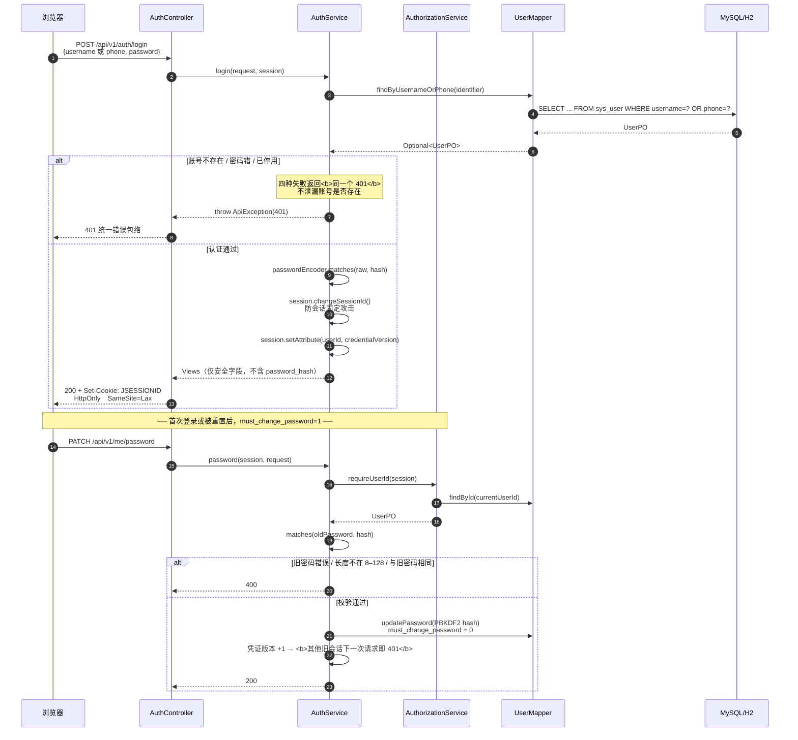
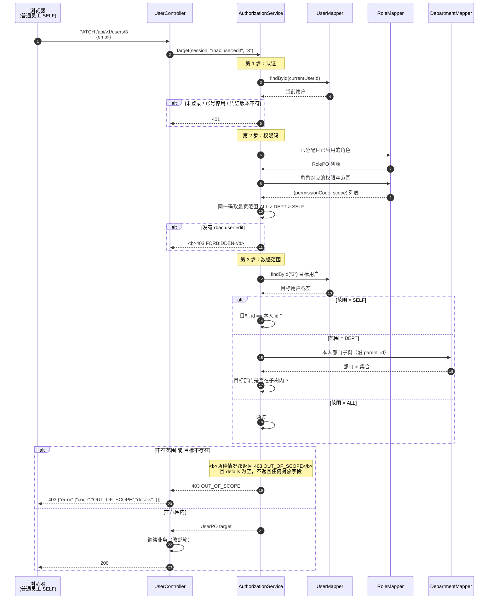
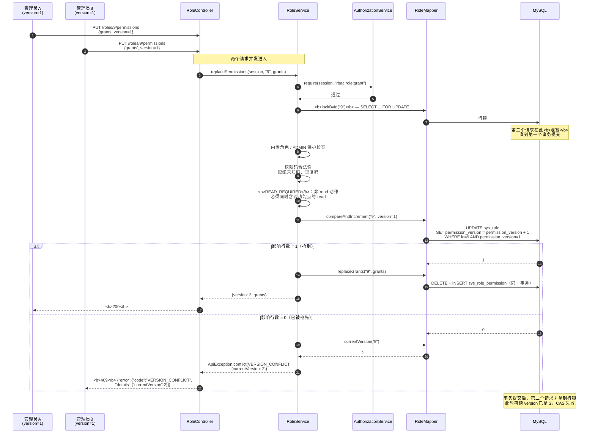
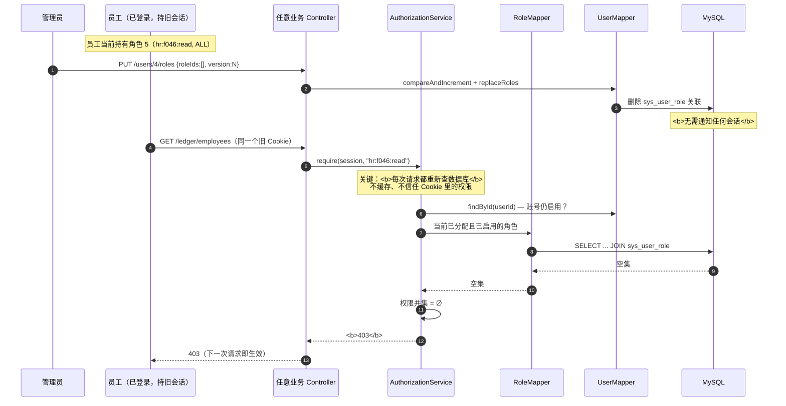
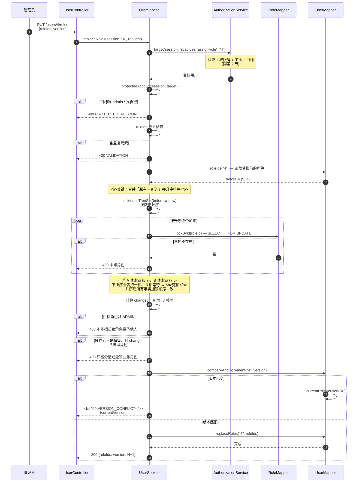
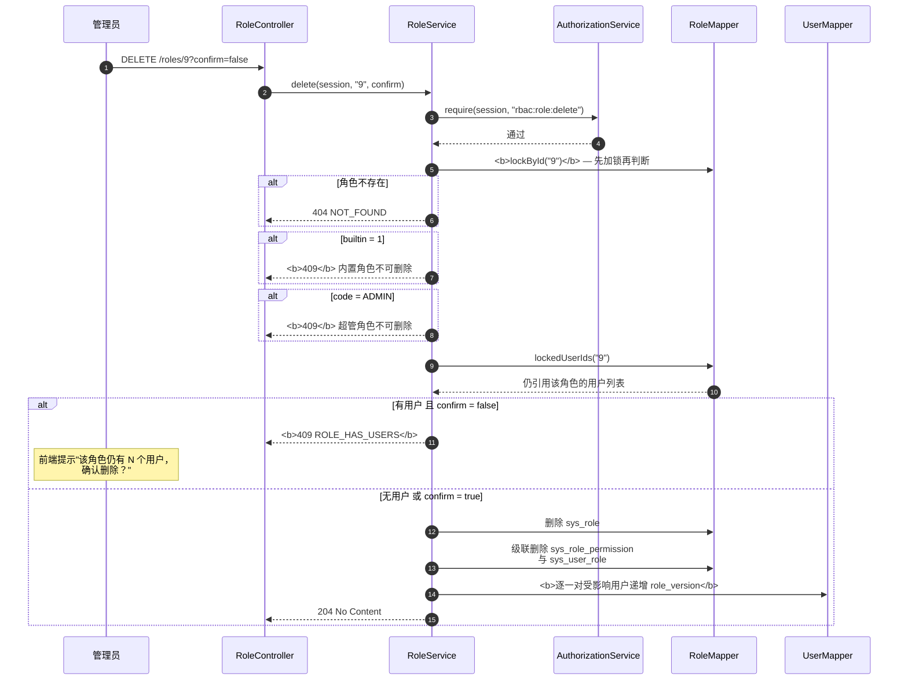

# 关键序列图

**负责人**：成员 5（胡俊朗）　**依据**：`backend-procedural/` 实际实现与 `Stage1ApiTest` 断言
**版本**：2026-10-18 集成版（`2954385`）

本文件选取六条最能体现设计取舍的流程，每条都能在 2—3 分钟内讲完。

---

## 1. 登录与首次改密



### 设计要点

| 决策 | 原因 |
|---|---|
| 四种失败统一 401 | 避免通过错误码枚举出"哪些工号存在" |
| 登录成功轮换 sessionId | 防会话固定（session fixation） |
| 密码用 PBKDF2 而非 BCrypt | BCrypt 在 **72 字节**处截断，8–128 字符的长密码会被悄悄截短 |
| 改密后凭证版本 +1 | 让其他设备上的旧会话立即失效，而不是等超时 |

---

## 2. 越权请求被拒绝（403）



### 设计要点

| 决策 | 原因 |
|---|---|
| **不存在 → 403，而非 404** | 若返回 404，攻击者可用状态码差异**探测**哪些用户 ID 存在 |
| `details` 为空 | 不返回目标对象的任何字段，避免通过错误响应泄漏数据 |
| 先认证 → 再权限码 → 再范围 | 分层短路，越早拒绝成本越低 |
| 查询先裁剪范围再分页 | 否则 `total` 会泄漏范围外的数据量 |

> 对应测试：`ledgerSelfScopeAndUnknownFieldProtection`（第 195–201 行）、
> `departmentUserFiltersCannotEscapeScope`（第 235–242 行）。

---

## 3. 角色授权整组替换与 409 版本冲突

这是全系统**并发最难**的一条路径。



### 设计要点

| 决策 | 原因 |
|---|---|
| `SELECT ... FOR UPDATE` 行锁 | 把并发写**串行化**到同一角色行 |
| **先锁行，再读版本** | 锁内读到的版本一定是最新的，不会用到快照里的过期值 |
| `WHERE permission_version = ?` 条件更新 | CAS 的原子性由数据库保证，不靠应用层判断 |
| 失败返回 `currentVersion` | 前端可据此提示"请刷新"，而不是让用户盲目重试 |
| 整组替换在**同一事务** | 任一步异常全部回滚，不留半套授权 |
| `READ_REQUIRED` 前置校验 | 保证不会出现"能编辑却看不到"的无效授权组合 |

> 对应测试：
> - `simultaneousCasHasExactlyOneWinner` — 两线程并发，断言状态码**恰好 `[200, 409]`**
> - `failedReplacementRollsBackGrantsAndVersion` — mock 写入后抛异常，断言版本未变、授权数为 0
> - `userRoleVersionConflictAndDuplicateValidation` — 重复提交 version=1 → 409 且带 currentVersion=2

### 用户角色替换的额外约束

`UserService.replaceRoles` 比角色授权多一层**锁顺序控制**：

```java
// 统一锁顺序：按角色 ID 数值升序，再对目标用户做 CAS
Set<String> lockIds = new TreeSet<>(Comparator.comparingLong(Long::parseLong));
lockIds.addAll(before);
lockIds.addAll(r.roleIds());
for (String roleId : lockIds) roles.lockById(roleId);
```

**为什么必须排序？** 若 A 请求锁 {5,7}、B 请求锁 {7,5}，两边各持一把、互相等待，就形成**死锁**。
统一升序后，任何两个事务的加锁顺序一致，不可能循环等待。

---

## 4. 权限变更即时生效



### 设计要点

| 决策 | 原因 |
|---|---|
| **每次请求重新查权限** | 不在会话里缓存权限，避免"改完要等超时" |
| 不信任客户端传来的角色/权限 | 请求体里的 roleId 只作为"目标值"，不参与鉴权计算 |
| 角色停用同样即时生效 | 查询条件带 `role.status = 1` |
| 账号停用即时生效 | `findById` 后检查 `status`，返回 401 |

> 对应测试：
> - `businessRoleUnionAndImmediateRevocation` — 移除全部角色后**下一次请求**即 403
> - `roleCrudStatusDeleteAndBuiltinGuards` — 停用角色后下一次请求即 403
> - `disableInvalidatesExistingSessionOnNextRequest` — 停用账号后旧会话下一次请求即 401

**代价**：每个请求多两次查询（用户 + 角色权限）。
这是**用性能换一致性**的明确取舍——在权限系统里，**撤销不及时比多查两次危险得多**。

---

## 5. 用户角色整组替换与防死锁

这是全系统唯一需要**显式控制加锁顺序**的地方。



### 为什么必须按 ID 升序加锁

| 场景 | 不排序 | 升序后 |
|---|---|---|
| A 请求锁 {5, 7} | A 持有 5，等 7 | A 先锁 5 再锁 7 |
| B 请求锁 {7, 5} | B 持有 7，等 5 | B 也先锁 5 再锁 7 |
| 结果 | **互相等待 → 死锁** | 一方等锁释放，顺序推进 |

代码中的实现：

```java
// UserService.replaceRoles
Set<String> lockIds = new TreeSet<>(Comparator.comparingLong(Long::parseLong));
lockIds.addAll(before);
lockIds.addAll(r.roleIds());
for (String roleId : lockIds) roles.lockById(roleId);
```

> 对应测试：`simultaneousCasHasExactlyOneWinner`（并发断言 `[200, 409]`）、
> `selfAndUniqueAdminProtection`（管理员与自身保护）。

---

## 6. 角色删除与确认机制



### 三个容易讲错的地方

| 点 | 正确说法 |
|---|---|
| **先加锁再判断** | 不是「查完再删」，而是先 `FOR UPDATE`，避免判断与删除之间被并发分配 |
| **confirm 是第二道闸** | 有成员不是直接拒绝，而是**要求调用方确认**；确认后才连带清理 |
| **删除要动用户版本号** | 受影响用户的角色集合变了，其手里的旧 `version` 必须失效，否则并发修改会绕过检查 |

> 对应测试：`roleCrudStatusDeleteAndBuiltinGuards`（409 → 204 且用户版本递增）、
> `concurrentAssignmentMakesUnconfirmedRoleDeleteRefuse`（并发分配使未确认删除被拒）。

---

## 7. 六条流程的共性

| 共性 | 含义 |
|---|---|
| 鉴权集中在 `AuthorizationService` | 所有 Controller 走同一条流水线，口径一致 |
| 先裁剪范围再分页 | 避免 `total` 泄漏 |
| 失败信息最小化 | 统一 401、统一 403、`details` 不带对象字段 |
| 事务只在 Service 层 | Controller 无 `@Transactional` |
| 版本号由数据库 CAS | 不靠应用层判断，避免竞态 |
| 需要多行加锁时统一升序 | 消除循环等待，避免死锁 |
| 删除/替换都递增关联版本号 | 让并发的旧版本请求被 409 拒绝 |
