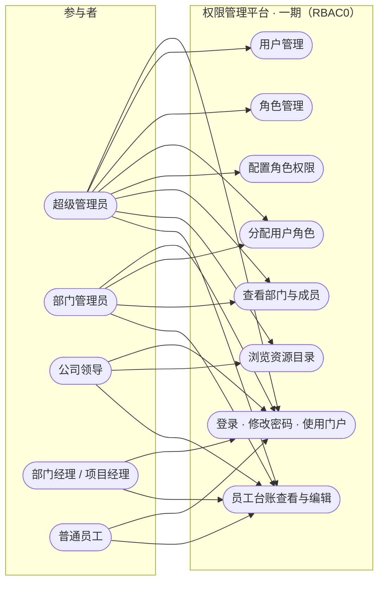

# 用例图（一期 RBAC0）

**负责人**：成员 5（胡俊朗）　**依据**：[需求规格 2.2 参与者](../requirements/req-spec.md)、[阶段规划](../planning/milestones.md)
**范围**：仅第一阶段。角色继承、SSD/DSD、基数约束属二、三阶段，见文末说明。

> **关于图形选择**：mermaid 没有原生用例图类型，这里用 `flowchart` + 系统边界子图 + 圆角节点近似 UML 用例图。
> 语义与 UML 一致（参与者—用例—系统边界），GitHub 可直接渲染。

---

## 1. 用例图

---

## 2. 参与者与用例对照

| 用例 | 超级管理员 | 部门管理员 | 公司领导 | 部门经理 | 普通员工 |
|---|---|---|---|---|---|
| 登录 / 改密 / 门户 | ✅ | ✅ | ✅ | ✅ | ✅ |
| 用户管理 | ✅ | 仅本部门及下级 | — | — | — |
| 角色管理 | ✅ | — | — | — | — |
| 分配用户角色 | ✅ | **仅业务角色** | — | — | — |
| 配置角色权限 | ✅ | ❌ 明令禁止 | — | — | — |
| 查看部门与成员 | ✅ 全部 | 仅本部门子树 | — | — | — |
| 浏览资源目录 | ✅ | ✅ | ✅ | — | — |
| 员工台账 | ✅ 全部 | 本部门子树 | 只读全部 | 本部门 | **仅本人** |

**部门管理员的边界**（需求 GRANT-03 明确）：

- 可以：管本部门及**全部下级部门**的用户、分配/撤销**业务角色**
- 不可以：分配管理类角色、修改角色授权

---

## 3. 主要用例简述

> 完整用例模板见 [用例模板](../requirements/use-cases.md)（当前仍是空模板，本表是图的最小说明）。

### UC-01 登录与会话

| 项 | 内容 |
|---|---|
| 参与者 | 全部 |
| 前置 | 账号已存在且启用 |
| 正常流程 | 工号或手机号 + 密码 → 建立会话 → 按已启用角色激活权限 |
| 异常流程 | 账号不存在 / 密码错 / 已停用 → **统一 401**，不区分原因 |
| 后置 | 会话有效；`must_change_password=1` 时只能改密 |

### UC-02 用户管理

| 项 | 内容 |
|---|---|
| 参与者 | 超级管理员、部门管理员（限本部门子树） |
| 正常流程 | 按部门（含下级）筛选 → 增/改/启停/重置/删 |
| 异常流程 | 超范围 → 403；工号重复 → 409；操作自己 → 409 保护 |
| 规则 | 删除时级联清理角色关联，并将部门负责人置空 |

### UC-03 分配用户角色

| 项 | 内容 |
|---|---|
| 参与者 | 超级管理员、部门管理员（仅业务角色） |
| 正常流程 | GET 取当前角色与 `version` → PUT 提交完整 `roleIds` + `version` |
| 异常流程 | 版本过期 → **409** 带 `currentVersion`；分配管理角色 → 403（部门管理员） |
| 规则 | 整组替换、原子事务、**版本 CAS** |

### UC-04 配置角色权限

| 项 | 内容 |
|---|---|
| 参与者 | **仅超级管理员** |
| 正常流程 | 在资源目录勾选权限码与数据范围 → PUT 完整 `grants` + `version` |
| 异常流程 | 内置角色/ADMIN → 409；未知权限码 → 400；非 read 动作缺 read → 400 `READ_REQUIRED` |
| 规则 | 整组替换、原子事务、版本 CAS |

### UC-05 使用门户

| 项 | 内容 |
|---|---|
| 参与者 | 全部 |
| 正常流程 | 登录后按 `read` 权限生成菜单 → 进入功能页 → 查看「我的权限」及来源角色 |
| 异常流程 | 无查看权限的功能点不显示菜单，直接访问 URL 返回 403 |
| 规则 | 菜单与按钮均由后端权限驱动，前端不硬编码 |

### UC-06 员工台账

| 项 | 内容 |
|---|---|
| 参与者 | 全部（范围不同） |
| 正常流程 | 按 `hr:f046` 的查看范围列出员工 → 编辑电话/邮箱 |
| 异常流程 | 范围外 → 403 `OUT_OF_SCOPE`；改姓名等字段 → 400 `FIELD_NOT_EDITABLE` |
| 规则 | **查看范围与编辑范围分别计算**；只允许改 phone/email |

---

## 4. 二、三阶段用例（已设计，**一期未实现**）

以下用例在需求中存在，但不属于本次检查范围。图中未画出，避免让人误以为已实现：

| 用例 | 需求编号 | 阶段 |
|---|---|---|
| 设置角色继承（DAG） | ROLE-05 ~ 07 | 二（RBAC1） |
| 静态职责分离 SSD | ROLE-10、13 | 三（RBAC2） |
| 动态职责分离 DSD | ROLE-11 | 三 |
| 基数约束 | ROLE-12 | 三 |
| 激活/切换角色 | LOGIN-07 | 三 |
| 审计日志 | — | 三 |

**讲解时的说法**：这些在需求规格里有，设计中预留了扩展点（如 `sys_role` 已有层级字段规划），但一期只交付 RBAC0。
